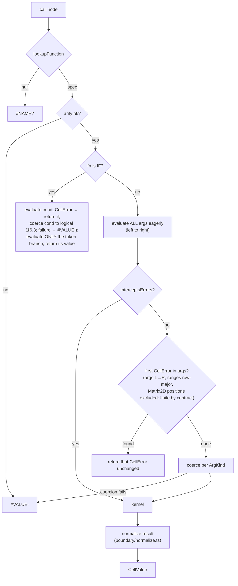
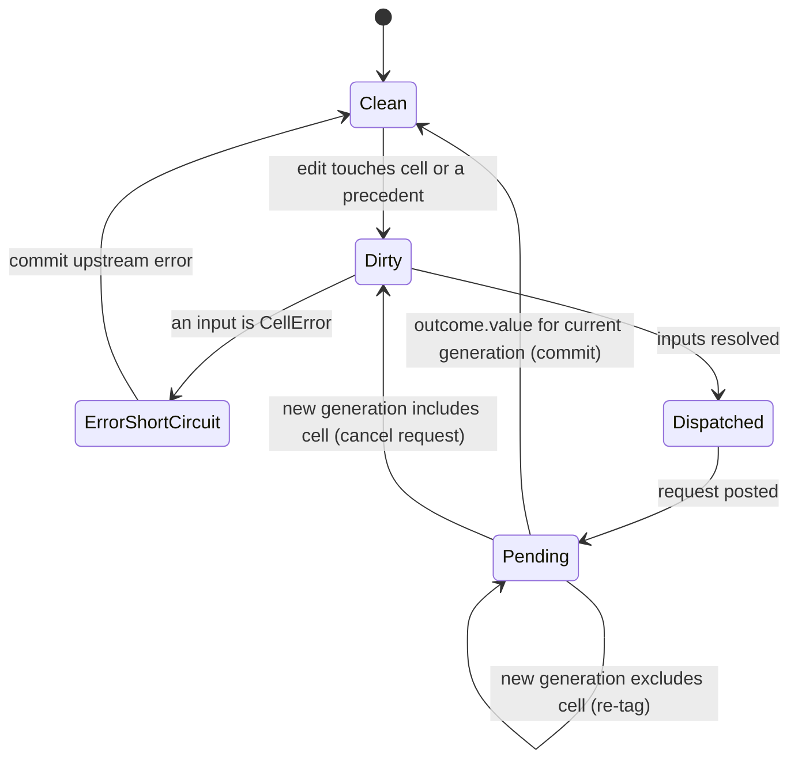
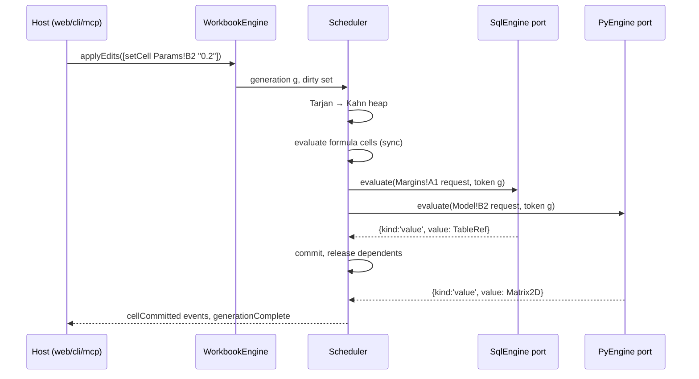

# Design: Cross-Engine DAG

Implements `requirements.md` in this folder. The binding contracts are in `.kiro/steering/dag-and-type-contract.md` and `.kiro/steering/architecture-and-isolation.md`. All code lives in `packages/core/src/`, compiled with `"lib": ["ES2022"]`, `"types": []`, `strict`, `noUncheckedIndexedAccess`, and `exactOptionalPropertyTypes`.

## 1. Module layout

```mermaid
flowchart LR
  subgraph core["packages/core/src"]
    model["model/<br/>values.ts, address.ts, workbook.ts"]
    parse["parse/<br/>dialect.ts, lexer.ts, parser.ts, printer.ts,<br/>sqlTemplate.ts, pyInputs.ts"]
    fn["functions/<br/>registry.ts, coerce.ts, kernels/*.ts"]
    graph["graph/<br/>depGraph.ts, rangeIndex.ts, tarjan.ts, kahn.ts"]
    sched["schedule/<br/>scheduler.ts, generation.ts, scenario.ts"]
    norm["boundary/<br/>normalize.ts, assertCanonical.ts, libraryErrors.ts"]
    ports["ports/<br/>engines.ts, cancellation.ts, clock.ts"]
  end
  parse --> model
  fn --> model
  graph --> model
  sched --> graph
  sched --> fn
  sched --> ports
  norm --> model
  sched --> norm
```

Runtime dependencies of `packages/core`: `@formulajs/formulajs` (function kernels), `apache-arrow` (building `TableRef`s from ranges and scanning results at the engine boundary; isomorphic, no DOM), and `fast-check` (used by Spec 03). `fast-formula-parser` is a dev dependency only (see §6.4).

## 2. Value model (`model/values.ts`)

These declarations have exactly the fields, field types, and union members of the steering contract; only comments are abbreviated. They are the single source for every other spec.

```ts
export type EngineId = 'formula' | 'sql' | 'py';

export type CellErrorCode =
  | '#DIV/0!' | '#VALUE!' | '#REF!' | '#NAME?' | '#N/A'
  | '#CYCLE!' | '#NUM!' | '#SQL!' | '#PY!' | '#TIMEOUT!';

export interface CellError {
  readonly kind: 'error';
  readonly code: CellErrorCode;
  readonly message: string;
  readonly origin: string;   // a CellKey
  readonly engine: EngineId;
}

export interface ArrowField {
  readonly name: string;
  readonly arrowType: string;
  readonly nullable: boolean;
}

export interface TableRef {
  readonly kind: 'table';
  readonly ipc: Uint8Array;
  readonly schema: ReadonlyArray<ArrowField>;
  readonly rowCount: number;
}

export interface Matrix2D {
  readonly kind: 'matrix';
  readonly rows: number;
  readonly cols: number;
  readonly data: Float64Array;
}

export type CellValue =
  | number | string | boolean | null
  | TableRef | Matrix2D | CellError;

/** Scalar subset used for literals, SQL parameters, fuzz inputs, and overrides. */
export type ScalarValue = number | string | boolean | null;

export const CELL_ERROR_CODES: ReadonlyArray<CellErrorCode> = [
  '#DIV/0!', '#VALUE!', '#REF!', '#NAME?', '#N/A',
  '#CYCLE!', '#NUM!', '#SQL!', '#PY!', '#TIMEOUT!',
];

export function isCellError(v: CellValue): v is CellError;
export function makeError(code: CellErrorCode, message: string, origin: CellKey, engine: EngineId): CellError;
```

`CellError.origin` is typed `string` in the steering contract. Producers pass a `CellKey`, which is assignable to `string`.

## 3. Addressing (`model/address.ts`)

```ts
declare const cellKeyBrand: unique symbol;
/** Canonical "<sheet>!<COL><ROW>", e.g. "Sheet1!B7" or "'Q3 Plan'!B7". */
export type CellKey = string & { readonly [cellKeyBrand]: true };

export interface CellCoord {
  readonly sheet: string;
  readonly row: number;   // 0-based, 0..1_048_575
  readonly col: number;   // 0-based, 0..16_383
}

export interface RangeCoord {
  readonly sheet: string;
  readonly top: number;
  readonly left: number;
  readonly bottom: number; // inclusive, >= top
  readonly right: number;  // inclusive, >= left
}

export type RefTarget =
  | { readonly kind: 'cell'; readonly coord: CellCoord }
  | { readonly kind: 'range'; readonly range: RangeCoord };

export interface NamedParameter {
  readonly name: string;       // as declared; compared case-insensitively
  readonly target: RefTarget;
}

export const MAX_ROWS = 1_048_576;
export const MAX_COLS = 16_384;

export function toCellKey(c: CellCoord): CellKey;
export function parseCellKey(k: string): CellCoord | null;
export function columnLetters(col: number): string;      // 0 -> "A", 16383 -> "XFD"
export function compareRowMajor(a: CellCoord, b: CellCoord, sheetOrder: ReadonlyArray<string>): number;
```

- Sheet quoting: unquoted iff the name matches `^[A-Za-z_][A-Za-z0-9_]{0,30}$`. Otherwise it is wrapped in `'…'` with `'` doubled. Sheet names are 1–31 characters, may not contain `: \ / ? * [ ]`, and are unique case-insensitively.
- Row-major order: sheet index in `WorkbookDefinition.sheets`, then `row`, then `col`. This is the only ordering used for tie-breaks, range iteration, and "first error" selection.

## 4. Workbook definition and edits (`model/workbook.ts`)

```ts
export type CellDialect = 'literal' | 'formula' | 'sql' | 'py';

export interface CellSource {
  readonly key: CellKey;
  readonly raw: string;
  /** Present only for cells written by setLiteral; takes precedence over parsing raw. */
  readonly literal?: ScalarValue;
}

export interface SheetDefinition {
  readonly name: string;
  readonly cells: ReadonlyArray<CellSource>; // sorted row-major, no empty raws
}

export interface DatasetMeta {
  readonly name: string;                      // ^[a-z_][a-z0-9_]{0,62}$
  readonly format: 'csv' | 'parquet' | 'xlsx';
  readonly sha256: string;                    // lowercase hex of source bytes
  readonly byteLength: number;
  readonly rowCount: number;
  readonly schema: ReadonlyArray<ArrowField>;
}

export interface WorkbookDefinition {
  readonly sheets: ReadonlyArray<SheetDefinition>;
  readonly names: ReadonlyArray<NamedParameter>;
  readonly datasets: ReadonlyArray<DatasetMeta>;
  readonly seed: number;                       // uint32
}

export type Edit =
  | { readonly kind: 'setCell'; readonly key: CellKey; readonly raw: string }
  | { readonly kind: 'setLiteral'; readonly key: CellKey; readonly value: ScalarValue } // lossless; no literal re-parsing
  | { readonly kind: 'clearCell'; readonly key: CellKey }
  | { readonly kind: 'setName'; readonly param: NamedParameter }
  | { readonly kind: 'removeName'; readonly name: string }
  | { readonly kind: 'addSheet'; readonly name: string }
  | { readonly kind: 'removeSheet'; readonly name: string }
  | { readonly kind: 'registerDataset'; readonly meta: DatasetMeta }
  | { readonly kind: 'dropDataset'; readonly name: string };
```

`setCell` with `raw === ''` is equivalent to `clearCell`. `setLiteral` stores a literal cell whose value is exactly `value`, including `-0` and strings such as `"TRUE"` or `"#N/A"` that `setCell` would re-parse. Its `CellSource` stores `raw` as display text plus `literal: value`, and `literal` takes precedence over parsing `raw`. Scenario evaluation and the Exorcist apply overrides only through `setLiteral`. Removing a sheet turns every reference to it into `#REF!` on the next recalculation. Removing a dataset makes SQL that names it fail with `#SQL!` (DuckDB binder error). Name and dataset edits dirty every cell that references them.

## 5. Parsing

### 5.1 Dialect detection (`parse/dialect.ts`)

```ts
export type ParsedCell =
  | { readonly dialect: 'literal'; readonly value: ScalarValue | CellError }
  | { readonly dialect: 'formula'; readonly ast: FormulaAst; readonly refs: ReadonlyArray<ResolvedRef> }
  | { readonly dialect: 'sql'; readonly template: SqlTemplate; readonly refs: ReadonlyArray<ResolvedRef> }
  | { readonly dialect: 'py'; readonly program: PyProgram; readonly refs: ReadonlyArray<ResolvedRef> }
  | { readonly dialect: 'formula'; readonly parseError: { readonly offset: number; readonly message: string } };

export type ResolvedRef =
  | { readonly kind: 'cell'; readonly coord: CellCoord; readonly text: string }
  | { readonly kind: 'range'; readonly range: RangeCoord; readonly text: string }
  | { readonly kind: 'unresolved'; readonly text: string; readonly code: '#REF!' | '#NAME?' };

export function parseCell(raw: string, at: CellCoord, ctx: ParseContext): ParsedCell;

export interface ParseContext {
  readonly sheetNames: ReadonlyArray<string>;
  readonly names: ReadonlyMap<string, NamedParameter>; // key: uppercased name
}
```

Literal parsing order:
1. Empty string → `null`.
2. `TRUE`/`FALSE` (case-insensitive) → boolean.
3. One of the ten canonical codes, `#NULL!`, or `#SPILL!` → `CellError`, mapped via §8.3.
4. `^[+-]?(\d+\.?\d*|\.\d+)([eE][+-]?\d+)?$` whose `Number()` is finite → number.
5. Anything else → string, unchanged.

### 5.2 Formula AST (`parse/parser.ts`, `parse/printer.ts`)

```ts
export type FormulaAst =
  | { readonly t: 'num'; readonly v: number }
  | { readonly t: 'str'; readonly v: string }
  | { readonly t: 'bool'; readonly v: boolean }
  | { readonly t: 'err'; readonly code: CellErrorCode }
  | { readonly t: 'ref'; readonly ref: ResolvedRef; readonly abs: AbsFlags }
  | { readonly t: 'name'; readonly name: string }
  | { readonly t: 'unary'; readonly op: '+' | '-'; readonly arg: FormulaAst }
  | { readonly t: 'percent'; readonly arg: FormulaAst }
  | { readonly t: 'binary'; readonly op: BinaryOp; readonly left: FormulaAst; readonly right: FormulaAst }
  | { readonly t: 'call'; readonly fn: string; readonly args: ReadonlyArray<FormulaAst> } // fn uppercased
  | { readonly t: 'paren'; readonly arg: FormulaAst };

export type BinaryOp = '^' | '*' | '/' | '+' | '-' | '&' | '=' | '<>' | '<' | '>' | '<=' | '>=';
export interface AbsFlags { readonly col: boolean; readonly row: boolean; readonly col2: boolean; readonly row2: boolean }

export function parseFormula(src: string, at: CellCoord, ctx: ParseContext):
  { readonly ok: true; readonly ast: FormulaAst } | { readonly ok: false; readonly offset: number; readonly message: string };
export function printFormula(ast: FormulaAst, at: CellCoord): string;
```

- Hand-written lexer plus Pratt parser. Binding powers, from lowest to highest: comparison 10, `&` 20, `+ -` 30, `* /` 40, `^` 50 (left-associative, as in legacy spreadsheets), postfix `%` 60, prefix `+ -` 70, range `:` 80.
- `paren` nodes are preserved, so `printFormula` reproduces the user's grouping and the round-trip property `parse(print(ast)) ≡ ast` holds structurally.
- Numbers print using the shortest round-trip form (`String(n)`). Strings print with `"` doubled.
- String literals may span lines (`\n` and `\r\n` are kept verbatim), so `=SQL()` and `=PY()` sources can be multi-line. The only escape is a doubled `""`. SQL and Python inside them should use single quotes.
- Function names that are not in the registry still parse, as `call` nodes, so `#NAME?` is an evaluation result rather than a parse error.

### 5.3 SQL template (`parse/sqlTemplate.ts`)

```ts
export interface SqlTemplate {
  /** SQL text with every interpolation replaced by a slot placeholder "__suture_s<k>". */
  readonly text: string;
  readonly slots: ReadonlyArray<SqlSlot>;  // index k ↔ placeholder "__suture_s<k>", order of first appearance
  /** Set when the template is malformed (Req 3.8); the cell evaluates to #SQL! without dispatch. */
  readonly error?: string;
}

export interface SqlSlot {
  readonly placeholder: string;            // "__suture_s<k>"
  readonly ref: ResolvedRef;
}
```

- Interpolations match `\{\{\s*([^{}]+?)\s*\}\}`. An unterminated `{{` or an empty body gives `#SQL!` (Req 3.8).
- At parse time a cell's interpolations can't be classified as parameters or tables, because that depends on the referenced cell's current value. So parsing produces only slots, and evaluation resolves each slot (§7.3): a scalar becomes a positional parameter `$<i>`, while a `TableRef` or range becomes a table identifier `__suture_b<n>`.
- Repeated interpolations of the same reference text share one slot.

### 5.4 Python inputs (`parse/pyInputs.ts`)

```ts
export interface PyProgram {
  readonly code: string;
  readonly vectorized: boolean;
  readonly inputKeys: ReadonlyArray<{ readonly key: string; readonly ref: ResolvedRef }>; // order of first appearance
}
```

- Keys are extracted with `inputs\[\s*(['"])((?:(?!\1).)+)\1\s*\]`. Matches inside Python comments or strings still create dependencies. This is deliberate: it over-approximates dependencies and never under-approximates them.
- Resolution uses the same grammar as formula references and names. An unresolvable key gives `#REF!` or `#NAME?`.

## 6. Functions

### 6.1 Registry (`functions/registry.ts`)

```ts
export type ArgKind = 'scalar' | 'rangeOrScalar' | 'criteria';

export interface FunctionSpec {
  readonly name: SupportedFunction;
  readonly minArgs: number;
  readonly maxArgs: number;        // variadic functions use 255
  readonly argKinds: (index: number) => ArgKind;
  readonly interceptsErrors: boolean; // true only for IFERROR and ISERROR
  readonly kernel: 'formulajs' | 'native';
  readonly evaluate: (args: ReadonlyArray<EvalArg>, ctx: EvalContext) => CellValue;
}

export type SupportedFunction =
  | 'SUM' | 'AVERAGE' | 'MIN' | 'MAX' | 'COUNT' | 'COUNTA' | 'ROUND' | 'ABS' | 'POWER' | 'SQRT' | 'MOD'
  | 'SUMIF' | 'SUMIFS' | 'COUNTIF' | 'COUNTIFS' | 'AVERAGEIF'
  | 'IF' | 'AND' | 'OR' | 'NOT' | 'IFERROR' | 'ISERROR' | 'ISBLANK' | 'ISNUMBER'
  | 'VLOOKUP' | 'INDEX' | 'MATCH' | 'NPV' | 'PMT' | 'IRR';

export type EvalArg =
  | { readonly kind: 'scalar'; readonly value: CellValue }
  | { readonly kind: 'range'; readonly rows: number; readonly cols: number; readonly values: ReadonlyArray<CellValue> }; // row-major

export const FUNCTIONS: ReadonlyMap<SupportedFunction, FunctionSpec>;
export function lookupFunction(upperName: string): FunctionSpec | null; // null → #NAME?
```

The registry is the allowlist. `lookupFunction` returning `null` is the only path to `#NAME?` for calls. No library function is reachable unless the registry lists it.

### 6.2 Evaluation pipeline per call



### 6.3 Coercion (`functions/coerce.ts`)

| Context | number | string | boolean | null | TableRef / Matrix2D |
|---|---|---|---|---|---|
| Arithmetic operand / numeric scalar arg | itself | numeric literal grammar (§5.1 rule 4) else `#VALUE!` | 1 / 0 | 0 | `#VALUE!` |
| `&` operand | `String(n)` | itself | `TRUE`/`FALSE` | `""` | `#VALUE!` |
| Logical scalar arg (`IF` cond, `NOT`) | `n !== 0` | `"TRUE"`/`"FALSE"` case-insensitive, else `#VALUE!` | itself | `false` | `#VALUE!` |
| Numeric range member (`SUM`, `AVERAGE`, `MIN`, `MAX`, `COUNT`, `NPV`, `IRR`) | included | ignored | ignored | ignored | `#VALUE!` (nested table) |
| `COUNTA` range member | counted | counted | counted | not counted | counted |
| Logical range member (`AND`, `OR`) | `n !== 0` | ignored | itself | ignored | `#VALUE!` |

A `Matrix2D` passed in a `rangeOrScalar` position is treated as a range of finite numbers. A `TableRef` in any function position gives `#VALUE!`, except as the `value` of `IFERROR`, `ISERROR`, `ISBLANK`, or `ISNUMBER`, and as a plain reference (`=A1`), which returns the same `TableRef`.

### 6.4 Function table

"Div set" means the result is `#DIV/0!` by the steering rule for division-based functions. Every other non-finite result is `#NUM!` (§8). FJ = `@formulajs/formulajs`. N = native kernel in `functions/kernels/`.

| Function | Signature | Kernel | Edge cases |
|---|---|---|---|
| `SUM` | `(v1, …v255)` rangeOrScalar | FJ | none numeric → `0` |
| `AVERAGE` | `(v1, …v255)` | FJ | zero numeric values → `#DIV/0!` (div set) |
| `MIN` / `MAX` | `(v1, …v255)` | FJ | zero numeric values → `0` |
| `COUNT` | `(v1, …v255)` | FJ | counts numbers only |
| `COUNTA` | `(v1, …v255)` | FJ | counts non-null |
| `ROUND` | `(x, digits)` | N | half away from zero, computed on the shortest round-trip decimal string of `x` (`ROUND(1.005,2)=1.01`); `digits` truncated to an integer in [-308, 308], else `#NUM!` |
| `ABS` | `(x)` | FJ | — |
| `POWER` | `(base, exp)` | N | integer `exp` → binary exponentiation; `0^0` → `#NUM!`; `0^neg` → `#DIV/0!` (div set); negative base with non-integer `exp` → `#NUM!` |
| `SQRT` | `(x)` | FJ | `x < 0` → `#NUM!` |
| `MOD` | `(n, d)` | FJ | `d = 0` → `#DIV/0!` (div set, checked before the kernel); result takes the sign of `d` |
| `SUMIF` | `(range, criteria, [sum_range])` | FJ | `sum_range` shape follows `range` |
| `SUMIFS` | `(sum_range, crit_range1, crit1, …)` | FJ | all ranges must be the same shape, else `#VALUE!` |
| `COUNTIF` | `(range, criteria)` | FJ | — |
| `COUNTIFS` | `(crit_range1, crit1, …)` | FJ | same shape rule |
| `AVERAGEIF` | `(range, criteria, [avg_range])` | FJ | no matches → `#DIV/0!` (div set) |
| `IF` | `(cond, then, [else=FALSE])` | N | short-circuit: `cond` first (error → propagates); then only the taken branch is evaluated (its error propagates); the untaken branch is never evaluated |
| `AND` / `OR` | `(l1, …l255)` | N | no logical values found → `#VALUE!` |
| `NOT` | `(l)` | N | — |
| `IFERROR` | `(value, fallback)` | N | intercepts; `value` a range → `#VALUE!` |
| `ISERROR` | `(value)` | N | intercepts |
| `ISBLANK` | `(value)` | N | `null` → `true`; error → propagates |
| `ISNUMBER` | `(value)` | N | number → `true`; error → propagates |
| `VLOOKUP` | `(key, table, col, [approx=TRUE])` | FJ | miss → `#N/A`; `col < 1` → `#VALUE!`; `col > width` → `#REF!` |
| `INDEX` | `(range \| Matrix2D, row, [col=1])` | N | 1-based; out of bounds or `row`/`col` = 0 → `#REF!` |
| `MATCH` | `(key, range, [type=1])` | FJ | miss → `#N/A`; `range` must be 1-D, else `#N/A` |
| `NPV` | `(rate, v1, …v254)` | N | `rate = -1` → `#DIV/0!` (div set); discount factors by binary exponentiation |
| `PMT` | `(rate, nper, pv, [fv=0], [type=0])` | N | `nper = 0` → `#NUM!`; `rate = 0` → `-(pv+fv)/nper`; integer `nper` → binary exponentiation |
| `IRR` | `(values, [guess=0.1])` | N | requires at least one positive and one negative value, else `#NUM!`; Newton-Raphson, at most 50 iterations, stop when \|ΔNPV\| < 1e-10, else `#NUM!`; derivative zero → `#NUM!` |

Criteria grammar (`SUMIF`, `SUMIFS`, `COUNTIF`, `COUNTIFS`, `AVERAGEIF`): optional operator `= <> < > <= >=`, then an operand. A numeric operand compares numerically against number members. Otherwise the comparison is case-insensitive string comparison, where `=` and `<>` support `*`, `?`, and `~` escapes. Error members in a criteria range propagate (strict), which deliberately differs from legacy spreadsheets.

Kernel choice:
- Native kernels exist where the steering forces semantics a library cannot give: short-circuit `IF`, eager error propagation (`AND`, `OR`, `NOT`, `ISBLANK`, `ISNUMBER`), interception (`IFERROR`, `ISERROR`), and `Matrix2D` support (`INDEX`).
- They also exist where bit-identical determinism requires binary exponentiation (`POWER`, `NPV`, `PMT`, `IRR`) or decimal-correct rounding (`ROUND`).
- Each FJ kernel has a conformance test against the table above. If a conformance test fails, the kernel is replaced with a native one in the same task.

`fast-formula-parser` is used as a dev-dependency differential oracle (Spec 03 task 2.4). It is not used in production, for these reasons:
1. It exposes no AST, which rules out allowlist enforcement before evaluation and the print round-trip.
2. In several places its error handling follows legacy behavior where Suture is deliberately stricter, for example errors inside criteria and aggregation ranges.
3. Its built-ins include `IFNA`, `ISERR`, `ISNA`, and `ERROR.TYPE`, which must resolve to `#NAME?`.

Keeping it out of production also keeps about 81 KB (gzip) out of the main bundle.

### 6.5 Error-first selection

```ts
export function firstError(args: ReadonlyArray<EvalArg>): CellError | null;

export type EvaluatedLeaf =
  | { readonly kind: 'ref'; readonly ref: ResolvedRef }
  | { readonly kind: 'errorLiteral'; readonly code: CellErrorCode };

/** Leaves on the evaluated path, in evaluation order. For IF: cond leaves, then only the taken branch's leaves. */
export function evaluatedLeaves(ast: FormulaAst, at: CellCoord, valueOf: (ref: ResolvedRef) => EvalArg): ReadonlyArray<EvaluatedLeaf>;
```

Arguments are scanned left to right, and range values row-major (top-left first). The first `CellError` is returned unchanged, so `origin` and `engine` stay those of the cell where the error was created.

`evaluatedLeaves` evaluates each `IF` condition with the same evaluator to choose the branch. When the condition is itself an error, the path stops after the condition's leaves. The Exorcist's propagation oracle uses it (Spec 03 §4.2).

## 7. Dependency graph and scheduling

### 7.1 Graph (`graph/depGraph.ts`, `graph/rangeIndex.ts`)

```ts
export type NodeId = number; // dense; cells and range nodes share one id space

export interface DepGraph {
  cellNode(key: CellKey): NodeId | null;
  precedents(node: NodeId): ReadonlyArray<NodeId>;   // sorted by row-major / range id
  dependents(node: NodeId): ReadonlyArray<NodeId>;
}
```

- Every non-empty cell is a node.
- Each distinct `RangeCoord` referenced by any formula is a **range node**. Edges run member cell → range node → referencing cell. Range nodes only connect cells that exist.
- `RangeIndex` stores the ranges of each sheet in column buckets of width 64, each holding row intervals. When a cell is created, edited, or cleared, it finds the ranges containing that cell in O(log n + k).
- A range node whose range contains its own referencing cell creates a cycle. This is how `=SUM(A1:A10)` in `A5` is detected.

### 7.2 Cycles (`graph/tarjan.ts`)

- An iterative Tarjan SCC (no recursion, so 1M-node chains don't overflow the stack) runs over the subgraph reachable from the dirty set.
- For every SCC of size ≥ 2, and every self-loop, each member cell `c` gets a cycle path. It is the shortest cycle through `c` found by BFS from `c`'s successors back to `c`, restricted to the SCC and expanding successors in sorted order. Range nodes are collapsed out of the printed path.

```ts
export interface CycleReport {
  readonly members: ReadonlyArray<CellKey>;                 // row-major
  readonly paths: ReadonlyMap<CellKey, ReadonlyArray<CellKey>>; // first === last === member
}
export function formatCyclePath(path: ReadonlyArray<CellKey>): string; // "A1 -> B2 -> C1 -> A1"
```

### 7.3 Scheduler (`schedule/scheduler.ts`)

```ts
export type TieBreak =
  | { readonly kind: 'rowMajor' }
  | { readonly kind: 'seeded'; readonly seed: number };

export interface RecalcOptions {
  readonly tieBreak: TieBreak;
  readonly token: CancellationToken;
  /** Max synchronous evaluation time before awaiting deps.yieldControl(); 0 = never yield. */
  readonly sliceMs: number;
}

export interface RecalcResult {
  readonly generation: number;
  readonly values: ReadonlyMap<CellKey, CellValue>;   // every cell in the dirty set
  readonly cycles: ReadonlyArray<CycleReport>;
  readonly pending: ReadonlyArray<CellKey>;           // empty when the generation is complete
}

export interface WorkbookEngine {
  applyEdits(edits: ReadonlyArray<Edit>): number;                        // returns new generation id
  recalculate(opts: RecalcOptions): Promise<RecalcResult>;
  recalculateAll(opts: RecalcOptions): Promise<RecalcResult>;           // full recompute
  getValue(key: CellKey): CellValue | 'pending';
  getParsed(key: CellKey): ParsedCell | null;
  precedents(key: CellKey): ReadonlyArray<CellKey>;
  dependents(key: CellKey): ReadonlyArray<CellKey>;
  graphVersion(): number;                 // increments whenever any dependency edge changes
  definition(): WorkbookDefinition;
  subscribe(listener: (event: EngineEvent) => void): () => void;
  evaluateScenarioBatch(batch: ScenarioBatch): Promise<ScenarioBatchResult>;
}

export type EngineEvent =
  | { readonly kind: 'cellCommitted'; readonly generation: number; readonly key: CellKey; readonly value: CellValue }
  | { readonly kind: 'cellPending'; readonly generation: number; readonly key: CellKey }
  | { readonly kind: 'generationComplete'; readonly generation: number }
  | { readonly kind: 'kernelException'; readonly key: CellKey; readonly fn: string; readonly message: string };

export interface EngineDeps {
  readonly sql: SqlEngine;
  readonly py: PyEngine;
  readonly clock: Clock;
  /** Host-provided yield (web: MessageChannel tick; Node: setImmediate). Not an ES2022 API, so injected. */
  readonly yieldControl: () => Promise<void>;
}

export function createWorkbookEngine(def: WorkbookDefinition, deps: EngineDeps): WorkbookEngine;
```

Algorithm for one generation `g`:
1. Compute `dirty = closure(dependents, editedCells)`.
2. Run Tarjan over `dirty` (§7.2). Commit `#CYCLE!` for SCC members.
3. Compute in-degrees restricted to `dirty \ cycleMembers`.
4. Push the ready cells into a binary heap keyed by row-major order, or, in seeded mode, by `mix32(seed, fnv1a32(cellKey))` with row-major order breaking hash ties (§9). Keys come from cell content rather than from node ids, which depend on insertion history, so a seeded order can be reproduced from the seed alone. A range node has no value of its own and is released as soon as its in-degree reaches zero, without entering the heap.
5. Pop a cell `c`. If `sliceMs > 0` and `clock.now()` minus the slice start is at least `sliceMs`, first `await deps.yieldControl()` and start a new slice. Yielding never reorders evaluation, so it cannot affect values.
   - **literal / formula:** evaluate synchronously, then commit.
   - **sql / py:** resolve inputs. If an input is an error, commit it (Req 3.7, 4.6). Otherwise dispatch `SqlEngine.evaluate` / `PyEngine.evaluate` with the generation's token, and mark `c` pending.
   - When `c` commits, decrement its dependents' in-degrees and push the ones that become ready.
6. When an engine outcome arrives: if `generation` is still current for that cell, commit `value` and continue step 5. Otherwise discard it (Req 10.5).
7. When the heap is empty and nothing is pending, emit `generationComplete`.

Resolving SQL slots at evaluation time (§5.3): for each slot `__suture_s<k>`, in order, look up the referenced value. The counters `i` (parameters, starting at 1) and `n` (tables, starting at 0) advance independently, and the resolved text becomes `SqlEvalRequest.sql`.
- Scalar → replace with `$<i>` and append to `params`.
- `TableRef` or range → replace with `__suture_b<n>` and append a `SqlTableBinding`. A range is converted to a `TableRef` by `rangeToTableRef` (column letters as names; per-column type `DOUBLE` if all members are numbers or null, `BOOLEAN` if all are booleans or null, else `VARCHAR` with numbers rendered by `String(n)`).

Supersession (Req 10.4): when generation `g+1` starts, each in-flight request for a cell in `dirty(g+1)` has its `CancellationSource` cancelled. Every other in-flight request is re-tagged to `g+1`, which is safe because its inputs did not change.

### 7.4 Engine cell state machine



A `cancelled` outcome is never committed. The cell is already `Dirty` in the newer generation, which dispatches it again.

### 7.5 Recalculation data flow



## 8. Engine ports and the boundary

### 8.1 Ports (`ports/engines.ts`, `ports/cancellation.ts`, `ports/clock.ts`)

```ts
export interface CancellationToken {
  readonly cancelled: boolean;
  onCancel(listener: () => void): () => void; // returns unsubscribe
}
export interface CancellationSource {
  readonly token: CancellationToken;
  cancel(): void;
}
export function createCancellationSource(): CancellationSource;

export interface Clock { now(): number } // ms; injected; used for deadlines and time slicing only

export interface SqlTableBinding {
  readonly identifier: string;  // "__suture_b<n>"
  readonly table: TableRef;
}

export interface SqlEvalRequest {
  readonly cell: CellKey;
  readonly generation: number;
  readonly sql: string;
  readonly params: ReadonlyArray<ScalarValue>;
  readonly tables: ReadonlyArray<SqlTableBinding>;
}

export interface SqlBatchEvalRequest {
  readonly cell: CellKey;
  readonly generation: number;
  readonly sql: string;                                       // identical across scenarios
  readonly shared: ReadonlyArray<SqlTableBinding>;            // tables not affected by overrides
  readonly scenarios: ReadonlyArray<{
    readonly params: ReadonlyArray<ScalarValue>;
    readonly tables: ReadonlyArray<SqlTableBinding>;          // scenario-dependent tables
  }>;
}

export interface RangeSnapshot {
  readonly kind: 'range';
  readonly rows: number;
  readonly cols: number;
  readonly values: ReadonlyArray<ScalarValue>;               // row-major; errors already short-circuited
}

export type PyInputValue = Exclude<CellValue, CellError> | RangeSnapshot;

export interface PyBinding {
  readonly key: string;           // exactly as written in inputs['…']
  readonly value: PyInputValue;
}

export interface PyEvalRequest {
  readonly cell: CellKey;
  readonly generation: number;
  readonly code: string;
  readonly vectorized: boolean;
  readonly seed: number;          // uint32 = mix32(workbook.seed, fnv1a32(cell))
  readonly inputs: ReadonlyArray<PyBinding>;
}

export interface PyBatchEvalRequest {
  readonly cell: CellKey;
  readonly generation: number;
  readonly code: string;
  readonly vectorized: boolean;
  readonly seed: number;
  readonly shared: ReadonlyArray<PyBinding>;
  readonly scenarios: ReadonlyArray<ReadonlyArray<PyBinding>>;
}

export type EngineOutcome =
  | { readonly kind: 'value'; readonly value: CellValue }
  | { readonly kind: 'cancelled' };

export type EngineBatchOutcome =
  | { readonly kind: 'values'; readonly values: ReadonlyArray<CellValue> } // length === scenarios.length
  | { readonly kind: 'cancelled' };

export interface SqlEngine {
  evaluate(req: SqlEvalRequest, token: CancellationToken): Promise<EngineOutcome>;
  evaluateBatch(req: SqlBatchEvalRequest, token: CancellationToken): Promise<EngineBatchOutcome>;
}

export interface PyEngine {
  evaluate(req: PyEvalRequest, token: CancellationToken): Promise<EngineOutcome>;
  evaluateBatch(req: PyBatchEvalRequest, token: CancellationToken): Promise<EngineBatchOutcome>;
}
```

Port contract:
- Ports never reject. Every failure (engine error, timeout, crash, protocol error) arrives as `{kind:'value', value: CellError}` with code `#SQL!`, `#PY!`, or `#TIMEOUT!`.
- Every returned value is already canonical. Normalization (§8.2) runs on the engine side of the boundary, which in the web host is inside the worker (Spec 02), using these same `packages/core` functions.

`AbortSignal` is not part of ES2022, so `core` uses `CancellationToken`. Hosts adapt it (Spec 02 §6.1, `tokenFromSignal` / `signalFromToken`).

### 8.2 Normalization (`boundary/normalize.ts`, `boundary/assertCanonical.ts`)

```ts
export type DivisionEvidence = 'divisionByZero' | 'none';

export function normalizeNumber(x: number, evidence: DivisionEvidence, origin: CellKey, engine: EngineId): number | CellError;
export function normalizeMatrix(m: Matrix2D, evidence: DivisionEvidence, origin: CellKey, engine: EngineId): Matrix2D | CellError;
export function normalizeTable(t: TableRef, origin: CellKey, engine: EngineId): TableRef | CellError; // scans Float16/32/64 columns
export function collapseSqlResult(t: TableRef, origin: CellKey): CellValue;  // 1×1 → scalar, else t
export function safeIntegerOrError(x: bigint, origin: CellKey, engine: EngineId): number | CellError;
export function assertCanonical(v: CellValue): void; // throws InvariantViolation
export class InvariantViolation extends Error { readonly invariant: string }
```

Order inside `normalizeNumber`: `NaN` → `#NUM!`. `±Infinity` → `#DIV/0!` if `evidence === 'divisionByZero'`, else `#NUM!`. Finite → unchanged (including `-0`).

### 8.3 Library errors (`boundary/libraryErrors.ts`)

```ts
export function mapLibraryError(raw: string, origin: CellKey): CellError;
```

FJ kernels signal errors by returning `Error` instances whose `message` is the error string. The adapter maps them with the steering table and never lets an `Error` instance escape as a value.

## 9. Determinism primitives

- `fnv1a32(s: string): number` hashes the UTF-16 code units of `s`.
- `mix32(a, b)` is the lowbias32 finalizer applied to `(a ^ Math.imul(b, 0x9e3779b9)) >>> 0`: `x ^= x >>> 16; x = Math.imul(x, 0x7feb352d); x ^= x >>> 15; x = Math.imul(x, 0x846ca68b); x ^= x >>> 16; return x >>> 0`. It uses only `Math.imul`, xor, and shifts, so it is bit-identical in every JavaScript engine.
- `ipow(base, n)` is binary exponentiation for integer `n`. When `n < 0` it returns `1 / ipow(base, -n)`, with a zero base reported as division evidence.
- Each `=PY()` cell's seed is `mix32(workbook.seed, fnv1a32(cellKey))`. It is independent of scenario index and generation, so batched and single evaluation see the same `rng` stream (Req 12.3).

Bit-identical scope:
- Integer-exponent arithmetic and all IEEE basic operations are identical across V8, JavaScriptCore, and SpiderMonkey.
- `Math.pow` with a non-integer exponent may differ by 1 ulp across JavaScript engine families, so Req 11.6 limits the guarantee for that case.
- DuckDB and NumPy run as pinned WebAssembly builds, so their arithmetic is identical across browsers.

## 10. Scenario evaluation (`schedule/scenario.ts`)

```ts
export type ScenarioOverrides = ReadonlyArray<{ readonly cell: CellKey; readonly value: ScalarValue }>;

export interface ScenarioBatch {
  readonly scenarios: ReadonlyArray<ScenarioOverrides>;   // every scenario overrides the same cell set
  readonly targets: ReadonlyArray<CellKey>;
  readonly tieBreak: TieBreak;
  readonly token: CancellationToken;
}

export interface ScenarioBatchResult {
  readonly values: ReadonlyArray<ReadonlyMap<CellKey, CellValue>>; // per scenario: every cell in the subgraph
  readonly subgraph: ReadonlyArray<CellKey>;                       // topological order used
  readonly engineCalls: number;                                    // <= engine cells in subgraph (Req 12.2)
  readonly events: ReadonlyArray<EngineEvent>;                     // kernelException events raised during the batch
}
```

1. Build the subgraph: `descendants(overriddenCells) ∩ ancestors(targets)`, plus the overridden cells and targets.
2. Topologically sort it once, using the `tieBreak`.
3. Evaluate cell by cell in topological order. Formula cells evaluate in-process for all scenarios.
4. For an engine cell, partition its bindings into **shared** (the value is identical across all scenarios, compared by identity for `TableRef` and by `Object.is` for scalars) and **per-scenario**. Issue one `evaluateBatch` call.
5. A scenario whose inputs to an engine cell include an error short-circuits locally and gets the upstream error. The batch call carries only the remaining scenarios, in order, and the results are mapped back to their original indices. If every scenario short-circuits, the cell makes no call. A batch therefore makes at most one call per engine cell.

Workbook state is never mutated. Values outside the subgraph come from the last completed generation.

## 11. Failure modes

| Failure | Detection | Result |
|---|---|---|
| Parse error | `parseFormula` `ok:false` | `#VALUE!`, message has offset |
| Unknown function | registry `null` | `#NAME?` |
| Undefined name or sheet | `ResolvedRef` `unresolved` | `#NAME?` / `#REF!` |
| Engine call nested in an expression | dialect check | `#VALUE!` |
| Cycle | Tarjan | `#CYCLE!` with path |
| Library `Error` value | adapter | mapped code |
| Kernel throws | `try` around kernel | `#VALUE!` with message `internal: <name>`, plus a `kernelException` `EngineEvent` (the Exorcist reports it as Tier 1 `T1.noUnhandledException`) |
| Non-canonical value at boundary | `assertCanonical` | `InvariantViolation` thrown (fatal; tests fail) |
| Engine failure, timeout, crash | port outcome | `#SQL!` / `#PY!` / `#TIMEOUT!` |
| Superseded result | generation check | discarded |
| Deep chains (1M cells) | iterative algorithms | no stack overflow |

## 12. Testing strategy

- Unit tests for every module.
- A conformance table test for every row of §6.4.
- Property tests (owned by Spec 03 and the `pbt-adversary` agent):
  - parse/print round-trip;
  - `firstError` order;
  - topological-order independence (`seeded` tie-break vs `rowMajor`);
  - edit-history independence (random edit sequences vs a direct build of the final state);
  - incremental vs `recalculateAll`;
  - scenario batch vs per-scenario edits;
  - cycle-path minimality (BFS cross-checked against brute-force DFS on small graphs).
- Purity checks: `tsc -p packages/core` with an ES2022-only lib, and a lint rule banning the forbidden globals.
