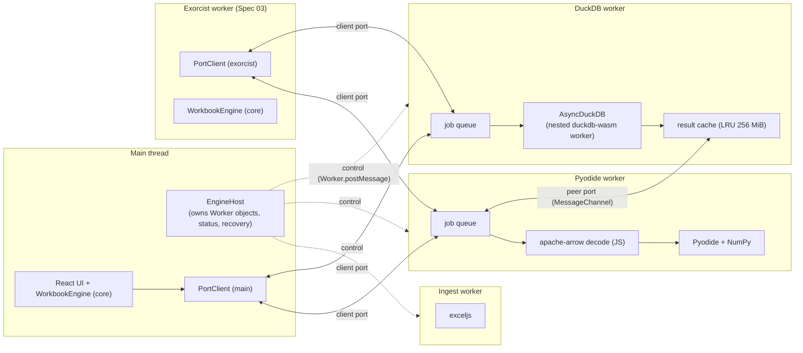
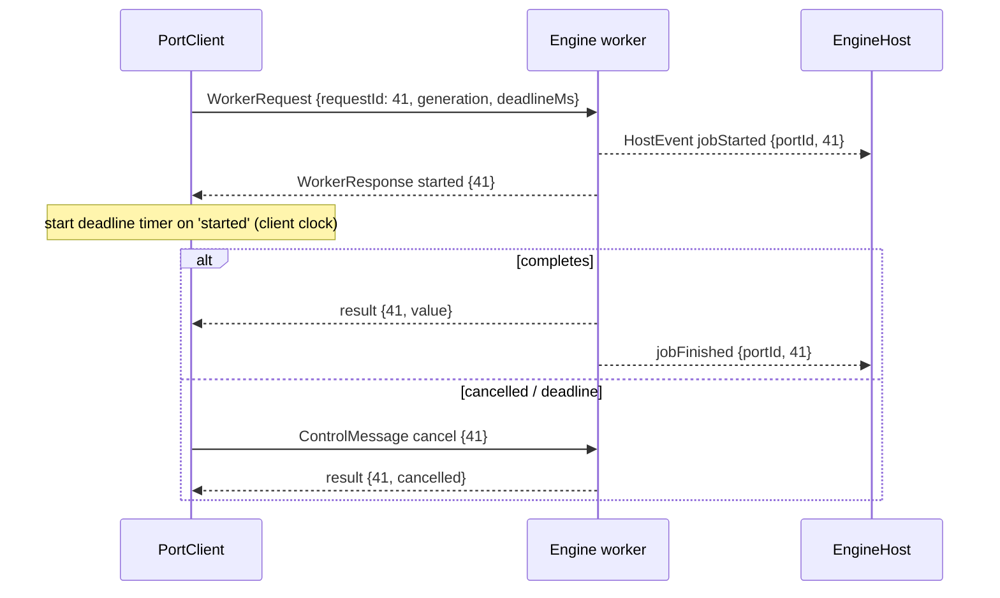
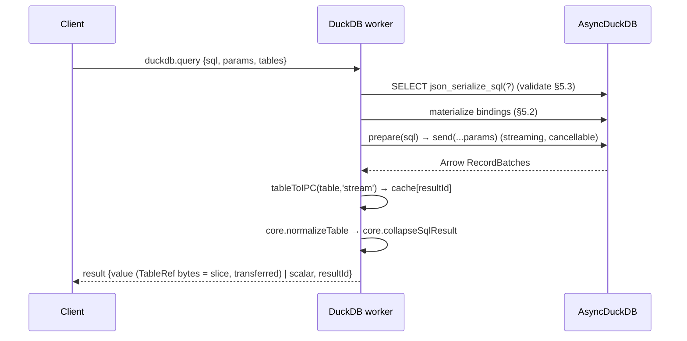
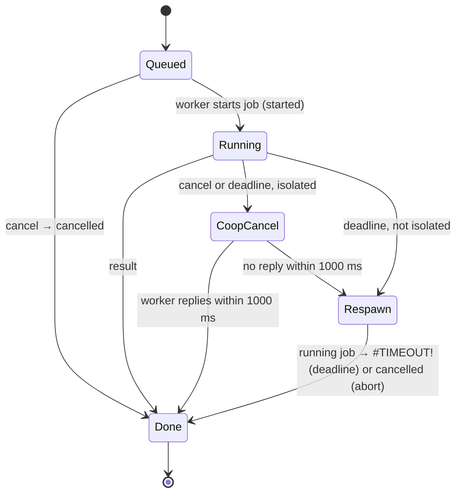
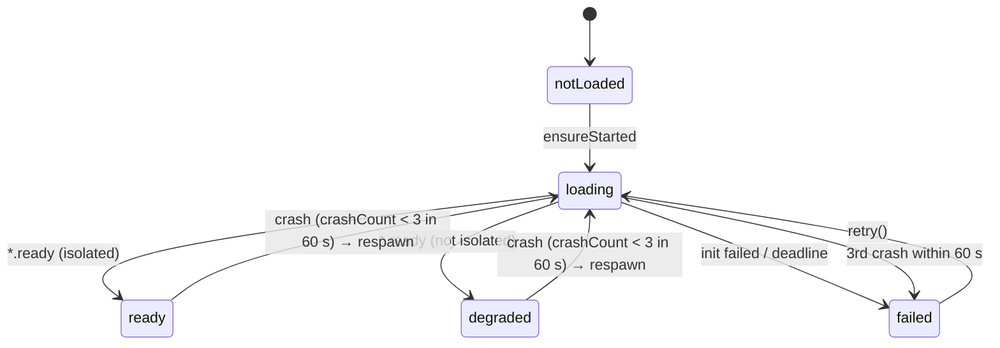

# Design: WASM Worker Bridge

Implements `requirements.md` in this folder. All types from Spec 01 (`CellKey`, `CellValue`, `CellError`, `ScalarValue`, `TableRef`, `Matrix2D`, `ArrowField`, `DatasetMeta`, `RangeSnapshot`, `SqlEngine`, `PyEngine`, `SqlEvalRequest`, `SqlBatchEvalRequest`, `PyEvalRequest`, `PyBatchEvalRequest`, `EngineOutcome`, `EngineBatchOutcome`, `CancellationToken`) are imported from `@suture/core` unchanged. This spec defines no competing version of any of them.

## 1. Topology



- The `EngineHost` is the only owner of `Worker` objects.
- Each client gets its own `MessagePort` per engine worker (`attachPort` control message).
- The DuckDB↔Pyodide peer port is created by the host and handed to both workers.
- Table bytes for Python inputs travel DuckDB → Pyodide over the peer port and never pass through main-thread application logic.

File layout (`packages/web/src/workers/`):
- `protocol.ts` (all message types and type guards);
- `portClient.ts`;
- `engineHost.ts`;
- `sqlBridge.ts` and `pyBridge.ts` (implementing the core ports);
- `duckdb.worker.ts`;
- `pyodide.worker.ts` with `python/suture_bridge.py` (embedded as a string at build time);
- `arrowColumns.ts`;
- `ingest.worker.ts`;
- `isolation.ts`.

## 2. Isolation detection (`isolation.ts`)

```ts
export interface IsolationInfo {
  readonly crossOriginIsolated: boolean;
  readonly sharedArrayBuffer: boolean;
}
export function detectIsolation(): IsolationInfo; // reads globalThis.crossOriginIsolated, typeof SharedArrayBuffer
export function isIsolated(i: IsolationInfo): boolean; // both true
```

## 3. Protocol (`protocol.ts`)

```ts
import type {
  CellKey, CellValue, ScalarValue, TableRef, Matrix2D, ArrowField, DatasetMeta, RangeSnapshot,
} from '@suture/core';
import type { IsolationInfo } from './isolation';

export const PROTOCOL_VERSION = 1 as const;
export type ProtocolVersion = typeof PROTOCOL_VERSION;

export type WorkerKind = 'duckdb' | 'pyodide' | 'ingest';
export type Priority = 'interactive' | 'background';
/** "r<epoch>.<portId>.<requestId>.<scenarioIndex>" — unique for a DuckDB worker instance. */
export type ResultId = string;

interface RequestBase<K extends string, P> {
  readonly protocol: ProtocolVersion;
  readonly requestId: number;     // unique, strictly increasing per client port
  readonly generation: number | null; // recalculation generation for cell evaluations; null for lifecycle requests
  readonly kind: K;
  readonly priority: Priority;    // 'interactive' from main, 'background' from Exorcist
  readonly deadlineMs: number;    // relative budget enforced by the client, measured from the 'started' response (§6)
  readonly payload: P;
}

/* ---------- DuckDB ---------- */

export interface DuckDbInitPayload {
  readonly isolation: IsolationInfo;
}

export interface RegisterDatasetPayload {
  readonly name: string;                         // already sanitized by the host
  readonly sourceFormat: 'csv' | 'parquet' | 'xlsx';
  readonly encoding: 'csv' | 'parquet' | 'arrow';// 'arrow' for sheets from xlsx
  readonly bytes: Uint8Array;                    // transferred; host keeps its own copy (Req 5.7)
  readonly sha256: string;                       // lowercase hex of the original file bytes (for xlsx sheets: of the sheet's Arrow IPC bytes)
}

export type WireTableSource =
  | { readonly kind: 'result'; readonly resultId: ResultId }
  | { readonly kind: 'ipc'; readonly table: TableRef };

export interface WireTableBinding {
  readonly identifier: string;                   // "__suture_b<n>"
  readonly source: WireTableSource;
}

export interface DuckDbQueryPayload {
  readonly cell: CellKey;
  readonly sql: string;
  readonly params: ReadonlyArray<ScalarValue>;
  readonly tables: ReadonlyArray<WireTableBinding>;
}

export interface DuckDbQueryBatchPayload {
  readonly cell: CellKey;
  readonly sql: string;
  readonly shared: ReadonlyArray<WireTableBinding>;
  readonly scenarios: ReadonlyArray<{
    readonly params: ReadonlyArray<ScalarValue>;
    readonly tables: ReadonlyArray<WireTableBinding>;
  }>;
}

export type DuckDbRequest =
  | RequestBase<'duckdb.init', DuckDbInitPayload>
  | RequestBase<'duckdb.registerDataset', RegisterDatasetPayload>
  | RequestBase<'duckdb.dropDataset', { readonly name: string }>
  | RequestBase<'duckdb.query', DuckDbQueryPayload>
  | RequestBase<'duckdb.queryBatch', DuckDbQueryBatchPayload>
  | RequestBase<'duckdb.releaseResults', { readonly resultIds: ReadonlyArray<ResultId> }>;

/* ---------- Pyodide ---------- */

export interface PyInitPayload {
  readonly isolation: IsolationInfo;
  /** Int32Array(2) over a SharedArrayBuffer when isolated: [0] Pyodide interrupt signal, [1] target ticket. */
  readonly interruptBuffer: SharedArrayBuffer | null;
}

export type WirePyValue =
  | { readonly kind: 'scalar'; readonly value: ScalarValue }
  | { readonly kind: 'matrix'; readonly value: Matrix2D }
  | { readonly kind: 'table'; readonly source: WireTableSource; readonly schema: ReadonlyArray<ArrowField>; readonly rowCount: number }
  | { readonly kind: 'range'; readonly value: RangeSnapshot };

export interface WirePyBinding {
  readonly key: string;
  readonly value: WirePyValue;
}

export interface PyRunPayload {
  readonly cell: CellKey;
  readonly code: string;
  readonly vectorized: boolean;
  readonly seed: number;
  readonly inputs: ReadonlyArray<WirePyBinding>;
}

export interface PyRunBatchPayload {
  readonly cell: CellKey;
  readonly code: string;
  readonly vectorized: boolean;
  readonly seed: number;
  readonly shared: ReadonlyArray<WirePyBinding>;
  readonly scenarios: ReadonlyArray<ReadonlyArray<WirePyBinding>>;
}

export type PyRequest =
  | RequestBase<'py.init', PyInitPayload>
  | RequestBase<'py.run', PyRunPayload>
  | RequestBase<'py.runBatch', PyRunBatchPayload>;

/* ---------- Ingest ---------- */

export interface XlsxIngestResult {
  readonly sheets: ReadonlyArray<{
    readonly name: string;
    readonly cells: ReadonlyArray<{ readonly row: number; readonly col: number; readonly raw: string }>; // 0-based
  }>;
  readonly tables: ReadonlyArray<{
    readonly sheet: string;
    readonly ipc: Uint8Array;
    readonly header: 'firstRow' | 'columnLetters';
  }>;
  readonly warnings: ReadonlyArray<string>;
}

export type IngestRequest =
  RequestBase<'ingest.xlsx', { readonly fileName: string; readonly bytes: Uint8Array }>;

export type WorkerRequest = DuckDbRequest | PyRequest | IngestRequest;

/* ---------- Results ---------- */

export type WorkerResult =
  | { readonly kind: 'duckdb.ready'; readonly bundle: 'coi' | 'eh' | 'mvp'; readonly duckdbVersion: string }
  | { readonly kind: 'py.ready'; readonly pyodideVersion: string; readonly numpyVersion: string; readonly interrupt: boolean }
  | { readonly kind: 'dataset'; readonly meta: DatasetMeta }
  | { readonly kind: 'ack' }
  | { readonly kind: 'value'; readonly value: CellValue; readonly resultId: ResultId | null }
  | { readonly kind: 'values'; readonly values: ReadonlyArray<CellValue>; readonly resultIds: ReadonlyArray<ResultId | null> }
  | { readonly kind: 'missingTables'; readonly resultIds: ReadonlyArray<ResultId> }
  | { readonly kind: 'xlsx'; readonly workbook: XlsxIngestResult }
  | { readonly kind: 'failed'; readonly message: string }   // init / registration / ingest failures (not cell values)
  | { readonly kind: 'cancelled' };

export type LoadPhase = 'download' | 'compile' | 'packages' | 'bootstrap';

export type WorkerResponse =
  | { readonly protocol: ProtocolVersion; readonly kind: 'result'; readonly requestId: number; readonly result: WorkerResult }
  | { readonly protocol: ProtocolVersion; readonly kind: 'started'; readonly requestId: number }
  | { readonly protocol: ProtocolVersion; readonly kind: 'progress'; readonly requestId: number; readonly phase: LoadPhase; readonly loadedBytes: number; readonly totalBytes: number | null }
  | { readonly protocol: ProtocolVersion; readonly kind: 'protocolError'; readonly requestId: number | null; readonly reason: string };

/* ---------- Control (host → worker, worker → host) ---------- */

export type ControlMessage =
  | { readonly protocol: ProtocolVersion; readonly kind: 'cancel'; readonly requestId: number } // sent on the client's port
  | { readonly protocol: ProtocolVersion; readonly kind: 'attachPort'; readonly portId: number; readonly role: 'client' | 'peer'; readonly port: MessagePort };

export type HostEvent =
  | { readonly protocol: ProtocolVersion; readonly kind: 'jobStarted'; readonly portId: number; readonly requestId: number }
  | { readonly protocol: ProtocolVersion; readonly kind: 'jobFinished'; readonly portId: number; readonly requestId: number }
  | { readonly protocol: ProtocolVersion; readonly kind: 'fatal'; readonly reason: string };

/* ---------- Peer (Pyodide ↔ DuckDB) ---------- */

export type PeerMessage =
  | { readonly protocol: ProtocolVersion; readonly kind: 'peer.fetch'; readonly peerRequestId: number; readonly resultIds: ReadonlyArray<ResultId> }
  | { readonly protocol: ProtocolVersion; readonly kind: 'peer.tables'; readonly peerRequestId: number; readonly tables: ReadonlyArray<{ readonly resultId: ResultId; readonly ipc: Uint8Array }>; readonly missing: ReadonlyArray<ResultId> };

/* ---------- Status ---------- */

export type EngineName = 'duckdb' | 'pyodide';
export type EngineState = 'notLoaded' | 'loading' | 'ready' | 'degraded' | 'failed';

export interface EngineStatus {
  readonly engine: EngineName;
  readonly state: EngineState;
  readonly progress: { readonly loadedBytes: number; readonly totalBytes: number | null } | null;
  readonly reason: string | null;   // required when state is 'degraded' or 'failed'
  readonly crashCount: number;      // within the current 60 s window
}

/* ---------- Guards ---------- */

export function isWorkerRequest(m: unknown): m is WorkerRequest;
export function isWorkerResponse(m: unknown): m is WorkerResponse;
export function isControlMessage(m: unknown): m is ControlMessage;
export function isHostEvent(m: unknown): m is HostEvent;
export function isPeerMessage(m: unknown): m is PeerMessage;
export function transferListOf(m: WorkerRequest | WorkerResponse | PeerMessage): Transferable[];
```

Guards check every field, including the element types of arrays, and enumerate the `kind` discriminants exhaustively (`never` check). `transferListOf` collects every `ArrayBuffer` that a message carries in a `bytes`, `ipc`, or `Matrix2D.data` field, after ownership normalization (§4.1).

### 3.1 Request/response correlation



### 3.2 Worker job queue

Each engine worker keeps a priority queue: `interactive` before `background`, FIFO within a priority.

The worker never starts a job from inside an `onmessage` handler. It schedules the next job on a fresh `MessageChannel` tick, so every message already delivered (including `cancel`) is processed before the next job starts. A `cancel` for a queued job removes it and responds `cancelled`. A `cancel` for the running job triggers cooperative cancellation (§6).

## 4. Data path

### 4.1 Buffer ownership rule

```ts
export function owned(view: Uint8Array): Uint8Array {
  return view.byteOffset === 0 && view.byteLength === view.buffer.byteLength ? view : view.slice();
}
export function ownedF64(view: Float64Array): Float64Array; // same rule for Matrix2D.data
```

Every `ipc`, `bytes`, and `Matrix2D.data` is passed through `owned` / `ownedF64` before it is placed in a message, and its buffer is placed in the transfer list. After posting, the sender drops its reference.

The DuckDB worker keeps its cached copy separately: it posts a `slice()` of the cached bytes, never the cached buffer itself.

### 4.2 SQL result path



### 4.3 DuckDB → Pyodide path (Option C, the chosen design)

The data moves with a zero-copy worker transfer and then a single memcpy per column into WASM linear memory.

```mermaid
sequenceDiagram
  participant C as Client
  participant P as Pyodide worker (JS)
  participant D as DuckDB worker
  participant N as Python / NumPy
  C->>P: py.run {inputs: [{key, value: {kind:'table', source:{kind:'result', resultId}}}]}
  P->>D: peer.fetch {resultIds}
  D-->>P: peer.tables {ipc (slice, transferred)}    %% zero-copy worker transfer
  P->>P: apache-arrow tableFromIPC(ipc) → typed-array views (no copy)
  P->>N: column specs (JsProxy of views)
  N->>N: np.empty(n, dtype); spec.data.assign_to(arr)   %% single memcpy per column
  N->>N: np.unpackbits(validity, bitorder="little") → mask
  N-->>P: result tuple
  P->>P: getBuffer('f64') → copy → release → destroy proxies
  P->>P: core.normalizeMatrix / normalizeNumber
  P-->>C: result {value}
```

#### Why Option C

| Option | Cold-load bytes added | Copies per column into WASM memory | Code we maintain | Verdict |
|---|---|---|---|---|
| A. Python Arrow package (`pyarrow`) in Pyodide | tens of MB of wheel; forbidden by steering | ≥ 1 | none | rejected |
| B. Pure-Python Arrow IPC parser (flatbuffers + `np.frombuffer` at offsets) | ~0 | 1 (whole IPC buffer), then views | a flatbuffer metadata parser in Python | viable but expensive to maintain and to test |
| **C. `apache-arrow` decode in the worker's JS + `JsBuffer.assign_to` into `np.empty`** | **0** (apache-arrow is already in the worker bundle) | **exactly 1** | ~200 lines of TS + ~120 lines of Python | **chosen** |
| D. `JsProxy.to_py()` / `to_memoryview()` then `np.frombuffer` | 0 | 2 (to an intermediate Python buffer, then NumPy if a copy is needed) | small | rejected: extra copy |
| E. Write directly into WASM memory via private `_malloc` / `HEAPU8.set` | 0 | 1 | small | rejected: private API, breaks across Pyodide versions |

Facts behind the choice:
- A JavaScript `ArrayBuffer` is not part of WebAssembly linear memory. NumPy can only use memory inside that linear memory, so at least one copy is unavoidable. Option C makes exactly that one copy, and makes it straight into the final NumPy buffer.
- For uncompressed IPC with 8-byte-aligned buffers (Arrow's default; `owned()` guarantees `byteOffset === 0`), `apache-arrow` exposes each column's `data[i].values` as a typed-array view over the received bytes.
- `JsBuffer.assign_to(target)` is a public Pyodide API. It copies a JS buffer into any writable, contiguous Python buffer of identical byte length.
- Bitmaps are 1/8 of a byte per row. Unpacking them in NumPy is negligible next to the data copy.

### 4.4 Column specs (`arrowColumns.ts`)

```ts
export type BridgeDtype =
  | 'float64' | 'float32'
  | 'int8' | 'int16' | 'int32' | 'int64'
  | 'uint8' | 'uint16' | 'uint32' | 'uint64'
  | 'bool' | 'utf8' | 'date32' | 'timestamp_us';

export interface ColumnChunkSpec {
  readonly length: number;
  readonly data: Int8Array | Int16Array | Int32Array | BigInt64Array | Uint8Array | Uint16Array
               | Uint32Array | BigUint64Array | Float32Array | Float64Array; // view; bool → packed bits
  readonly bitOffset: number;           // bool data only; 0 otherwise
  readonly hasValidity: boolean;        // explicit flag; avoids JS null ↔ Python None ambiguity
  readonly validity: Uint8Array;        // empty when hasValidity is false
  readonly validityBitOffset: number;
  readonly offsets: Int32Array;         // utf8 only (length + 1 entries); empty otherwise
}

export interface ColumnSpec {
  readonly name: string;
  readonly dtype: BridgeDtype;
  readonly length: number;
  readonly chunks: ReadonlyArray<ColumnChunkSpec>;
}

export type ColumnSpecResult =
  | { readonly ok: true; readonly columns: ReadonlyArray<ColumnSpec> }
  | { readonly ok: false; readonly column: string; readonly arrowType: string };

export function columnSpecs(ipc: Uint8Array): ColumnSpecResult;
```

Arrow → `BridgeDtype`: `Float64`/`Float32`, `Int*`/`Uint*` of matching width, `Bool`, `Utf8`, `DateDay` → `date32`, `Timestamp` with unit `MICROSECOND` → `timestamp_us`. Any other type gives `ok:false`, which becomes `#PY!` (Req 8.6).

For sliced chunks (`offset > 0`), the data view is `values.subarray(offset, offset + length)`. Validity and bool bit offsets carry the slice offset. Utf8 `offsets` is the subarray `[offset, offset + length]`, and `data` is the byte range `[offsets[0], offsets[length])`.

### 4.5 Python bridge (`python/suture_bridge.py`)

```python
import builtins
import numpy as np
from pyodide.code import eval_code

_MAX_SAFE = 9007199254740991

class _DivFlag:
    __slots__ = ("hit",)
    def __init__(self):
        self.hit = False
    def __call__(self, kind, flag):
        if kind == "divide by zero":
            self.hit = True

class _Inputs(dict):
    def __missing__(self, key):
        raise KeyError(f"undeclared input key {key!r}")

def _bits(js_bytes, bit_offset, n):
    raw = np.empty(js_bytes.byteLength, dtype=np.uint8)
    js_bytes.assign_to(raw)                                   # single memcpy (bitmap)
    return np.unpackbits(raw, bitorder="little")[bit_offset:bit_offset + n].astype(bool)

_NP_DTYPE = {"date32": np.int32, "timestamp_us": np.int64}

def _utf8(spec):
    out = []
    for c in spec.chunks:
        n = c.length
        offs = np.empty(n + 1, dtype=np.int32); c.offsets.assign_to(offs)
        data = np.empty(c.data.byteLength, dtype=np.uint8); c.data.assign_to(data)
        raw, base = data.tobytes(), int(offs[0])
        vals = [raw[int(offs[i]) - base:int(offs[i + 1]) - base].decode("utf-8") for i in range(n)]
        if c.hasValidity:
            valid = _bits(c.validity, c.validityBitOffset, n)
            vals = [v if ok else None for v, ok in zip(vals, valid)]
        out.extend(vals)
    return out

def _column(spec):
    if spec.dtype == "utf8":
        return _utf8(spec)
    n = spec.length
    if spec.dtype == "bool":
        vals = np.empty(n, dtype=bool); pos = 0
        for c in spec.chunks:
            vals[pos:pos + c.length] = _bits(c.data, c.bitOffset, c.length); pos += c.length
    else:
        vals = np.empty(n, dtype=_NP_DTYPE.get(spec.dtype, spec.dtype)); pos = 0
        for c in spec.chunks:
            c.data.assign_to(vals[pos:pos + c.length])        # single memcpy per column (per chunk slice)
            pos += c.length
    if spec.dtype == "date32":
        vals = vals.astype("datetime64[D]")
    elif spec.dtype == "timestamp_us":
        vals = vals.view("datetime64[us]")
    if not any(c.hasValidity for c in spec.chunks):
        return vals
    mask = np.zeros(n, dtype=bool); pos = 0
    for c in spec.chunks:
        if c.hasValidity:
            mask[pos:pos + c.length] = ~_bits(c.validity, c.validityBitOffset, c.length)
        pos += c.length
    return np.ma.MaskedArray(vals, mask=mask)
```

Each numeric column is allocated once with `np.empty(n)`, and each chunk is copied straight into its slice. Every data byte is therefore copied into WASM linear memory exactly once. `date32` is the one exception: it widens from `int32` to `datetime64[D]` with a second, dtype-converting copy, because NumPy has no 32-bit day type. Bitmaps are copied once and then unpacked.

Binding and execution:

```python
# value: JsProxy of a JS-side "resolved" binding. Before calling Python, the worker's JS resolves each
# WirePyValue: tables become {kind:'table', columns: ColumnSpec[]} (via peer fetch + columnSpecs), matrices
# become {kind:'matrix', rows, cols, data: Float64Array}, and ranges become
# {kind:'range', rows, cols, numeric: bool, data: Float64Array, validity: Uint8Array, values: ScalarValue[]}.
# _range returns a MaskedArray(shape (rows, cols)) when numeric is true, otherwise a row-major list[list].
def _bind(value):
    k = value.kind
    if k == "scalar":  return value.value                       # float | str | bool | None
    if k == "matrix":
        arr = np.empty(value.rows * value.cols, dtype=np.float64)
        value.data.assign_to(arr)
        return arr.reshape(value.rows, value.cols)
    if k == "table":   return {c.name: _column(c) for c in value.columns}
    if k == "range":   return _range(value)                      # MaskedArray if numeric/empty, else list[list]

def _run_one(code, filename, ns_inputs, seed):
    np.random.seed(seed)
    ns = {"__builtins__": builtins, "np": np, "inputs": _Inputs(ns_inputs),
          "rng": np.random.default_rng(seed)}
    flag = _DivFlag()
    try:
        with np.errstate(divide="call", call=flag):
            result = eval_code(code, globals=ns, filename=filename, return_mode="last_expr")
        return _to_result(result, flag.hit)
    except ZeroDivisionError as e:
        return ("err", "#DIV/0!", f"ZeroDivisionError: {e}")
    except KeyboardInterrupt:
        return ("interrupt",)
    except KeyError as e:
        msg = str(e.args[0]) if e.args else "KeyError"
        if msg.startswith("undeclared input key"):
            return ("err", "#PY!", msg)
        return ("err", "#PY!", f"KeyError: {msg}{_line(e)}")
    except MemoryError:
        return ("err", "#PY!", "MemoryError")
    except BaseException as e:
        return ("err", "#PY!", f"{type(e).__name__}: {e}{_line(e)}")

def _to_result(v, div):
    if v is None: return ("null",)
    if isinstance(v, (bool, np.bool_)): return ("bool", bool(v))
    if isinstance(v, (int, np.integer)):
        iv = int(v)
        if abs(iv) > _MAX_SAFE: return ("err", "#NUM!", "integer exceeds 2^53-1")
        return ("num", float(iv), div)
    if isinstance(v, (float, np.floating)): return ("num", float(v), div)
    if isinstance(v, str): return ("str", v)
    if isinstance(v, np.ma.MaskedArray) and np.ma.is_masked(v):
        return ("err", "#PY!", "masked values cannot be returned")
    if isinstance(v, np.ndarray):
        if v.ndim == 0: return _to_result(v.item(), div)
        if v.dtype.kind not in "biuf": return ("err", "#PY!", f"unsupported array dtype {v.dtype}")
        if v.dtype.kind in "iu" and v.size and int(np.abs(v).max()) > _MAX_SAFE:
            return ("err", "#NUM!", "integer exceeds 2^53-1")
        if v.ndim == 1: v = v.reshape(-1, 1)
        if v.ndim != 2: return ("err", "#PY!", "arrays must be 0-, 1-, or 2-D")
        a = np.ascontiguousarray(v, dtype=np.float64)
        return ("mat", a.shape[0], a.shape[1], a, div)
    return ("err", "#PY!", f"unsupported return type {type(v).__name__}")
```

`_line(e)` returns ` (line N)` from the deepest traceback frame whose filename matches the cell, or an empty string.

Batch execution:
- **Scalar mode (default):** `_run_batch` loops over scenarios in Python, merging `shared` and per-scenario bindings into a fresh `_Inputs` for each, and collects the result tuples.
- **Vectorized mode:** `_run_batch` calls `_run_one` once. Each per-scenario key is stacked as follows:
  - scalars → `np.ndarray` shape `(B,)`: `float64` for numbers, `bool` for booleans, `object` for strings; `None` masked via `MaskedArray`;
  - matrices of equal shape → `(B, r, c)`, else `#PY!`;
  - ranges → `MaskedArray` `(B, r, c)`;
  - per-scenario tables → `list` of `B` dicts.
  - Shared keys are bound once, unstacked. The result must have `len(result) == B`, and element `i` is converted with `_to_result`. Any other shape gives `#PY!` for every scenario.

JS side, per result tuple:
- `"num"` → `core.normalizeNumber(x, div ? 'divisionByZero' : 'none', …)`.
- `"mat"` → `proxy.getBuffer('f64')`, then `new Float64Array(buf.data)` (copy out of WASM memory), `buf.release()`, `core.normalizeMatrix`.
- `"interrupt"` → `#TIMEOUT!` if the interrupt ticket matches this job (§6.2), else re-run the job.
- `"err"` → `makeError(code, msg, cell, 'py')`.
- Every `PyProxy` created for the call is destroyed in a `finally` block.

## 5. DuckDB worker (`duckdb.worker.ts`)

### 5.1 Initialization

1. Pick a bundle:
   - **Isolated:** `selectBundle(getJsDelivrBundles())` (the version is pinned by the installed `@duckdb/duckdb-wasm`); the expected result is the `coi` bundle.
   - **Not isolated:** filter out the `coi` bundle before selection, giving `eh` or `mvp`, and report `degraded` (Req 4.2).
2. Start the nested duckdb-wasm worker from a Blob URL wrapper: `importScripts("<bundle.mainWorker>")`. Cross-origin script loading is allowed under COEP `credentialless`.
3. `db.instantiate(bundle.mainModule, bundle.pthreadWorker)` → `db.open({ query: { castDecimalToDouble: true, castBigIntToDouble: false } })`.
4. Run on the connection:
   - `SET autoinstall_known_extensions = false; SET autoload_known_extensions = false; SET threads = 1; SET preserve_insertion_order = true;`
   - Install the macros (§5.4).
   - Probe `SELECT json_serialize_sql('SELECT 1')`. On failure, report `failed` (Req 4.5).
5. Respond `duckdb.ready`.

### 5.2 Bindings and result cache

- Cache: `Map<ResultId, { ipc: Uint8Array; table: arrow.Table; bytes: number; lastUse: number; materialized: string | null }>`, LRU-bounded at 256 MiB (Req 6.10).
- A `result` binding materializes once as `CREATE TEMP TABLE "__res_<hex(fnv1a32(resultId))>_<n>" AS SELECT * FROM <arrow scan>` via `insertArrowFromIPCStream`, and is reused until release or eviction.
- An `ipc` binding is inserted as a temp table for the duration of the request.
- Each request then creates `CREATE OR REPLACE TEMP VIEW "__suture_b<n>" AS SELECT * FROM <source>` and drops its views after the request.
- In a batch, shared bindings are materialized once. Per-scenario views are replaced for each scenario.
- If any `result` binding is not cached, the worker responds `missingTables` without executing anything (Req 6.8).
- Dataset registration (CSV/Parquet) briefly raises `SET threads` to `min(4, hardwareConcurrency)` when isolated, then restores `threads = 1`. Jobs are serialized, so no cell query ever runs with more than one thread.

### 5.3 Query validation

```ts
export type SqlValidation = { readonly ok: true } | { readonly ok: false; readonly reason: string };
export function validateSerializedSql(json: unknown, allowedTables: ReadonlySet<string>): SqlValidation;
```

1. The JSON must have `error === false` and `statements.length === 1`. DuckDB serializes only `SELECT` statements, so DDL, `COPY`, `ATTACH`, `PRAGMA`, and `SET` fail to serialize and are rejected.
2. Walk every object node.
   - Collect CTE names from every `cte_map`.
   - For each node with `type === "BASE_TABLE"`: if `catalog_name` is empty and `schema_name` is empty, `"main"`, or `"temp"`, then `table_name` (compared case-insensitively) must be in `allowedTables ∪ CTE names`. Otherwise reject. Names starting with `__res_`, and binding names not in this request, are not in `allowedTables`.
   - For each node with `type === "TABLE_FUNCTION"`: the function name must be `range`, `generate_series`, or `unnest`.
3. `FROM 'file.csv'` and `FROM 'https://…'` serialize as `BASE_TABLE` with a path-like name. That name is not in `allowedTables`, so they are rejected.

`allowedTables` = registered dataset names ∪ this request's `__suture_b<n>` identifiers.

### 5.4 Deterministic macros

These macros are installed at initialization (internal DDL, not user SQL). Users may call them as scalar functions.

```sql
CREATE OR REPLACE MACRO suture_m32(x)    AS (x::UBIGINT & 4294967295::UBIGINT);
CREATE OR REPLACE MACRO suture_xs(x, s)  AS xor(x, x >> s);
CREATE OR REPLACE MACRO suture_mul(x, c) AS ((x::HUGEINT * c) % 4294967296)::UBIGINT;
-- lowbias32, identical to core mix32's finalizer
CREATE OR REPLACE MACRO suture_h32(x) AS
  suture_xs(suture_mul(suture_xs(suture_mul(suture_xs(suture_m32(x), 16), 2146121005), 15), 2221713035), 16);
-- uniform in [0, 1)
CREATE OR REPLACE MACRO suture_u01(i, stream) AS
  suture_h32(xor(suture_m32(i), suture_h32(suture_m32(stream + 2654435769)))) / 4294967296.0;
-- standard normal via Box–Muller (1 - u in (0, 1], so ln is finite)
CREATE OR REPLACE MACRO suture_normal(i, stream) AS
  sqrt(-2.0 * ln(1.0 - suture_u01(i, stream))) * cos(2.0 * pi() * suture_u01(i, stream + 1000));
```

A known-answer test checks `suture_h32` against core's lowbias32 finalizer on 10,000 inputs.

### 5.5 Execution

`conn.prepare(sql)` → `stmt.send(...params)` (a streaming reader, so `conn.cancelSent()` can interrupt between chunks) → collect the batches → `new arrow.Table(batches)` → `tableToIPC(table, 'stream')`.

Errors thrown by DuckDB (parser, binder, or execution error) become `#SQL!` with DuckDB's message. A `WebAssembly.RuntimeError`, a `RangeError` from memory growth, or an error event from the nested worker is fatal (§7).

## 6. Deadlines and cancellation

### 6.1 Client side (`portClient.ts`)

```ts
export interface PortClientOptions {
  readonly portId: number;
  readonly engine: EngineName;
  readonly isolation: IsolationInfo;
  readonly interrupt: Int32Array | null;  // Pyodide only, isolated only
  readonly onTimeoutWithoutIsolation: (requestId: number) => void; // main: EngineHost.requestRespawn; Exorcist: posts 'respawnRequest' (Spec 03 §6)
}

export class PortClient {
  constructor(port: MessagePort, opts: PortClientOptions);
  request<R extends WorkerRequest>(kind: R['kind'], payload: R['payload'],
    opts: { readonly priority: Priority; readonly deadlineMs: number; readonly signal: AbortSignal }): Promise<WorkerResult>;
  replacePort(port: MessagePort, crashedRunningRequestId: number | null, reason: string): void;
}

export function tokenFromSignal(signal: AbortSignal): CancellationToken;
export function signalFromToken(token: CancellationToken): AbortSignal;
```

`SqlBridge` and `PyBridge` implement the core `SqlEngine` / `PyEngine` ports on top of `PortClient`:
1. Convert `CancellationToken` → `AbortSignal`.
2. Map `SqlTableBinding.table` → `WireTableSource`. A table becomes `{kind:'result'}` when a `WeakMap<TableRef, ResultId>` (filled from responses) has an entry for it. Otherwise it becomes `{kind:'ipc'}`.
3. On `missingTables`, resend once with `ipc` sources for the missing ids.
4. Map `WorkerResult` → `EngineOutcome` / `EngineBatchOutcome`. `failed` and `protocolError` become a `CellError` (`#SQL!`/`#PY!`). `cancelled` from an abort becomes `{kind:'cancelled'}`. A deadline expiry becomes `#TIMEOUT!`.

### 6.2 Escalation



Cooperative cancellation:
- **DuckDB:** the `cancel` control message → `conn.cancelSent()`.
- **Pyodide:** the client writes its job ticket (`portId * 2^20 + requestId`, kept below 2^31) to `interrupt[1]`, then `Atomics.store(interrupt, 0, 2)` (SIGINT). When Python raises `KeyboardInterrupt`, the worker compares `interrupt[1]` with the running job's ticket:
  - on a match, it returns `#TIMEOUT!` or `cancelled`;
  - on a mismatch (the target finished and a new job started between the client's check and store), it clears the signal and re-runs the current job. Evaluation is deterministic, so the re-run is safe.

## 7. Crash recovery (`engineHost.ts`)

```ts
export interface EngineHost {
  status(engine: EngineName): EngineStatus;
  subscribe(listener: (s: EngineStatus) => void): () => void;
  ensureStarted(engine: EngineName): Promise<void>;
  connectClient(engine: EngineName): { readonly portId: number; readonly port: MessagePort };
  registerDataset(file: { readonly name: string; readonly bytes: Uint8Array;
    readonly sourceFormat: 'csv' | 'parquet' | 'xlsx'; readonly encoding: 'csv' | 'parquet' | 'arrow' }): Promise<DatasetMeta | { readonly error: string }>;
  requestRespawn(engine: EngineName, portId: number, requestId: number): void; // timeout without isolation, from any client
  ingestXlsx(fileName: string, bytes: Uint8Array): Promise<XlsxIngestResult | { readonly error: string }>;
  retry(engine: EngineName): Promise<void>;
}
```



On a crash (a `fatal` host event, `worker.onerror`, or a respawn request from a timeout). A `messageerror` is not a crash: it is handled as `protocolError` (Req 2.6, 9.7).
1. Terminate the worker, and record `running = {portId, requestId}` from the last `jobStarted` without a matching `jobFinished`.
2. Spawn a new worker. Replay init, then:
   - **DuckDB:** re-register every retained dataset in its original order. Macros are re-installed during init.
   - **Pyodide:** NumPy is imported during init.
3. Create new client ports and a new peer port. Call `replacePort(newPort, runningRequestIdForThatPort, reason)` on every client: the main `PortClient` directly, and the Exorcist through its `enginePortReplaced` message (Spec 03 §6), which carries the new `portId`.
4. `replacePort` resolves the running request as:
   - `#TIMEOUT!` if the respawn was caused by its deadline;
   - otherwise `#SQL!`/`#PY!` with `engine crashed: <reason>` (Req 9.2).
   It then re-sends, in original order, the requests that were sent but never started.
5. The epoch increments, so old `ResultId`s miss and fall back via `missingTables`.

Crash classification inside workers:
- **DuckDB:** `WebAssembly.RuntimeError`, `RangeError` (memory growth), and the nested duckdb-wasm worker's `error` event are fatal.
- **Pyodide:** every Python exception is caught inside `_run_one`, so any exception that escapes to JavaScript is fatal (this includes Pyodide fatal errors and traps). Python `MemoryError` stays an ordinary `#PY!` result (Req 9.6).

## 8. Ingest worker (`ingest.worker.ts`)

- `import { Workbook as XlsxWorkbook } from 'exceljs'`, then `new XlsxWorkbook().xlsx.load(bytes)`.
- For each worksheet, for each cell:
  - formula cells → `raw = "=" + cell.formula` (shared formulas are translated by exceljs);
  - numbers, strings, and booleans → their literal text;
  - dates → the legacy serial number (days since 1899-12-30, fractional time) as a number literal;
  - rich text → concatenated plain text;
  - hyperlinks → their text;
  - cached error values → the error literal.
- The table for each sheet uses its first row as the header when every first-row cell is a non-empty, unique string. Otherwise columns are named by their letters.
- Column types are inferred as in Spec 01 `rangeToTableRef`, and the table is encoded with `apache-arrow` `tableToIPC`.
- Unsupported features (merged cells beyond the top-left, data validation, macros, charts, external links) are skipped with a warning each.

## 9. Cold-load test

A Playwright test runs against `vite preview` on Chromium with a cold cache and network throttled to 50 Mbps / 20 ms RTT. It measures:
- gzip size of the main-thread JS (from the build manifest);
- time to grid interactive (first contentful paint plus the first keyboard selection handled);
- time from typing the first `=SQL()` to `duckdb.ready`;
- time from typing the first `=PY()` to `py.ready`.

The measurements are written to `packages/web/test/cold-load.json` and compared with the Req 10.2 budgets. They are initial budgets, to be revised with data once real measurements exist.

## 10. Failure modes

| Failure | Where detected | Cell result | Worker |
|---|---|---|---|
| SQL validation fails | DuckDB worker §5.3 | `#SQL!` | survives |
| DuckDB parse/bind/exec error | DuckDB worker | `#SQL!` | survives |
| Python exception | `_run_one` | `#PY!` / `#DIV/0!` | survives |
| Unsupported Arrow type for Python | `columnSpecs` | `#PY!` | survives |
| Deadline, isolated | client | `#TIMEOUT!` | survives (escalates after 1 s) |
| Deadline, not isolated | client → host | `#TIMEOUT!` (running only) | respawned |
| WASM trap / WASM heap exhaustion | worker → `fatal` | `#SQL!`/`#PY!` (running only) | respawned |
| 3 crashes in 60 s | host | pending → `#SQL!`/`#PY!` | `failed`, manual retry |
| Malformed message or `messageerror` | guards / `messageerror` handler | `#SQL!`/`#PY!` if identifiable | survives |
| Result evicted | DuckDB worker | none (retry with bytes) | survives |
| `json_serialize_sql` missing | init | — | `failed` with reason |

## 11. Security notes

- User SQL is restricted to one `SELECT` over registered tables and allowlisted table functions. This blocks file and URL reads and DDL.
- User Python runs in a worker with no DOM, but Pyodide's `js` module can still reach worker globals such as `fetch`. Worker isolation and COEP `credentialless` limit what a hostile workbook can do: no credentialed cross-origin requests and no DOM access. This is not a sandbox guarantee. The UI must warn before running `=PY()` cells from a workbook the user did not author (Spec 04 Requirement 6.5).
