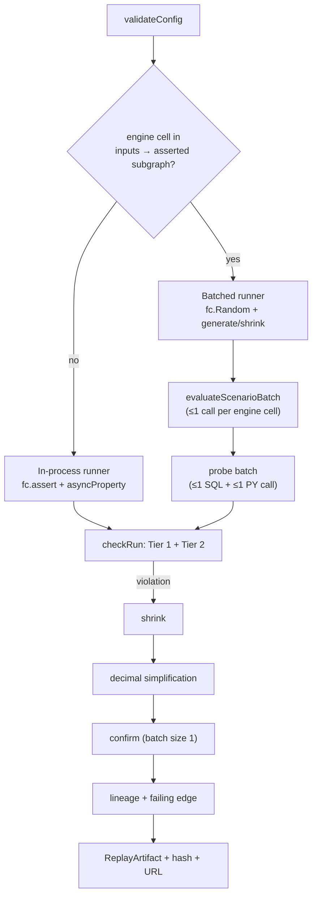
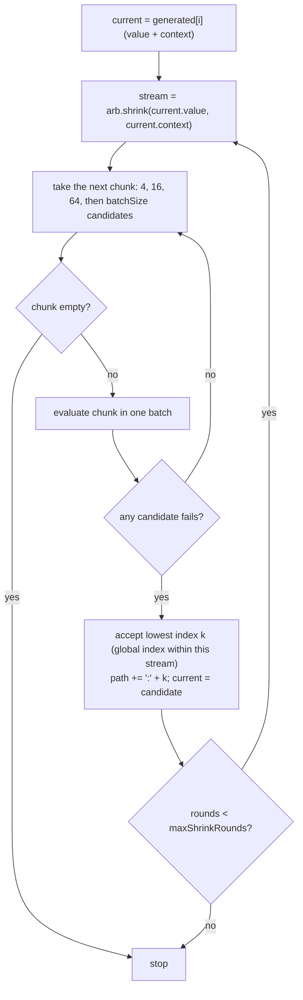

# Design: Exorcist PBT Fuzzer

Implements `requirements.md` in this folder. Core logic lives in `packages/core/src/exorcist/` (ES2022 only). The browser host is `packages/web/src/workers/exorcist.worker.ts`.

Imported unchanged:
- from Spec 01 (`@suture/core`): `CellKey`, `CellValue`, `CellError`, `CellErrorCode`, `EngineId`, `ScalarValue`, `TableRef`, `Matrix2D`, `WorkbookDefinition`, `WorkbookEngine`, `EngineDeps`, `ScenarioOverrides`, `ScenarioBatch`, `ScenarioBatchResult`, `TieBreak`, `CancellationToken`, `createWorkbookEngine`, `assertCanonical`, `InvariantViolation`, `mix32`, `fnv1a32`;
- from Spec 02, in the hosts only (`packages/core` never imports them): `EngineName` and `IsolationInfo` (`@suture/runtime/bridge`, since Phase 5), and in the web host `PortClient` (`packages/web/src/workers/portClient.ts`) and `EngineHost` (`workers/engineHost.ts`). Also from Spec 01: `Edit`, `EngineEvent`, `SqlBatchEvalRequest`, `PyBatchEvalRequest`.

New dependency: `pure-rand` (MIT, by the author of fast-check, already a transitive dependency of fast-check). It is added as a direct dependency of `packages/core` because `fc.Random` requires a `RandomGenerator`. The license check is recorded in the PR that adds it, as `.kiro/steering/architecture-and-isolation.md` §5 requires.

## 1. Types (`exorcist/types.ts`)

```ts
export type UniversalInvariantId =
  | 'T1.noUnhandledException'
  | 'T1.noNonFiniteLeak'
  | 'T1.strictErrorPropagation'
  | 'T1.editOrderDeterminism'
  | 'T1.crossEngineTolerance';

export type FuzzDomain =
  | { readonly kind: 'float'; readonly min: number; readonly max: number }
  | { readonly kind: 'integer'; readonly min: number; readonly max: number }
  | { readonly kind: 'choice'; readonly values: ReadonlyArray<ScalarValue> }
  | { readonly kind: 'boolean' };

export interface FuzzInput {
  readonly cell: CellKey;
  readonly domain: FuzzDomain;
}

export type AssertionOperand =
  | { readonly kind: 'const'; readonly value: number }
  | { readonly kind: 'cell'; readonly cell: CellKey };

interface AssertionBase { readonly id: string; readonly cell: CellKey }

export type CellAssertion =
  | (AssertionBase & { readonly kind: 'gte' | 'lte' | 'gt' | 'lt'; readonly operand: AssertionOperand })
  | (AssertionBase & { readonly kind: 'between'; readonly min: AssertionOperand; readonly max: AssertionOperand })
  | (AssertionBase & { readonly kind: 'notError' })
  | (AssertionBase & { readonly kind: 'finite' })
  | (AssertionBase & { readonly kind: 'notNull' })
  | (AssertionBase & { readonly kind: 'monotonicWith'; readonly input: CellKey; readonly direction: 'nonDecreasing' | 'nonIncreasing' });

export interface ExorcistConfig {
  readonly inputs: ReadonlyArray<FuzzInput>;
  readonly assertions: ReadonlyArray<CellAssertion>;
  readonly numRuns: number;       // in-process; default 1000
  readonly batchSize: number;     // batched; runs per batch, 100..200, default 200
  readonly maxBatches: number;    // batched; default 10
  readonly maxShrinkRounds: number; // default 64
}

export interface SutureDocument {
  readonly format: 'suture.workbook';
  readonly version: 1;
  readonly title: string;          // excluded from workbookHash
  readonly workbook: WorkbookDefinition;
  readonly exorcist: ExorcistConfig;
}

export type ExecutionMode = 'inProcess' | 'batched';

export type ValueSummary =
  | { readonly kind: 'scalar'; readonly value: EncodedScalar }
  | { readonly kind: 'error'; readonly code: CellErrorCode; readonly origin: CellKey; readonly engine: EngineId; readonly message: string }
  | { readonly kind: 'matrix'; readonly rows: number; readonly cols: number }
  | { readonly kind: 'table'; readonly rowCount: number; readonly columns: ReadonlyArray<string> };

export type ViolatedAssertion =
  | { readonly tier: 1; readonly invariant: UniversalInvariantId; readonly cell: CellKey | null; readonly detail: string }
  | { readonly tier: 2; readonly assertion: CellAssertion; readonly observed: ValueSummary; readonly paired: ValueSummary | null; readonly detail: string };

export interface LineageEdge { readonly from: CellKey; readonly to: CellKey }

export interface LineagePath {
  readonly cells: ReadonlyArray<CellKey>;      // topological order, inputs first, violating cell last
  readonly edges: ReadonlyArray<LineageEdge>;  // sorted by (to, from) row-major
  readonly failingEdge: LineageEdge | null;    // null only when the lineage has a single cell
}

/** Exact, JSON-safe scalar. Numbers keep -0 and every bit via String(n) / "-0". */
export type EncodedScalar =
  | { readonly t: 'n'; readonly v: string }
  | { readonly t: 's'; readonly v: string }
  | { readonly t: 'b'; readonly v: boolean }
  | { readonly t: 'z' };

export interface ReplayArtifact {
  readonly format: 'suture.replay';
  readonly version: 1;
  readonly mode: ExecutionMode;
  readonly seed: number;                // int32 (fast-check seed range)
  readonly path: string;                // in-process: fast-check path; batched: candidate path
  readonly numRuns: number;
  readonly batchSize: number;           // 1 in in-process mode
  readonly failingInputs: ReadonlyArray<{ readonly cell: CellKey; readonly value: EncodedScalar }>; // sorted by cell
  readonly violatedAssertion: ViolatedAssertion;
  readonly lineagePath: LineagePath;
  readonly workbookHash: string;        // "sha256:<64 hex>"
  readonly sutureVersion: string;
  readonly fastCheckVersion: string;
  readonly createdAt: string;           // ISO 8601 from the injected clock
}

export type ExorcistVerdict =
  | { readonly kind: 'passed'; readonly runs: number; readonly scenarios: number; readonly durationMs: number }
  | { readonly kind: 'violated'; readonly artifact: ReplayArtifact }
  | { readonly kind: 'stopped' }
  | { readonly kind: 'configError'; readonly message: string };

export type ExorcistProgress = {
  readonly phase: 'search' | 'shrink' | 'confirm';
  readonly mode: ExecutionMode;
  readonly runs: number;
  readonly scenarios: number;
  readonly shrinkRounds: number;
};
```

## 2. Ports (`exorcist/ports.ts`)

```ts
export interface Hasher { sha256(bytes: Uint8Array): Promise<Uint8Array> }
export interface Compressor {
  deflateRaw(bytes: Uint8Array): Promise<Uint8Array>;
  inflateRaw(bytes: Uint8Array): Promise<Uint8Array>;
}
export interface ExorcistDeps {
  readonly engine: EngineDeps;        // Spec 01: sql, py, clock, yieldControl
  readonly hasher: Hasher;
  readonly compressor: Compressor;
  readonly versions: { readonly suture: string; readonly fastCheck: string };
}
```

Host implementations:
- **Web:** `crypto.subtle.digest('SHA-256')` and `CompressionStream('deflate-raw')` / `DecompressionStream('deflate-raw')`.
- **CLI/MCP:** `node:crypto` and `node:zlib` `deflateRawSync` / `inflateRawSync`.

`core` also provides its own UTF-8 encoder/decoder and base64url codec, because `TextEncoder` and `btoa` are not part of ES2022.

## 3. Session API (`exorcist/session.ts`)

```ts
export interface ExorcistSession {
  run(opts: { readonly seed: number; readonly token: CancellationToken;
              readonly onProgress: (p: ExorcistProgress) => void }): Promise<ExorcistVerdict>;
  replay(artifact: ReplayArtifact, token: CancellationToken): Promise<ReplayOutcome>;
}

export type ReplayOutcome =
  | { readonly kind: 'reproduced'; readonly exact: boolean; readonly violation: ViolatedAssertion; readonly values: ReadonlyMap<CellKey, CellValue> }
  | { readonly kind: 'notReproduced'; readonly detail: string }
  | { readonly kind: 'hashMismatch'; readonly expected: string; readonly actual: string };

export function validateConfig(doc: SutureDocument): { readonly ok: true; readonly mode: ExecutionMode } | { readonly ok: false; readonly message: string };
export function createExorcistSession(doc: SutureDocument, deps: ExorcistDeps): Promise<ExorcistSession | { readonly configError: string }>;
```

## 4. Architecture



The **asserted subgraph** is `descendants(fuzzInputs) ∩ ancestors(assertionCells ∪ operandCells)`, plus those endpoints. Mode selection checks only this subgraph. Engine cells outside it keep their base values and are never re-run.

### 4.1 Run generation

```ts
export interface RunSample {
  readonly base: ScenarioOverrides;                      // all fuzz inputs
  readonly pairs: ReadonlyArray<{ readonly assertionId: string; readonly scenario: ScenarioOverrides }>;
}
export function runArbitrary(cfg: ExorcistConfig): fc.Arbitrary<RunSample>;
```

Domain arbitraries:
- `float` → uniform over **values**: `fc.integer({ min: 0, max: 0xFFFFFFFF })` mapped to `x = min·(1 − t) + max·t` with `t = k / 0xFFFFFFFF`, clamped to `[min, max]` (`fc.constant(min)` when `min = max`). Changed in Phase 3. `fc.double({ min, max })` is uniform over IEEE-754 bit patterns, so on a domain such as `[0, 0.35]` almost every draw lands near 0 and the upper part of the domain is starved. With it, the Flagship 2 flaw was hit at about 0.36% of runs, against a 7.4% share of the domain. The integer mapping keeps:
  - deterministic generation and replay from the seed and path;
  - fast-check's bias toward the integer bounds, so `k = 0` gives exactly `min` and `k = 2³² − 1` gives exactly `max`. No other value, including 0, gets special coverage unless it is a bound;
  - shrinking toward `k = 0`, which means toward `min`. Decimal simplification (§4.6) then rounds the result.
  The resolution is 2³² evenly spaced values per domain. `packages/core/src/__tests__/sampler.pbt.test.ts` checks in-domain draws for any finite bounds, exact `min` and `max`, quartile uniformity, coverage of the upper half (47.4% against 6.4% for `fc.double` with bias and 0.08% without), and shrinking toward `min`;
- `integer` → `fc.integer({ min, max })`;
- `choice` → `fc.constantFrom(...values)`;
- `boolean` → `fc.boolean()`.

For each `monotonicWith` assertion, the run also draws a step:
- for `float`, `uniformStep(domain.max − domain.min)`: the same linear mapping as `float` domains, with `k ∈ [1, 0xFFFFFFFF]`, giving a step uniform over `(0, span]` that is never 0 and shrinks toward the smallest step (Phase 3; previously `fc.double`). A zero-width domain gives step 0, and the pair is dropped;
- for `integer`, `fc.integer({ min: 1, max: domain.max - domain.min })`.

The paired scenario sets `input = min(base[input] + step, domain.max)`. When that equals `base[input]`, the pair is dropped.

Every scenario is flattened, in run order `[base, pair1, pair2, …]`, into one `ScenarioBatch`.

### 4.2 Checking a run (`exorcist/check.ts`)

```ts
export function checkRun(input: {
  readonly doc: SutureDocument;
  readonly subgraph: ReadonlyArray<CellKey>;
  readonly base: ReadonlyMap<CellKey, CellValue>;
  readonly pairs: ReadonlyArray<{ readonly assertionId: string; readonly values: ReadonlyMap<CellKey, CellValue> }>;
  readonly engineEvents: ReadonlyArray<EngineEvent>; // kernelException events from ScenarioBatchResult.events
  readonly probes: ReadonlyArray<ProbeComparison>;   // batched mode only
}): ViolatedAssertion | null;
```

Order of checks (the first violation wins, so results are deterministic):
1. `T1.noUnhandledException`: an evaluation that threw (caught by the runner), or any `kernelException` in `engineEvents`.
2. `T1.noNonFiniteLeak`: `assertCanonical` on every subgraph value. An `InvariantViolation` is converted to this invariant.
3. `T1.strictErrorPropagation`: the oracle below.
4. `T1.crossEngineTolerance`: any probe comparison outside tolerance.
5. Tier 2 assertions, in document order.

The `T1.editOrderDeterminism` checks (Req 2.6, 2.7, 5.5) run in the runner, because they require extra evaluations.

**Propagation oracle.** For a formula cell `c` whose AST contains no `IFERROR`/`ISERROR` call:
- Let `leaves = evaluatedLeaves(ast, at, valueOf)` (Spec 01 §6.5): the reference and error-literal leaves on the evaluated path in evaluation order, with range members expanded row-major. For `IF` this is the condition and the taken branch only. Let `firstErr` be the first leaf whose value is a `CellError`. An error in an untaken `IF` branch is therefore never required to propagate.
- A violation exists when either:
  - `firstErr` exists and `value(c)` is not a `CellError`; or
  - `value(c)` is a `CellError` with `origin ≠ c` that is not `firstErr` (compared by `code`, `origin`, and `engine`).

A locally created error (`origin = c`, for example from `/` evaluated before the first error leaf) is accepted. Engine cells use Spec 01 Req 3.7 / 4.6 ordering.

**Value identity.** `sameValue(a, b)` is used everywhere bit-identity is required:
- numbers: `Object.is`;
- strings and booleans: `===`;
- `null`: equal to `null`;
- errors: `code`, `origin`, `engine`, and `message` all equal;
- `Matrix2D`: same shape, and `Uint32Array` views over `data` equal element-wise;
- `TableRef`: same schema, same `rowCount`, and every column equal when decoded with `apache-arrow` (bitwise for floats via `Uint32Array` views; validity equal).

### 4.3 Cross-engine probes (`exorcist/probes.ts`)

```ts
export interface ProbeComparison {
  readonly source: { readonly cell: CellKey; readonly binding: string; readonly column: string };
  readonly aggregate: 'sum' | 'mean' | 'min' | 'max' | 'count';
  readonly values: ReadonlyArray<{ readonly engine: EngineId; readonly value: number }>;
}
export function crossEngineClose(a: number, b: number): boolean; // |a-b| <= max(1e-12, 1e-9*max(|a|,|b|))
```

Probe targets in the asserted subgraph:
- **Range bound into an SQL or PY cell,** with all members numbers or empty. Each column is aggregated in `formula` (`SUM`/`AVERAGE`/`MIN`/`MAX`/`COUNT` kernels), `sql` (`SELECT sum(c), avg(c), min(c), max(c), count(c) FROM __suture_b0`), and `py` (`np.ma` sum, mean, min, max, count). The SQL and PY cells may sit in different engines, so all three engines are computed.
- **`TableRef` bound into a PY cell.** For each Int or Float column, the aggregates are computed in `sql` (over the cached result) and in `py`.

When a column has no non-null values, its comparisons are skipped. `count` must match exactly. The other aggregates use `crossEngineClose`.

For one batch, all SQL probes are sent as one `SqlBatchEvalRequest` with probe SQL, and all PY probes as one `PyBatchEvalRequest` with built-in probe code. That is at most 2 extra calls per batch.

### 4.4 In-process runner (`exorcist/inProcess.ts`)

```ts
const property = fc.asyncProperty(runArbitrary(cfg), async (sample) => {
  const values = await engine.evaluateScenarioBatch({ scenarios: flatten(sample), targets, tieBreak: { kind: 'rowMajor' }, token });
  const violation = checkRun(...);
  if (violation === null && runIndex % 10 === 0) { /* seeded tie-break re-eval; compare with sameValue */ }
  if (violation === null && runIndex % 50 === 0) { /* fresh engine; apply setLiteral edits in permutation from mix32(seed, runIndex) */ }
  lastViolation = violation;
  return violation === null;
});
const details = await fc.check(property, { seed, numRuns: cfg.numRuns, endOnFailure: false });
```

`fc.check` returns `details.counterexample`, `details.counterexamplePath`, and `details.seed`. Those become the artifact's `path` and `seed`. `runIndex` is a counter in the property closure. Replay uses `fc.check(property, { seed, path, numRuns })` with `checkAll = true`, so every replayed run performs the every-10th and every-50th determinism checks. A violation that the search found on a sampled run therefore always reproduces in replay, even though replay renumbers runs.

### 4.5 Batched runner (`exorcist/batched.ts`)

```ts
import { Random } from 'fast-check';
import { xoroshiro128plus } from 'pure-rand';

const mrng = new Random(xoroshiro128plus(seed));
const arb = runArbitrary(cfg);
const generated: Array<fc.Value<RunSample>> = [];
for (let b = 0; b < cfg.maxBatches; b++) {
  const chunk = [];
  for (let k = 0; k < cfg.batchSize; k++) {
    const i = b * cfg.batchSize + k;
    chunk.push(arb.generate(mrng, 2 + Math.floor(Math.log10(i + 1))));
  }
  generated.push(...chunk);
  // one evaluateScenarioBatch for all scenarios of all runs in chunk (+ ≤ 2 probe calls)
  // checkRun per run; first failing run index → shrink
}
```

Shrinking:



- **Growing chunks (Phase 3):** within one shrink round, chunk `n` holds `min(batchSize, 4·4ⁿ)` candidates. The first failing candidate is usually early in the stream, so a round rarely pays for a full batch. Candidate indices stay global within the stream, so paths and replay are unchanged.
- **No probes on shrink or simplification candidates:** cross-engine probes (§4.3) run on every search batch and on confirmation only. Shrinking looks for the same `ViolatedAssertion`, and the confirmed result is still probed.
- After the last round, the shrunk sample is re-evaluated alone. If it does not fail alone, the runner falls back to the unshrunk sample with an empty shrink path.

Path suffix: both modes append `|<d0>,<d1>,…`, the decimal-simplification digits chosen per fuzz input (§4.6, `0` = unchanged), so replay re-applies simplification without evaluating candidates. Example: `0:0:0|0,0`.

Replay of a batched path needs no evaluation until the end:
1. Rebuild `mrng` from the seed.
2. Regenerate scenarios up to the index in `path[0]`.
3. For each `k` in `path[1..]`, take element `k` of `arb.shrink(current.value, current.context)`.
4. Evaluate once.

Crash bisection (Req 5.6): when a batch returns a crash (`#SQL!` or `#PY!` with `engine crashed:` for every scenario of a cell), the runner evaluates the lower half and then the upper half, and recurses into each half that crashes, down to single scenarios. Halves that do not crash supply their real values. The scenarios are deterministic, so one crashing scenario among S is isolated in at most 2·⌈log₂ S⌉ extra calls.

### 4.6 Decimal simplification (`exorcist/simplify.ts`)

After shrinking, the runner works through each numeric fuzz input in document order. For each, it tries rounding the value to 1, 2, …, 6 significant digits (`Number(x.toPrecision(d))`, kept only if still inside the domain) and keeps the first value that still violates the same `ViolatedAssertion` kind. Each attempt is one batch of up to 6 candidates per input in batched mode, and up to 6 evaluations in in-process mode.

The procedure is deterministic, so replay re-applies it after regenerating the counterexample. `failingInputs` stores the simplified values.

### 4.7 Confirmation and lineage (`exorcist/lineage.ts`)

```ts
export function computeLineage(engine: WorkbookEngine, base: ReadonlyMap<CellKey, CellValue>,
  counterexample: ReadonlyMap<CellKey, CellValue>, changed: ReadonlyArray<CellKey>, violating: CellKey,
  failsAt: (cell: CellKey, value: CellValue) => boolean): LineagePath;
```

- `cells = (descendants(changed) ∩ ancestors(violating)) ∪ changed ∪ {violating}`, in topological order.
- `edges` = the dependency edges between members, with range nodes collapsed into cell→cell edges.
- `failingEdge`: let `f` be the first cell in topological order where `failsAt` is true. `failsAt` is true when the value is a `CellError`, or when `f` is the violating cell. The failing edge is `(p, f)`, where `p` is `f`'s first lineage predecessor in row-major order.
- For a Tier 1 violation with `cell === null`, the violating cell is the first cell whose values differed.

## 5. Artifact encoding (`exorcist/artifact.ts`)

```ts
export function canonicalJson(v: unknown): string; // sorted keys (UTF-16 order), no whitespace, numbers via String(n); rejects non-finite, undefined, functions, typed arrays
export function encodeScalar(v: ScalarValue): EncodedScalar;  // number → {t:'n', v: Object.is(v,-0) ? '-0' : String(v)}
export function decodeScalar(e: EncodedScalar): ScalarValue;
export function workbookHash(doc: SutureDocument, h: Hasher): Promise<string>; // over canonicalJson({workbook, exorcist})
export function toReplayFragment(a: ReplayArtifact, c: Compressor): Promise<string | { readonly tooLong: number }>;
export function fromReplayFragment(fragment: string, c: Compressor): Promise<ReplayArtifact | { readonly error: string }>;
export function isReplayArtifact(v: unknown): v is ReplayArtifact; // full structural validation (untrusted input)
```

- Fragment: `"replay=v1." + base64url(deflateRaw(utf8(canonicalJson(artifact))))`, with no padding.
- Decoding enforces a 1 MiB decompressed limit, which protects against decompression bombs, and then `isReplayArtifact`.
- `String(n)` is the shortest round-trip representation, so `Number(String(n))` restores the exact bits for every finite number except `-0`. `-0` is encoded explicitly.

## 6. Exorcist worker protocol (`packages/web/src/workers/exorcistProtocol.ts`)

```ts
export type ExorcistCommand =
  | { readonly protocol: 1; readonly kind: 'start'; readonly sessionId: number; readonly document: SutureDocument; readonly seed: number;
      readonly duckdbPort: MessagePort | null; readonly duckdbPortId: number | null;
      readonly pyodidePort: MessagePort | null; readonly pyodidePortId: number | null;
      readonly isolation: IsolationInfo; readonly interruptBuffer: SharedArrayBuffer | null; readonly duckdbCancelBuffer: SharedArrayBuffer | null }
  | { readonly protocol: 1; readonly kind: 'replay'; readonly sessionId: number; readonly document: SutureDocument; readonly artifact: ReplayArtifact;
      readonly duckdbPort: MessagePort | null; readonly duckdbPortId: number | null;
      readonly pyodidePort: MessagePort | null; readonly pyodidePortId: number | null;
      readonly isolation: IsolationInfo; readonly interruptBuffer: SharedArrayBuffer | null; readonly duckdbCancelBuffer: SharedArrayBuffer | null }
  | { readonly protocol: 1; readonly kind: 'stop'; readonly sessionId: number }
  | { readonly protocol: 1; readonly kind: 'enginePortReplaced'; readonly engine: EngineName; readonly port: MessagePort;
      readonly portId: number; readonly runningRequestId: number | null; readonly cause: 'deadline' | 'abort' | 'crash'; readonly reason: string };

export type ExorcistEvent =
  | { readonly protocol: 1; readonly kind: 'progress'; readonly sessionId: number; readonly progress: ExorcistProgress }
  | { readonly protocol: 1; readonly kind: 'verdict'; readonly sessionId: number; readonly verdict: ExorcistVerdict; readonly fragment: string | null }
  | { readonly protocol: 1; readonly kind: 'replayed'; readonly sessionId: number; readonly outcome: ReplayOutcome }
  | { readonly protocol: 1; readonly kind: 'respawnRequest'; readonly engine: EngineName; readonly portId: number; readonly requestId: number; readonly cause: 'deadline' | 'abort' }; // → EngineHost.requestRespawn

export function isExorcistCommand(m: unknown): m is ExorcistCommand;
export function isExorcistEvent(m: unknown): m is ExorcistEvent;
```

- The main thread starts the engines the document uses (`EngineHost.ensureStarted`) and gets ports and port ids with `EngineHost.connectClient`. A port is `null` only when the document has no cell of that engine, because the worker's `recalculateAll` of base values evaluates every engine cell, including cells outside the asserted subgraph.
- `enginePortReplaced` carries Spec 02 §7 crash recovery into the Exorcist worker's `PortClient.replacePort`.
- `ReplayOutcome.values` is a `Map`, which survives structured clone. The worker keeps its own `TableRef`s for later checks, so it posts `owned()` `slice()` copies of their buffers and transfers those copies (steering §3).

```mermaid
sequenceDiagram
  participant UI as Main (Exorcist panel)
  participant H as EngineHost
  participant X as Exorcist worker
  participant D as DuckDB worker
  participant P as Pyodide worker
  UI->>H: ensureStarted(duckdb, pyodide); connectClient ×2
  UI->>X: start {document snapshot, seed, ports}
  X->>X: createWorkbookEngine(doc) → recalculateAll (base values)
  loop each batch
    X->>D: duckdb.queryBatch (background)
    X->>P: py.runBatch (background)
    X->>D: probe queryBatch
    X->>P: probe runBatch
    X-->>UI: progress (≤ 250 ms apart)
  end
  X->>X: shrink → simplify → confirm → lineage
  X-->>UI: verdict {violated, artifact, fragment}
```

## 7. Failure modes

| Failure | Handling |
|---|---|
| Invalid config | `configError` verdict before any evaluation |
| Evaluation throws | `T1.noUnhandledException` violation; the stack goes in `detail` |
| Worker crash in a batch | bisection; crashed values are ordinary `#SQL!` / `#PY!` |
| Engine `failed` state | `configError` naming the engine |
| Batch/single mismatch | `T1.editOrderDeterminism` violation |
| User edits during a session | session continues on its snapshot; verdict marked stale in the UI |
| Stop | token cancelled; in-flight requests cancelled; `stopped` verdict |
| Fragment too long | download only, with the reason shown |
| Malformed replay link | `fromReplayFragment` error; nothing is evaluated |
| Hash mismatch | `hashMismatch` outcome; nothing is evaluated |

## 8. Determinism of the Exorcist itself

- The same document, seed, and config produce the same artifact (Req 7.9). Every random choice comes from `mrng`, fast-check's seeded runner, or `mix32(seed, runIndex)`.
- Every iteration is in document, row-major, or index order.
- Wall-clock time appears only in `createdAt` and in progress events.

## 9. Testing strategy

- Unit tests for each module.
- Golden tests: an artifact from a fixed seed matches a stored canonical JSON byte for byte.
- Differential oracle: for error-free generated formulas within the 30-function subset whose semantics agree with legacy spreadsheets (no errors in criteria or aggregation ranges), the Suture evaluator and the dev-dependency `fast-formula-parser` return equal values (Spec 01 §6.4). The inputs are error-free, so `IF`'s evaluation strategy (fast-formula-parser receives both branches already evaluated; Suture short-circuits) cannot change values, and `IF` is included.
- A replay round-trip test: artifact → fragment → artifact gives an identical value.
- Detection tests: each Tier 1 check is exercised by a test-only port wrapper, defined in test code and wrapping the real engine, that breaks exactly one contract. Examples: returning a raw `NaN`, returning the second upstream error instead of the first, or a result that depends on the batch index. Each wrapper must trigger exactly its invariant. Production code contains no flags for this.

## 10. Reference workbooks for the performance budget

Fixtures live in `packages/core/test/fixtures/exorcist/`.
- **`reference-pass.suture.json`:** 50 formula cells, dependency depth 10, 5 `float` fuzz inputs, and 3 assertions (`gte`, `notError`, `monotonicWith`) that hold for the whole domain.
- **`reference-fail.suture.json`:** the same shape, with one assertion that fails on a region covering about 5% of the input domain.

Budget: `reference-pass` runs 1,000 runs, and `reference-fail` completes search, shrink, and simplification, each in under 2 s on GitHub Actions `ubuntu-latest` with Node LTS, measured as the median of 5 runs.

Both workbooks are built in code by `packages/core/src/__tests__/benchmark.test.ts` (5 float inputs in `A1:A5` feeding 50 formula cells in 10 layers of 5), not stored as JSON files. Phase 3 measurement in the development sandbox: `reference-pass` median 376 ms, `reference-fail` median 69 ms.
