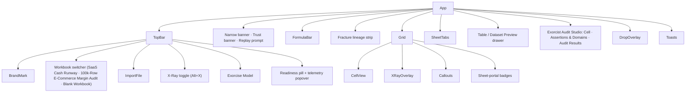
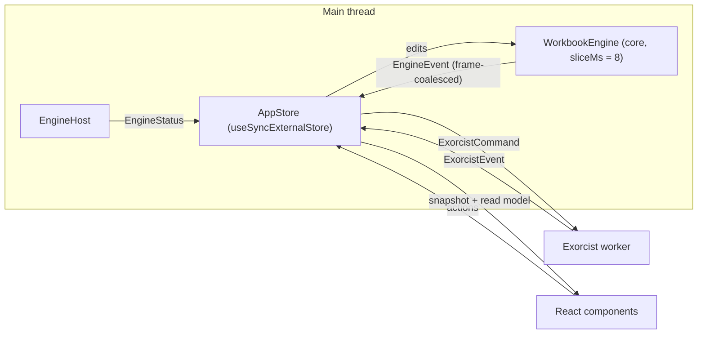
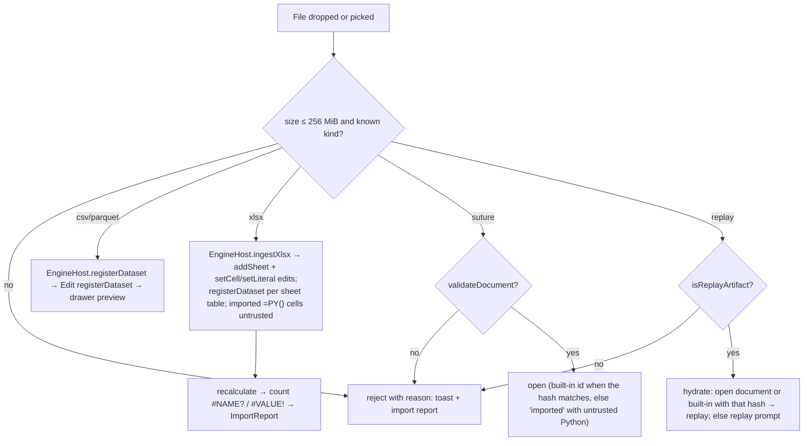

# Design: X-Ray UI & Flagship Workbooks

Implements `requirements.md` in this folder. All code is in `packages/web/src/` (Vite + React + Tailwind). Imported types are used unchanged:
- **Spec 01:** `CellKey`, `CellCoord`, `CellValue`, `CellError`, `EngineId`, `Edit`, `DatasetMeta`, `WorkbookDefinition`, `WorkbookEngine`, `EngineEvent`, `PyEngine`, `createWorkbookEngine`, `parseCellKey`, `toCellKey`.
- **Spec 02:** `EngineHost`, `EngineStatus`, `EngineState`, `EngineName`, `XlsxIngestResult`, `IsolationInfo`, `detectIsolation`, `SqlBridge`, `PyBridge`.
- **Spec 03:** `SutureDocument`, `ReplayArtifact`, `ReplayOutcome`, `LineagePath`, `LineageEdge`, `ExorcistVerdict`, `ExorcistProgress`, `ValueSummary`, `CellAssertion`, `FuzzInput`, `ExorcistConfig`, `Hasher`, `ExorcistCommand`, `ExorcistEvent`, `workbookHash`, `fromReplayFragment`, `isReplayArtifact`.

No new runtime dependencies. Virtualization, the overlay, and state management are implemented in-repo.

## 1. Component tree and data flow





- The main-thread `WorkbookEngine` runs with `sliceMs: 8` and a `yieldControl` that resolves on a fresh `MessageChannel` message (Spec 01 Req 10.7). Formula evaluation therefore never holds the main thread for longer than one slice plus one cell.
- The `PyBridge` from Spec 02 is wrapped by `gatedPyEngine` (§6.2). `SqlBridge` is used directly.
- The `AppStore` creates the Exorcist worker as a top-level worker (`architecture-and-isolation.md` §2: zero nested workers). For `start` and `replay` it passes ports from `EngineHost.connectClient` and buffers from `EngineHost.controlBuffer` (`interruptBuffer` for Pyodide, `duckdbCancelBuffer` for DuckDB).
- No new runtime dependencies: virtualization, the overlay, state, and the drop target are implemented in-repo. Fonts are the system stacks (no font downloads).

## 2. State (`app/store.ts`)

`AppStore` is an external store read with `useSyncExternalStore`. Its snapshot (`AppSnapshot`) holds UI state only. Cell values are not copied into it: components read them through the store's read model (`source`, `dialect`, `value`, `precedents`, `dependents`, `cellsOn`), and `valueVersion` bumps once per animation frame when engine commits arrive, so 100,000-row results never pass through React state.

| Field | Meaning |
|---|---|
| `workbook`, `title`, `sheets`, `activeSheet` | `'saas' \| 'ecommerce' \| 'blank' \| 'imported'`; sheet order from the definition |
| `selection`, `draft` | one active cell; a draft `{ key, text, where: 'cell' \| 'bar' }` (in-cell editor or formula bar) |
| `valueVersion`, `editVersion`, `structureVersion` | value commits (per frame), source edits, sheet/structure changes (column widths are recomputed only on the last) |
| `xray`, `focus` | X-Ray on/off; fracture focus `{ artifact, lineage, callouts }` (§5.4) |
| `exorcist`, `exorcistStale` | `idle \| running \| finished \| replaying \| replayed \| error`; stale marker (Req 7.5) |
| `applied` | the applied artifact plus the input cells' previous sources, for Reset Base Values |
| `config`, `configCheck` | the editable `ExorcistConfig`; `validateConfig` result with the execution mode, or the reason it cannot run |
| `assertions` | live status per assertion at current values (`holds now` / `fails now` / pending) |
| `datasets`, `imports`, `largeTables` | registered datasets with previews, import reports, `TableRef` cells with ≥ 1,000 rows (telemetry) |
| `drawer`, `panel`, `toasts` | preview drawer target, studio tab, notifications |
| `untrustedPy`, `replayPrompt` | count of blocked imported Python cells (§6.2); a replay waiting for its `.suture.json` |
| `usesSql`, `usesPy` | whether the document has SQL / Python cells (which engine ports the Exorcist needs) |

Actions are methods: `switchWorkbook`, `select`, `goTo` (name box), `beginEdit` / `updateDraft` / `commitDraft(move)` / `cancelDraft`, `clearCell`, `move`, `addSheet`, `toggleXRay`, `focusInXRay`, `importFiles`, `trustPython`, `updateConfig`, `runExorcist` / `stopExorcist` / `replay`, `applyCounterexample`, `resetBaseValues`, `copyReplayLink`, `downloadReplay`, `exportWorkbook`, `openDrawer`, `setPanel`, `retryEngine`.

- **Hashes:** the document hash is `workbookHash` over the engine's canonical definition (Spec 03 §5, `webHasher` on `crypto.subtle`). Built-in hashes are computed once, lazily.
- **Stale (Req 7.5):** a document change while a session runs is hashed (debounced 200 ms); a hash different from the session's marks the verdict stale. Edits after the verdict (Apply Counterexample, Reset Base Values) do not, because the artifact still names the workbook it came from.
- **Assertion status in the inspector (Req 3.5):** `violated` for the artifact's assertion; `held` for every assertion when the verdict is `passed`; otherwise `not reached`.
- **Deep link:** `?workbook=saas|ecommerce|blank` opens that built-in first (a Blank start keeps both engines Lazy). The default is SaaS Cash Runway.

## 3. Grid virtualization (`grid/viewport.ts`)

```ts
export const ROW_HEIGHT = 24;
export const DEFAULT_COL_WIDTH = 96;
export const HEADER_HEIGHT = 24;
export const ROW_HEADER_WIDTH = 56;
export const MAX_SCROLL_PX = 8_000_000;
export const OVERSCAN_ROWS = 4;
export const OVERSCAN_COLS = 2;

export interface ColumnLayout {
  readonly widths: Float64Array;      // per column, px
  readonly prefix: Float64Array;      // prefix[i] = sum(widths[0..i-1]); length cols + 1
}

export interface VisibleWindow {
  readonly top: number; readonly bottom: number;   // inclusive row indices
  readonly left: number; readonly right: number;   // inclusive col indices
  readonly offsetY: number;                         // px offset of row `top` inside the scroll content
}

export function rowScale(rows: number): number;  // max(1, rows * ROW_HEIGHT / MAX_SCROLL_PX)
export function visibleWindow(scrollTop: number, scrollLeft: number, viewportW: number, viewportH: number,
  rows: number, layout: ColumnLayout): VisibleWindow;
export function colAt(x: number, layout: ColumnLayout): number; // binary search over prefix
export function cellRect(c: CellCoord, win: VisibleWindow, layout: ColumnLayout): { readonly x: number; readonly y: number; readonly w: number; readonly h: number };
```

- Rows have a fixed height of 24 px. The scroll content height is `min(rows × 24, 8,000,000)`. A full 1,048,576-row sheet would be 25,165,824 px, above the height browsers accept, so the scroll range is mapped **linearly** onto the row range: `firstRowExact(scrollTop) = scrollTop / maxScroll × (rows − bodyHeight / 24)`, with `scrollTopForRow` as its inverse. Phase 4 changed this from `floor(scrollTop × scale / 24)`: that formula left the last ~60 rows unreachable at maximum scroll, while the linear map puts row 1,048,576 at the bottom edge (`test/viewport.test.ts`).
- Columns use variable widths with a prefix sum. The maximum, 16,384 × 96 = 1,572,864 px, needs no scaling. Widths are computed per sheet when it opens or its structure changes (`grid/columns.ts`: label columns fit their longest literal up to 340 px, SQL columns get room for the table badge), never while typing.
- **Layers:** the scroll container holds one spacer (the full content size) and one `position: sticky` viewport layer. Inside it, the column header, row header, and body layers are translated with `translate3d` on every scroll event. React re-renders only when the visible range leaves the rendered window (visible cells plus 4 rows / 2 columns of overscan), inside `flushSync` so transforms and cells never disagree for a frame.
- **Cells:** one memoized `CellView` per rendered coordinate, keyed by `CellKey`, with primitive props. Literal numbers right-align in tabular figures; non-literal cells carry an `FX` / `SQL` / `PY` chip in the engine color; `TableRef` cells render as an inspect button (`100,000 × 6 — inspect`) that opens the drawer; errors render as a crimson badge with the code, and the cell title carries the message, engine, and origin.
- Number display: grid cells use `formatGridNumber` (`app/format.ts`): thousand separators, at most 2 decimals when |n| ≥ 1, 4 significant digits when |n| < 1 (`Intl.NumberFormat('en-US')`), and the shared exponent form outside `[1e-6, 1e15)`. The cell tooltip, the inspector, X-Ray callouts, the lineage strip, and the Audit Studio keep `formatNumber`: up to 12 significant digits (`toPrecision(12)`, trailing zeros trimmed), shared with the CLI. Number cells carry `data-raw` (`String(n)`), which E2E tests read for exact values. Display formatting never changes stored values.
- Landing (Req 2.5): the web `WORKBOOKS` registry gives each built-in a `landing` cell (`Model!B5`, `Margins!B5`); `open()` activates its sheet and selects it. It is not part of `SutureDocument`, so hashes and replay artifacts are unchanged.
- Loading shell (Req 11.6): `index.html` holds an inline-styled shell inside `#root`, with literal hex values that mirror the steering tokens, because Tailwind tokens do not exist before the stylesheet loads. The hex check covers `src/**/*.tsx` only.
- **Keyboard (Req 1.3):** arrows, Tab / Shift+Tab, Enter / Shift+Enter, Page Up / Down, Home, Ctrl/Cmd+Home, Ctrl/Cmd+End, F2, Delete / Backspace; any printable key starts an in-cell edit with that character. Enter commits and moves down, Tab commits and moves right, Escape discards. Double-click edits in place, or in the formula bar for SQL and Python cells.
- **X-Ray hotkey:** Alt+X (Option+X) toggles X-Ray everywhere; a bare `X` toggles it only when focus is outside the grid and outside text inputs, so type-to-edit is never blocked.

## 4. Engine Readiness Pill (`chrome/ReadinessPill.tsx`)

```ts
export function engineLabel(s: EngineStatus): string;
```

| `EngineState` | Label | Extra |
|---|---|---|
| `notLoaded` | `Lazy` | `ui-craft-and-branding.md` §4: shown only before loading begins; never shown again once the engine has started loading |
| `loading` | `Loading` or `Loading 42%` | percentage only when `progress !== null && progress.totalBytes !== null` |
| `ready` | `Ready` | — |
| `degraded` | `Degraded (restart on timeout)` for both engines (not cross-origin isolated) | `EngineStatus.reason` holds the unprefixed reason ("timeouts restart the engine (page is not cross-origin isolated)"). The popover and accessible name prepend the engine name, giving the steering wording "DuckDB: timeouts restart the engine (page is not cross-origin isolated)". |
| `failed` | `Failed` | popover: reason, crash count, Retry → `EngineHost.retry` |

The rendered text uses the colon form `Grid: Ready | DuckDB: Lazy | Python/NumPy: Lazy` (`pillText`). The segment colors are `engine-formula` for Grid, `engine-sql` for DuckDB, and `engine-py` for Python/NumPy; a status dot per segment adds a second signal. The whole pill is a button whose accessible name lists every segment with its full reason (`pillAccessibleName`).

The popover (`data-testid="telemetry-popover"`) shows `crossOriginIsolated`, the SQL validator (`ast` / `lexical`), cold boot per engine, first eval (may include boot), warm DAG eval, engine versions, respawn counts, each engine's reason and crash count with Retry when `failed`, and the registered datasets plus `TableRef` cells with ≥ 1,000 rows. When `crossOriginIsolated` is false it explains, without detecting the browser, that SharedArrayBuffer is unavailable, so timeouts restart the engine, and that browsers without COEP `credentialless` support stay in this mode.

## 5. X-Ray overlay (`xray/`)

### 5.1 Geometry (`xray/geometry.ts`)

```ts
export interface Point { readonly x: number; readonly y: number }
export interface Rect { readonly x: number; readonly y: number; readonly w: number; readonly h: number }

export interface Bezier { readonly p0: Point; readonly p1: Point; readonly p2: Point; readonly p3: Point }

export function threadCurve(from: Rect, to: Rect): Bezier;
export function toPathD(b: Bezier): string;                    // "M x y C x y, x y, x y"
export function splitAt(b: Bezier, t: number): readonly [Bezier, Bezier]; // de Casteljau
export function brokenThread(b: Bezier, gapPx: number): readonly [string, string]; // halves with a gap at t = 0.5
```

- **Endpoints:** if `to` is right of `from`, the curve runs from `from`'s right-middle to `to`'s left-middle. If `to` is left of `from`, it runs from left-middle to right-middle. If they share a column, it runs right-middle to right-middle.
- **Control points:** offset horizontally by `o = clamp(|Δx| / 2, 40, 240)`, or `o = 60` when they share a column, so threads bow outward.
- **Range precedents** expand to one thread per precedent cell (the 1,500 cap bounds them).
- **Cross-sheet edges** draw a 12 px stub: entering the local cell's left edge for a precedent on another sheet, leaving its right edge for a dependent on another sheet (`stubPath`). The sheet is named by a portal badge (§5.2), not on the canvas.
- **Broken thread:** `splitAt(b, 0.5)`, then each half is trimmed by `gapPx / 2 = 3 px` of arc length around the split point (by binary search on `t`). Two 6 px perpendicular ticks mark the fracture.

### 5.2 Edge selection (`xray/edges.ts`)

```ts
export interface XRayThread { readonly id: string; readonly edge: LineageEdge; readonly engine: EngineId; readonly d: string;
  readonly broken: { readonly halves: readonly [string, string]; readonly ticks: readonly [string, string] } | null;
  readonly fractured: boolean; readonly touchesSelection: boolean; readonly flow: boolean }
export interface XRayStub { readonly id: string; readonly d: string; readonly anchor: Point; readonly engine: EngineId; readonly fractured: boolean; readonly direction: 'in' | 'out'; readonly sheet: string }
export interface XRayPortal { readonly sheet: string; readonly direction: 'in' | 'out'; readonly count: number; readonly engine: EngineId; readonly target: CellKey; readonly fractured: boolean }
export interface XRayFrame { readonly threads: ReadonlyArray<XRayThread>; readonly stubs: ReadonlyArray<XRayStub>;
  readonly portals: ReadonlyArray<XRayPortal>; readonly hidden: number; readonly involved: ReadonlySet<string> }

// Pure: graph access goes through functions, so the frame is unit-tested without an engine.
export function computeXRayFrame(input: { readonly sheet: string; readonly cells: ReadonlyArray<CellKey>;
  readonly precedents: (k: CellKey) => ReadonlyArray<CellKey>; readonly dependents: (k: CellKey) => ReadonlyArray<CellKey>;
  readonly engineOf: (k: CellKey) => EngineId; readonly window: VisibleWindow; readonly expanded: VisibleWindow;
  readonly layout: ColumnLayout; readonly selection: CellKey | null; readonly lineage: LineagePath | null }): XRayFrame;
```

1. Candidate edges come from `dependents()` / `precedents()` of the sheet's cells inside `expanded` (the window grown by one viewport on each side). Lineage edges with an endpoint in `expanded` are always included.
2. Edges with both endpoints on the active sheet become threads; edges with one endpoint elsewhere become stubs plus one aggregated **portal** per (remote sheet, direction) with an edge count, the dependent's engine, a jump target on the remote sheet, and `fractured` if any of its edges is on the lineage.
3. If more than 1,500 threads qualify, keep only those touching the selection plus the lineage edges, and set `hidden` to the number dropped (Req 5.4).
4. A thread is `fractured` if it is in `lineage.edges`, `broken` if it is `lineage.failingEdge`, and `flow` if it touches the selection (at most 64 flow threads).
5. **Dimming priority:** with a lineage, only its cells stay bright; otherwise, with a selection that has edges, the selection and its direct precedents and dependents; otherwise every connected cell. All other content cells render at 30% opacity.
6. The grid memoizes the frame on `(X-Ray on, sheet, window, layout, editVersion, selection, lineage)` (Req 5.8). The overlay sits in the body layer in window coordinates, so scrolling inside the rendered window only moves it; `data-frame-id` on the `<svg>` counts recomputations, and Journey 1 asserts it does not change on such a scroll.

### 5.3 Rendering (`xray/XRayOverlay.tsx`)

- There is one `<svg>` with `pointer-events: none`; ordinary threads and stubs sit in an `aria-hidden` group.
- Per thread, the `<path>` has `stroke` set to the engine token, a `stroke-dasharray` of `6 4` (SQL), `2 4` (Python), or none (Formula), a width of 1.25, an opacity of 0.55, and an arrowhead marker in the same token at the dependent end (direction is static, never animated). Threads touching the selection are drawn at width 2 and opacity 1.
- Flow threads (≤ 64) get a second path with `stroke-dasharray: 3 13` and the class `suture-flow` (animates `stroke-dashoffset`).
- Fractured paths use the `fracture` stroke at width 2.25 with the class `suture-pulse` (opacity), a crimson arrowhead, `pointer-events: stroke`, `role="button"`, `tabindex=0`, and an `aria-label` such as "Failing lineage from Params!B2 to Margins!B5, open counterexample". The broken thread is a `<g role="button">` with two halves and two ticks. Clicking one, or pressing Enter, opens the Audit Results tab on the counterexample (Req 5.7).
- CSS:
  ```css
  @keyframes suture-pulse { from { opacity: 1 } to { opacity: .35 } }
  .suture-pulse { animation: suture-pulse 1.2s ease-in-out infinite alternate }
  @keyframes suture-flow { to { stroke-dashoffset: -16 } }
  .suture-flow { animation: suture-flow 0.9s linear infinite }
  @media (prefers-reduced-motion: reduce) { .suture-pulse { animation: none; opacity: 1 } .suture-flow { animation: none; opacity: 0 } }
  ```
  Only `opacity` and `stroke-dashoffset` are animated, as the steering requires.
- **Portal badges** sit at the top-right edge of the grid frame (`◂ Inputs ·18`, `Model ▸ ·2`) in the engine color, or pulsing crimson when fractured. Clicking one switches to that sheet and selects the target cell. A hidden-count chip shows threads beyond the cap.

### 5.4 Fracture focus, callouts, and the lineage strip

- When a session reports `violated`, or a replay reproduces, the store enables X-Ray, switches to the violated cell's sheet, selects it, and sets `focus`. "Focus in X-Ray" does the same on demand.
- **Callout values:** one `evaluateScenarioBatch` on the main engine with the shrunk failing inputs as the only scenario and the lineage cells as targets. It does not change the workbook, so the pills appear before Apply Counterexample; a replay reuses the outcome's values. Pills render in the body layer, 70 px right of their cell (past the same-column bow): `IN 0.3` on failing inputs, `SQL → table 32×5` / `PY → …` / `FX → …` on intermediate cells, and `✗ <assertion id>: <observed>` on the violated cell.
- **Lineage strip:** above the grid, every lineage step in topological order with its engine chip and value, the failing edge drawn as `─╳→`, and the sheet name shown once per run of same-sheet steps. Each chip is a button that switches to its sheet and selects the cell.

## 6. Bring your own data (`import/`)

### 6.1 File routing (`import/routeFile.ts`)

```ts
export type ImportKind = 'csv' | 'parquet' | 'xlsx' | 'suture' | 'replay';
export const MAX_IMPORT_BYTES = 256 * 1024 * 1024;
export function importKind(fileName: string): ImportKind | null; // lowercase extension; ".suture.json" → 'suture', other ".json" → 'replay'
export function checkImport(fileName: string, size: number): { ok: true; kind: ImportKind } | { ok: false; reason: string };
```

Files arrive through the Import File button, the full-window drop overlay (`chrome/DropOverlay.tsx`), the replay prompt, or Import Replay JSON. All of them call `AppStore.importFiles`, and nothing is uploaded (Journeys 3 and 4 assert no non-GET requests).



- `validateDocument(v: unknown)` checks every field of `WorkbookDefinition` and `ExorcistConfig` and returns the first failing JSON path (`$.exorcist.assertions[0].kind is not one of the 9 assertion kinds`), which the rejection message names (Req 6.4). `isSutureDocument` is its boolean form.
- XLSX sheets keep their names, with ` (2)`, ` (3)`, … appended on collision; the first imported sheet becomes active. Formulas and error values arrive as `setCell`, values as lossless `setLiteral` (Spec 02 §8).
- Each sheet table is registered with `EngineHost.registerDataset({ name, bytes: table.ipc, sourceFormat: 'xlsx', encoding: 'arrow' })` (Spec 02 Req 5.3), and the returned `DatasetMeta` is applied as a `registerDataset` edit.
- **Export workbook** writes the current document (definition plus the edited `ExorcistConfig`) as `<title>.suture.json`; importing it reproduces the same hash.

### 6.2 Python trust gate (`gatedPy.ts`, in `@suture/runtime/bridge` since Phase 5)

```ts
export const PY_BLOCKED_MESSAGE = 'Python is blocked until you trust this workbook';
export function gatedPyEngine(inner: PyEngine, isBlocked: (cell: CellKey) => boolean): PyEngine;
```

- The gate is **per cell**. The store blocks every `=PY()` cell that arrived in an imported file (`.suture.json` that is not a built-in, or `.xlsx` sheets), so importing a spreadsheet into a flagship does not stop the flagship's own Python.
- A blocked request resolves immediately with `#PY!` and the exact message (origin = the cell, engine `py`). The inner engine is never called, so no Pyodide worker starts and no Pyodide bytes are fetched (Journey 4 checks the network).
- A **non-blocking trust banner** (it replaces the modal dialog) names the number of blocked cells and explains that Python runs locally in a worker that can make network requests from this page. Formulas and SQL keep running. "Trust and run Python" clears the set and recalculates everything.
- A cell the user edits becomes user-authored and leaves the set.
- Exorcise Model is disabled while any cell is blocked, because a session would execute that Python in its worker.

## 7. Flagship workbooks (`@suture/runtime/workbooks`, `packages/runtime/src/workbooks/` since Phase 5)

Both documents are TypeScript modules (`workbooks/saasRunway.ts`, `workbooks/ecommerceMargin.ts`) that build a `SutureDocument` with the helpers in `workbooks/build.ts`. Each module also exports `WorkbookNotes` (the flaw, the control edit, and the expected assertion id), which the estimation and control tests use. SQL and Python sources are exported constants, so tests and docs reference one copy. Built-in hashes are computed at runtime with `workbookHash` over the canonical definition. Replay links (Req 7.3) compare against those hashes, so no generated hash file can drift from the source.

Both flagships run in **batched** mode (Spec 03): each contains `=SQL()` and `=PY()` cells. Neither uses `monotonicWith`. The engine still implements and tests it (Spec 03).

### 7.1 SaaS Cash Runway & Unit Economics (batched)

The data flow is DuckDB cohort SQL → Pyodide NumPy OLS (`Model!B4`) → the unguarded formula `Model!B5 = cash / B4`.

Sheet `Inputs` (column A holds labels, which are literal strings):

| Cell | Label | Base value | Fuzz domain |
|---|---|---|---|
| B2 | Cash on hand | 6000000 | — |
| B3 | Starting MRR | 300000 | float [150000, 450000] |
| B4 | New customers / month | 30 | integer [5, 60] |
| B5 | ARPA (monthly) | 1500 | float [900, 2400] |
| B6 | Monthly logo churn | 0.025 | float [0.005, 0.08] |
| B7 | Blended CAC | 9000 | float [4000, 14000] |
| B8 | Gross margin | 0.78 | float [0.70, 0.85] |
| B9 | Opex excl. S&M (monthly) | 450000 | float [300000, 600000] |
| B10 | Churn shock × | 1 | float [0.25, 3] |

Sheet `Cohorts`:

| Cell | Engine | Content |
|---|---|---|
| A1 | DuckDB | `COHORT_BASE_SQL`: 12 monthly signup cohorts, `intake_factor = 0.85 + 0.30·suture_u01(m, 11)`. It has no inputs, so it is computed once and cached across every scenario. |
| A3 | DuckDB | `TRAJECTORY_SQL`: the 12-month operating trajectory. Legacy MRR decays with `churn = B6·B10`. Each cohort's survivors decay by the same churn. Opex grows 2% a month. Columns: `month, gross_profit, sm_spend, opex, net_burn`. Every `Inputs` value is a bound prepared-statement parameter (Spec 02 §5.2). |

Sheet `Model`:

| Cell | Label | Formula | Base value |
|---|---|---|---|
| B2 | Gross profit (month 0) | `=Inputs!B3*Inputs!B8` | 234000 |
| B3 | S&M spend (monthly) | `=Inputs!B4*Inputs!B7` | 270000 |
| B4 | Projected net burn (OLS, month 13) | `=PY(BURN_PY)`: `np.linalg.lstsq` of `net_burn` on `[1, month]`, evaluated at month 13 | 275710.02 (rounded) |
| B5 | Runway (months) | `=Inputs!B2/B4` | 21.76 (rounded) |
| B6 | Runway status | `=IF(B5<12,"RAISE NOW",IF(B5<18,"PLAN RAISE","OK"))` | OK |
| B7 | Net new MRR | `=Inputs!B4*Inputs!B5-Inputs!B3*Inputs!B6*Inputs!B10` | 37500 |
| B8 | LTV | `=Inputs!B5*Inputs!B8/(Inputs!B6*Inputs!B10)` | 46800 |
| B9 | LTV / CAC | `=B8/Inputs!B7` | 5.2 |
| B10 | CAC payback (months) | `=Inputs!B7/(Inputs!B5*Inputs!B8)` | 7.6923076923076925 |

Assertions, in document order:
1. `runway-non-negative`: `Model!B5` `gte` const 0.
2. `runway-defined`: `Model!B5` `notError`.
3. `runway-finite`: `Model!B5` `finite`.

The flaw: `Model!B5` divides cash by projected net burn without handling a company that turns profitable (projected net burn ≤ 0). With high MRR, margin, and ARPA, low churn, and low opex, the burn trend crosses zero. Runway then goes negative, or becomes `#DIV/0!` at exactly zero, and `B6` tells a profitable company to "RAISE NOW". At the base case, every assertion holds.

The expected violated assertion is `runway-non-negative`. It comes first in document order, and both a negative number and `#DIV/0!` fail `gte`.

- **Control (Req 10.4):** the corrected formula is the standard division guard `=IF(B4<=0,120,Inputs!B2/B4)`, which caps runway at 120 months ("10+ years") for companies that are not burning cash. `IF` short-circuits (Spec 01 Req 7.6), so the division never runs when `B4 ≤ 0`. The shipped `Model!B5` stays unguarded, so the Exorcist still has a real cliff to find.
- **Estimation:** the failing region is where the month-13 OLS projection of net burn is ≤ 0. Measured over 1,000 uniform samples: 10.4% fail with the flaw and 0% with the control.

### 7.2 100,000-Row E-Commerce Margin Audit (batched)

The sheets are `Params, Orders, Segments, Cohorts, Model, Margins`. The DAG has two layers:
- **Upstream of `Params` (computed once, cached across every scenario):** `Orders!A1` synthesizes the 100,000 orders, and `Segments!A1` collapses them into a 96-row tier table. Neither depends on any fuzzed input, so batched evaluation (Spec 01 §8) never re-runs them.
- **Downstream of `Params` (per scenario):** `Segments!A3` stress SQL over the 96 tiers, the NumPy pivot and model in `Model`, the `Cohorts` lookups, and the `Margins` KPIs.

No fuzz scenario re-scans the 100,000 rows.

Sheet `Params`:

| Cell | Label | Base value | Fuzz domain |
|---|---|---|---|
| B2 | Promo discount | 0.10 | float [0, 0.35] |
| B3 | Loyalty discount | 0.05 | float [0, 0.20] |
| B4 | Discount cap (policy) | 0.25 | float [0.15, 0.30] |
| B5 | Shipping cost per order | 3.5 | — |
| B6 | Unit cost shock × | 1 | float [0.95, 1.10] |

Sheet `Orders`, cell A1 (`ORDERS_SQL`, dataset synthesis; deterministic per Spec 02 §5.4):

```sql
=SQL("WITH base AS (
  SELECT i,
         1 + CAST(floor(suture_u01(i, 1) * 8) AS INTEGER) AS ci,
         round(exp(3.2 + 0.9 * suture_normal(i, 3)), 2) AS lp
  FROM range(100000) t(i)
)
SELECT i AS order_id,
       list_extract(['Electronics','Home','Apparel','Beauty','Sports','Toys','Grocery','Books'], ci) AS category,
       CASE WHEN suture_u01(i, 2) < 0.55 THEN 'NA' WHEN suture_u01(i, 2) < 0.85 THEN 'EU' ELSE 'APAC' END AS region,
       lp AS list_price,
       round(lp * least(0.70, greatest(0.20,
             list_extract([0.58, 0.48, 0.38, 0.42, 0.50, 0.45, 0.60, 0.55], ci) + 0.03 * suture_normal(i, 5))), 2) AS unit_cost,
       1 + CAST(floor(suture_u01(i, 6) * 4) AS INTEGER) AS quantity,
       list_extract([0.0, 0.05, 0.10], 1 + CAST(floor(suture_u01(i, 7) * 3) AS INTEGER)) AS base_discount,
       suture_u01(i, 8) < 0.30 AS has_promo,
       suture_u01(i, 9) < 0.25 AS is_loyal,
       DATE '2026-01-01' + CAST(floor(suture_u01(i, 10) * 365) AS INTEGER) AS order_date
FROM base
ORDER BY i")
```

Sheet `Segments`:

| Cell | Engine | Content |
|---|---|---|
| A1 | DuckDB | `TIERS_SQL`: `GROUP BY category, base_discount, has_promo, is_loyal` over `{{Orders!A1}}`, giving 8 × 3 × 2 × 2 = 96 rows with `orders, units, gross = Σ quantity·list_price, cost = Σ quantity·unit_cost`. It does not depend on `Params`, so it is computed once. |
| A3 | DuckDB | `STRESS_SQL` (the flaw, below): per tier, `d = least(base_discount, cap) + [promo] least(promo, cap) + [loyal] least(loyal, cap)`. Grouped by category and cohort (`stacked`, `promo`, `loyal`, `none`): `revenue = Σ gross·(1−d)`, `margin = Σ gross·(1−d) − cost·shock − orders·ship`, `stacked_discount = Σ gross·d / Σ gross`. |

The discount `d` is constant inside a tier. So `Σ q·p·(1−d) − Σ q·c·shock − n·ship` over a tier equals the per-order scan exactly, up to float summation order. Each scenario reads 96 rows, not 100,000.

Sheet `Model`:

| Cell | Content |
|---|---|
| B2 | `=PY(PIVOT_PY)`: an 8 × 2 `Matrix2D` of stacked-cohort margin and revenue per category, in the order Electronics, Home, Sports, Toys, Apparel, Beauty, Grocery, Books. |
| B3 | `=PY(MODEL_PY)`: revenue-weighted `np.linalg.lstsq` of margin % on stacked discount plus category effects over the `Segments!A3` rows. Returns a 1 × 2 `Matrix2D`: the projected Electronics margin % at the maximum stacked discount `0.10 + 2·cap`, and the number of cohort anomalies with \|z\| > 2. |

Sheet `Cohorts` (rows 2–9, one per category, in the `Model!B2` order):

| Column | Content |
|---|---|
| A | category literal |
| B | segment literal: `Hardlines` (Electronics, Home, Sports, Toys), `Softlines` (Apparel, Beauty), `Consumables` (Grocery, Books) |
| C | `=INDEX(Model!B2, r, 1)` stacked margin |
| D | `=INDEX(Model!B2, r, 2)` stacked revenue |
| E | `=C/D` stacked margin % |

Sheet `Margins`:

| Cell | Label | Formula |
|---|---|---|
| B2 | Total margin | `=SQL("SELECT sum(margin) FROM {{Segments!A3}}")` |
| B3 | Stacked-cohort margin | `=SUM(Cohorts!C2:C9)` |
| B4 | Hardlines stacked margin | `=SUMIFS(Cohorts!C2:C9,Cohorts!B2:B9,"Hardlines")` |
| B5 | Hardlines stacked net margin % | `=B4/SUMIFS(Cohorts!D2:D9,Cohorts!B2:B9,"Hardlines")` (base value 0.3235, rounded) |
| B6 | Average stacked margin % (Softlines) | `=AVERAGEIF(Cohorts!B2:B9,"Softlines",Cohorts!E2:E9)` |
| B7 | Hardlines margin floor (policy) | `=VLOOKUP("Hardlines",D11:E13,2,FALSE)` over the literal policy table in `D10:E13` (Hardlines 0.05, Softlines 0.12, Consumables 0.03) |
| B8 | Discount policy status | `=IF(B5<B7,"BREACH","OK")` |
| B9 | Model: projected Electronics margin % at max stack | `=INDEX(Model!B3,1,1)` |
| B10 | Model: cohort anomalies (\|z\| > 2) | `=INDEX(Model!B3,1,2)` |

Assertions, in document order:
1. `hardlines-stacked-net-margin`: `Margins!B5` `gte` const 0.
2. `total-margin-not-null`: `Margins!B2` `notNull`.
3. `model-projection-finite`: `Margins!B9` `finite`.

The flaw: the policy says the stacked discount per order must not exceed the cap. `STRESS_SQL` caps each discount separately, so a promo-plus-loyal order can receive up to `0.10 + least(promo, cap) + least(loyalty, cap)`, which is 0.10 + 0.30 + 0.20 = 0.60 at the domain maximum. At the base case, the stacked discount is at most 0.25 and the Hardlines stacked net margin is 0.3235. With high promo and loyalty, a cap near its maximum, and a cost shock above 1, the Hardlines stacked cohort goes negative.

The expected violated assertion is `hardlines-stacked-net-margin`.

- **Control (Req 10.4):** `Segments!A3` with `d` replaced by `least(base_discount + CASE WHEN has_promo THEN {{Params!B2}} ELSE 0 END + CASE WHEN is_loyal THEN {{Params!B3}} ELSE 0 END, {{Params!B4}})` (`STRESS_SQL_FIXED`).
- **Estimation:** measured over 1,000 uniform samples: 7.4% fail with the flaw and 0% with the control.

### 7.3 Performance

Both flagships use `batchSize: 100` and `maxBatches: 10`. Flagship 1 uses `maxShrinkRounds: 32` and flagship 2 uses `maxShrinkRounds: 12`. Decimal simplification (Spec 03) finishes the shrink. The longer double-shrink tail adds seconds without making the counterexample clearer.

Per scenario, flagship 1 runs one trajectory query over a 12-row cohort table and one 12-point least-squares fit. Flagship 2 runs one stress query over the 96 tiers, two small NumPy calls, and one total-margin query. The 100,000-row synthesis and the tier aggregation run once per workbook load.

Targets: flagship 1 discovers its flaw from a fresh seed in at most 3 s in the browser. Flagship 2 does so in 5–10 s.

Measured on the Phase 3 build with value-uniform float domains (Spec 03 §4.1, commit dc77fb6) and flagship 2 at `maxShrinkRounds: 12`. Times cover search, shrink, and decimal simplification from fresh random seeds. Browser times are the app's own Run → verdict measurement:

| Flagship | Node, real engines | Browser (Playwright, Chromium) | Index of the first failing run |
|---|---|---|---|
| 1 | 1.9–3.0 s (7 seeds) | 2.5–3.6 s (8 runs: 3 local, 5 on GitHub Actions; 3 above the 3 s target, at 3.1, 3.4, and 3.6 s) | 0–5 (Node) |
| 2 | 2.3–4.8 s (7 seeds) | 2.5–3.6 s (10 runs: 6 local, 4 on GitHub Actions) | 0–79 |

History for flagship 2:
- With `fc.double` domains, the first failing run came at index 17–737 over 8 seeds. That is about 0.36% of runs, so about 3% of seeds would have found nothing in 1,000 runs. Node discovery took 3.4–18.3 s.
- With value-uniform domains and 24 shrink rounds, search finished inside the first batch, but every run used all 24 rounds. Node discovery took 3.9–11.6 s over 7 seeds and the browser took 4.0–10.7 s over 6 seeds.
- At 12 rounds, the shrunk counterexamples are still simplified to short values (for example `Params!B2=0.2, B3=0.2, B4=0.2, B6=1.1`), and every replay is exact.

## 8. Tests for flagship discovery

The flagship tests run against **real engines**, never mocks:
- **Node:** `packages/runtime/test/flagships.test.ts` uses the host-agnostic handlers (Spec 02 §1.1) through `@suture/runtime/node`, with DuckDB's Node build and Pyodide with NumPy. The CLI tests (`packages/cli/test/cli.test.ts`) run the same discovery through the compiled `suture` binary.
- **Browser:** `packages/web/e2e/flagships.spec.ts` runs both flagships in Chromium. For each one it checks that the base case holds, discovers the flaw from a fresh seed, uses Apply Counterexample to trip the assertion, and replays the artifact exactly. Journeys 1 and 2 (§13) repeat discovery through the full UI.

```mermaid
sequenceDiagram
  participant T as Test (Node or Playwright)
  participant S as Exorcist session (Node) or page + Exorcist worker (browser)
  T->>T: seed = crypto.getRandomValues(Int32Array(1))[0]; log seed
  T->>S: open flagship (built-in), start Exorcist with seed
  S-->>T: verdict
  T->>T: expect verdict.kind === 'violated'
  T->>T: expect assertion id === WorkbookNotes.expectedAssertion
  T->>S: replay the artifact (Node: decoded fragment; browser: replay link)
  T->>T: expect outcome.kind === 'reproduced' && exact === true
```

Rules (Req 10.2):
- The test source contains no input values, no counterexamples, and no fixed discovery seeds.
- It asserts only verdict kinds, assertion ids, and replay outcomes. Seeds, shrunk inputs, and timings are logged for the audit trail.

The estimation and control tests are deterministic and run in Node against real engines. They use `fc.sample(arb, { seed: 1, numRuns: 1000 })` for both flagships. The arbitraries are uniform over values: `fc.noBias(fc.integer({ min: 0, max: 2^32 − 1 }))` mapped onto the float domain. `fc.double` is uniform over float bit patterns, which piles mass near 0 on small domains. Scenarios are evaluated with `evaluateScenarioBatch` in chunks of 100. Each test then:
- asserts that the failing fraction under the shipped formulas is at least 1%;
- applies the corrected formula (`WorkbookNotes.control`) as an `Edit` to a fresh engine, and asserts zero violations of the expected assertion over the same samples.

## 9. Trademark check (`packages/web/test/trademark.test.ts`, `test/fixtures/trademark.ts`)

- The banned-term list is stored only as SHA-256 hex digests of lowercase terms (`test/fixtures/banned-term-digests.json`: single words and adjacent word pairs). The terms themselves never appear in the repository, as the steering requires.
- The scanner splits text into lowercase words (also at camelCase boundaries) and adjacent word pairs, hashes each one, and reports matches by file, line, and column, never by term.
- `trademark.test.ts` proves detection with a made-up word whose digest is added in memory, written to a temporary file that the test deletes, then scans every tracked text file under `packages/`, `.kiro/`, `.github/`, `README.md`, and `vercel.json`.
- Journey 5 runs the same scanner over the rendered DOM: visible text, the document title, and every `title`, `aria-label`, and `placeholder`, for all three workbooks.

## 10. Failure modes

| Failure | Behavior |
|---|---|
| Engine `failed` | pill shows `Failed`; the popover shows the reason, crash count, and Retry; dependent cells show `#SQL!` / `#PY!` from the port |
| Page not cross-origin isolated | both engines `Degraded (restart on timeout)`; the popover explains why, based only on `crossOriginIsolated` |
| Import too large or unsupported | rejected with the reason in a toast and an import report; workbook unchanged |
| Malformed `.suture.json` | rejected with the first failing JSON path |
| Malformed replay link | Audit Results shows the decode error |
| Replay for an unknown workbook | replay prompt asks for its `.suture.json`; opening a document with that hash replays it |
| Untrusted Python | blocked cells show `#PY!` with the exact message; trust banner; Exorcise Model disabled; no Pyodide download |
| Exorcise with no domain or assertion | Audit Results names what is missing (`configCheck`) instead of starting |
| Over 1,500 threads | partial X-Ray with a hidden-count chip |
| Session stale | verdict labelled stale; replay still possible against the artifact's hash |
| Replay too long for a link | Copy Replay Link downloads the replay JSON instead (> 8,192 characters, `MAX_FRAGMENT_CHARS`) |

## 11. Telemetry

The readiness popover never reports WASM cold boot as DAG latency. It shows these values separately:

| Field | Source | Meaning |
|---|---|---|
| cold boot DuckDB | `EngineHost.telemetry().duckdbInitMs` | worker start → engine ready (WASM download, compile, init) |
| cold boot Pyodide | `EngineHost.telemetry().pyodideInitMs` | worker start → Python + NumPy ready |
| first eval | `AppStore` | first recalculation of the open workbook, including any engine boot it triggered (0 ms for an empty workbook) |
| warm DAG eval | `AppStore` | latest recalculation in which no engine booted or respawned |

`AppStore.recalc` records the engine boot count before and after each recalculation. A recalculation that booted or respawned an engine never updates `warm DAG eval`. Opening another workbook resets both eval fields. Journey 3 measured cold boots of about 1.0 s (DuckDB) and 2.8 s (Pyodide) and a 20 ms warm DAG eval for a DuckDB query over a 2,000-row CSV.

## 12. Exorcist Audit Studio (`app/RightPanel.tsx`, `exorcist/`)

The right panel has three tabs: **Cell** (the inspector, Req 3), **Assertions & Domains**, and **Audit Results**. Exorcise Model and fracture clicks switch to Audit Results.

- **Assertions & Domains** (`exorcist/AssertionsTab.tsx`):
  - fuzz domains: float or integer `[min, max]` on literal input cells ("+ Domain on B5" defaults to ±50% of the current value); choice and boolean domains from imported documents are shown read-only;
  - Tier 2 assertions: all 9 kinds (`gte`, `lte`, `gt`, `lt`, `between`, `notError`, `finite`, `notNull`, `monotonicWith`), constant or cell operands, monotonic input and direction, a unique id;
  - fields commit on Enter or blur only when valid; invalid fields stay red with a hint;
  - a live `holds now / fails now` chip per assertion and the `validateConfig` result with its execution mode.
- **Audit Results** (`exorcist/AuditTab.tsx`): status line; execution mode (`In-Process fast-check` or `Batched WASM`), seed, runs, scenarios evaluated, shrink rounds, and elapsed ms (live while running; the confirm phase never zeroes the counters); Tier 1 invariant status (all five); Tier 2 status per assertion (`violated` / `held` / `not reached`); and the verdict card with the violated assertion, violated cell, observed value, shrunk failing inputs, seed, and path.
- **Action bar:** Apply Counterexample (lossless `setLiteral`, live recompute, crimson X-Ray), Reset Base Values (restores the overwritten input sources, including literals), Focus in X-Ray, Copy Replay Link (clipboard with a toast; for a workbook that is not built in, the toast says to share the exported `.suture.json`; above 8,192 characters it downloads the replay JSON instead), Download Replay JSON, Export workbook (.suture.json), and Import Replay JSON.

## 13. Phase 4 end-to-end journeys (`e2e/journeys.spec.ts`)

All journeys run on the production build behind COOP `same-origin` / COEP `credentialless`, fail on any console error, and register a `longtask` observer. Steering §3 scopes the 50 ms rule to scrolling, typing, and X-Ray rendering, so `withinFrameBudget` asserts it inside those windows (not during engine boot or the first document load).

| Journey | Covers |
|---|---|
| 1 | Flagship 1: X-Ray toggle and scroll within budget, dash patterns and arrowheads, frame reuse on scroll (Req 5.8), Exorcise Model, Tier 1 and Tier 2 status, auto-focus with callouts before Apply, Apply Counterexample, Reset Base Values, opacity pulse and reduced motion, Enter on a fractured thread, Copy Replay Link reproduced exactly in a fresh page |
| 2 | Flagship 2: Orders `100,000 × 10` badge and drawer (exactly 100 decoded rows), Segments `96 × 8`, Alt+X within budget, discovery, cross-sheet lineage strip, fractured portals, lineage-step and portal jumps, SQL dash pattern |
| 3 | Blank workbook: `Lazy → Loading → Ready` for both engines (never back to Lazy), drag-and-drop CSV, typing within budget, a bare `x` in the grid does not toggle X-Ray, `=SQL()` with a cell parameter and `=PY()` over its table, warm DAG eval, every Req 1.3 key, fling to row 1,048,576 within budget, Exorcise without a domain |
| 4 | Real `.xlsx` with formulas (`#NAME?` for a function outside the 30), imported Python blocked with no Pyodide request, trust, a custom fuzz domain and `lte` assertion edited in the studio, in-process Exorcist, Apply trips the custom assertion, no uploads |
| 5 | 390×844: no horizontal overflow for all three workbooks, Exorcise Model in the viewport and runnable, zero banned names in the DOM (§9) |

Two more tests in `e2e/journeys.spec.ts` complete the suite (Phase 5, 16 tests, none skipped):
- **Req 1.5:** editing the input of 20,000 formulas runs with no main-thread task over 50 ms. It relies on the Spec 01 incremental graph and sliced preamble, plus the store's edit-scoped re-index. The same test jumps through a defined name in the name box.
- **Req 4.1:** the app page served without COOP/COEP shows `Degraded (restart on timeout)` for each engine once it loads, with the reason in the accessible name and the `crossOriginIsolated` note in the popover.

The Phase 2 slice spec was retired with the slice workbook; Journey 3 carries its readiness, warm-eval, and live-query coverage.

## 14. Caching, narrow viewports, and layout

- **No service worker.** Hashed `/assets/*` files are served with `Cache-Control: public, max-age=31536000, immutable` (`vercel.json`); `index.html` keeps `max-age=0, must-revalidate`, so a deploy never strands old chunks; COOP/COEP headers are unchanged. The engine WASM comes from jsDelivr, which already serves it with a one-year `max-age` (DuckDB also `immutable`). A service worker would add offline use, at the cost of precaching about 40 MB of cross-origin engine files, re-serving every navigation with exact COOP/COEP headers, and the risk of a stale worker serving an `index.html` that points at deleted chunks.
- **Narrow viewports (< 768 px):** the layout stacks into one column, the studio becomes a collapsible bottom sheet, the top bar wraps with Exorcise Model visible, a banner says desktop is optimal, and only the grid scrolls sideways (`html, body { overflow: hidden }`).
- **Bundle:** the main chunk is 668.1 kB raw / 194.3 kB gzip (budget 350 KB; Phase 5 added 1.4 kB gzip for the incremental scheduler in core). exceljs/jszip, DuckDB-WASM, and Pyodide appear only in their worker chunks.
