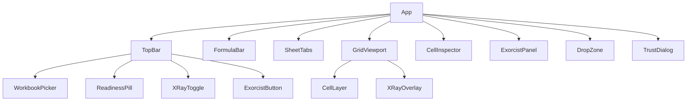
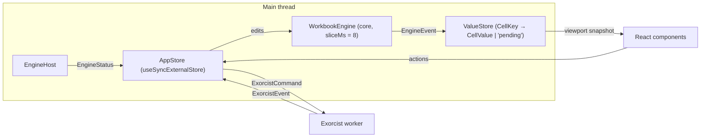
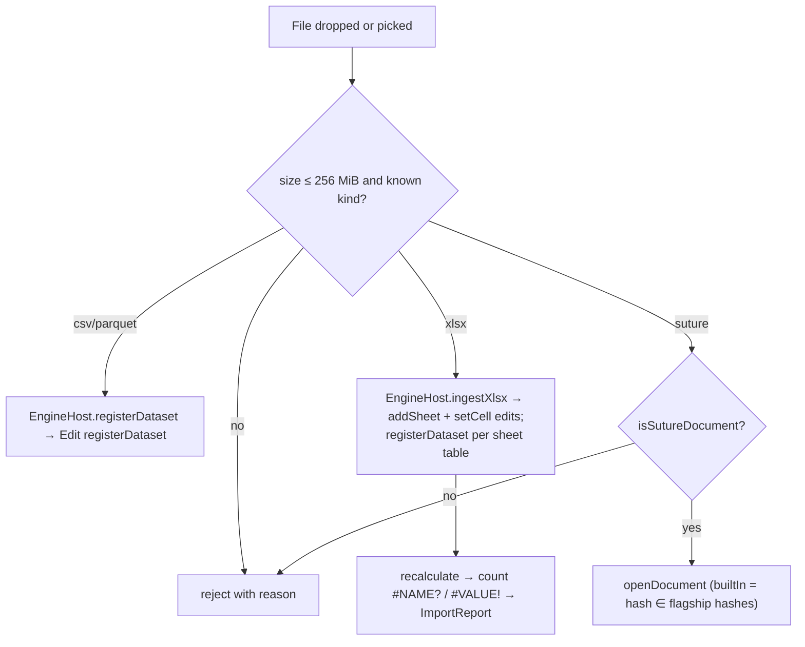

# Design: X-Ray UI & Flagship Workbooks

Implements `requirements.md` in this folder. All code is in `packages/web/src/` (Vite + React + Tailwind). Imported types are used unchanged:
- **Spec 01:** `CellKey`, `CellCoord`, `CellValue`, `CellError`, `EngineId`, `Edit`, `DatasetMeta`, `WorkbookDefinition`, `WorkbookEngine`, `EngineEvent`, `PyEngine`, `createWorkbookEngine`, `parseCellKey`, `toCellKey`.
- **Spec 02:** `EngineHost`, `EngineStatus`, `EngineState`, `EngineName`, `XlsxIngestResult`, `IsolationInfo`, `detectIsolation`, `SqlBridge`, `PyBridge`.
- **Spec 03:** `SutureDocument`, `ReplayArtifact`, `ReplayOutcome`, `LineagePath`, `LineageEdge`, `ExorcistVerdict`, `ExorcistProgress`, `ValueSummary`, `CellAssertion`, `FuzzInput`, `ExorcistConfig`, `Hasher`, `ExorcistCommand`, `ExorcistEvent`, `workbookHash`, `fromReplayFragment`, `isReplayArtifact`.

No new runtime dependencies. Virtualization, the overlay, and state management are implemented in-repo.

## 1. Component tree and data flow





- The main-thread `WorkbookEngine` runs with `sliceMs: 8` and a `yieldControl` that resolves on a fresh `MessageChannel` message (Spec 01 Req 10.7). Formula evaluation therefore never holds the main thread for longer than one slice plus one cell.
- `SqlBridge` and `PyBridge` from Spec 02 are wrapped by `GatedPyEngine` (§6.2).

## 2. State (`state/appStore.ts`)

```ts
export interface Selection { readonly anchor: CellKey; readonly focus: CellKey }

export type ExorcistUiState =
  | { readonly kind: 'idle' }
  | { readonly kind: 'running'; readonly sessionId: number; readonly seed: number; readonly startedHash: string; readonly progress: ExorcistProgress | null }
  | { readonly kind: 'finished'; readonly sessionId: number; readonly seed: number; readonly verdict: ExorcistVerdict; readonly fragment: string | null; readonly stale: boolean }
  | { readonly kind: 'replaying'; readonly artifact: ReplayArtifact }
  | { readonly kind: 'replayed'; readonly artifact: ReplayArtifact; readonly outcome: ReplayOutcome };

export type ImportJob =
  | { readonly id: number; readonly file: string; readonly kind: 'csv' | 'parquet' | 'xlsx' | 'suture'; readonly state: 'running' }
  | { readonly id: number; readonly file: string; readonly kind: 'csv' | 'parquet' | 'xlsx' | 'suture'; readonly state: 'done'; readonly report: ImportReport }
  | { readonly id: number; readonly file: string; readonly kind: 'csv' | 'parquet' | 'xlsx' | 'suture'; readonly state: 'failed'; readonly reason: string };

export interface ImportReport {
  readonly sheetsAdded: ReadonlyArray<string>;
  readonly datasetsAdded: ReadonlyArray<DatasetMeta>;
  readonly nameErrors: number;   // cells evaluating to #NAME?
  readonly valueErrors: number;  // cells evaluating to #VALUE!
  readonly warnings: ReadonlyArray<string>;
}

export interface AppState {
  readonly document: SutureDocument;
  readonly documentHash: string;
  readonly builtIn: boolean;              // document hash matches a shipped flagship
  readonly trustedPython: boolean;        // true for built-ins; otherwise set by the user
  readonly activeSheet: string;
  readonly selection: Selection;
  readonly draft: { readonly key: CellKey; readonly text: string } | null;
  readonly engines: Readonly<Record<EngineName, EngineStatus>>;
  readonly gridReady: boolean;
  readonly xray: { readonly enabled: boolean; readonly lineage: LineagePath | null };
  readonly exorcist: ExorcistUiState;
  readonly imports: ReadonlyArray<ImportJob>;
}

export type Action =
  | { readonly kind: 'select'; readonly selection: Selection }
  | { readonly kind: 'editDraft'; readonly key: CellKey; readonly text: string }
  | { readonly kind: 'commitDraft' }
  | { readonly kind: 'cancelDraft' }
  | { readonly kind: 'applyEdits'; readonly edits: ReadonlyArray<Edit> }
  | { readonly kind: 'openDocument'; readonly document: SutureDocument; readonly builtIn: boolean }
  | { readonly kind: 'trustPython' }
  | { readonly kind: 'toggleXRay' }
  | { readonly kind: 'startExorcist' }
  | { readonly kind: 'stopExorcist' }
  | { readonly kind: 'replay'; readonly artifact: ReplayArtifact }
  | { readonly kind: 'importFile'; readonly file: File };
```

`documentHash` is recomputed with `workbookHash(document, webHasher)` (Spec 03 §5; `webHasher` implements `Hasher` with `crypto.subtle`) after every edit, debounced to 200 ms. Assertion status in the inspector (Req 3.5) is derived from the latest `finished` state: `violated` for the artifact's assertion; `held` for every assertion when the verdict is `passed`; otherwise `not reached`. While a session is `running`, a hash different from `startedHash` marks it stale (Req 7.5).

## 3. Grid virtualization (`grid/viewport.ts`)

```ts
export const ROW_HEIGHT = 24;
export const DEFAULT_COL_WIDTH = 96;
export const HEADER_HEIGHT = 24;
export const ROW_HEADER_WIDTH = 56;
export const MAX_SCROLL_PX = 8_000_000;
export const OVERSCAN_ROWS = 4;
export const OVERSCAN_COLS = 2;

export interface ColumnLayout {
  readonly widths: Float64Array;      // per column, px
  readonly prefix: Float64Array;      // prefix[i] = sum(widths[0..i-1]); length cols + 1
}

export interface VisibleWindow {
  readonly top: number; readonly bottom: number;   // inclusive row indices
  readonly left: number; readonly right: number;   // inclusive col indices
  readonly offsetY: number;                         // px offset of row `top` inside the scroll content
}

export function rowScale(rows: number): number;  // max(1, rows * ROW_HEIGHT / MAX_SCROLL_PX)
export function visibleWindow(scrollTop: number, scrollLeft: number, viewportW: number, viewportH: number,
  rows: number, layout: ColumnLayout): VisibleWindow;
export function colAt(x: number, layout: ColumnLayout): number; // binary search over prefix
export function cellRect(c: CellCoord, win: VisibleWindow, layout: ColumnLayout): { readonly x: number; readonly y: number; readonly w: number; readonly h: number };
```

- Rows have a fixed height of 24 px. The scroll content height is `min(rows × 24, 8,000,000)`. With `scale = rowScale(rows)`, `top = floor(scrollTop × scale / 24)`, and the cell layer is translated so that row `top` sits at the right pixel. A full 1,048,576-row sheet would be 25,165,824 px, which is above the height limits browsers accept, so the scale is needed.
- Columns use variable widths with a prefix sum. The maximum, 16,384 × 96 = 1,572,864 px, needs no scaling.
- The cell layer is a single absolutely positioned container. React renders one memoized `<Cell>` per visible coordinate, keyed by `CellKey`. Values come from one `ValueStore` snapshot for the visible window, taken per animation frame, not from a subscription per cell.
- Number display: up to 12 significant digits (`toPrecision(12)` with trailing zeros trimmed), and exponent notation outside `[1e-6, 1e15)`. Display formatting never changes stored values.

## 4. Engine Readiness Pill (`chrome/ReadinessPill.tsx`)

```ts
export function engineLabel(s: EngineStatus): string;
```

| `EngineState` | Label | Extra |
|---|---|---|
| `notLoaded` | `Lazy` | — |
| `loading` | `Loading` or `Loading 42%` | percentage only when `progress !== null && progress.totalBytes !== null` |
| `ready` | `Ready` | — |
| `degraded` | `Degraded (single-threaded)` for DuckDB, `Degraded (restart on timeout)` for Python/NumPy | full `reason` in the popover and the accessible name |
| `failed` | `Failed` | popover: reason, crash count, Retry → `EngineHost.retry` |

The rendered text has the form `Grid Ready | DuckDB Lazy | Python/NumPy Lazy`. The segment colors are `ink` for Grid, `engine-sql` for DuckDB, and `engine-py` for Python/NumPy.

## 5. X-Ray overlay (`xray/`)

### 5.1 Geometry (`xray/geometry.ts`)

```ts
export interface Point { readonly x: number; readonly y: number }
export interface Rect { readonly x: number; readonly y: number; readonly w: number; readonly h: number }

export interface Bezier { readonly p0: Point; readonly p1: Point; readonly p2: Point; readonly p3: Point }

export function threadCurve(from: Rect, to: Rect): Bezier;
export function toPathD(b: Bezier): string;                    // "M x y C x y, x y, x y"
export function splitAt(b: Bezier, t: number): readonly [Bezier, Bezier]; // de Casteljau
export function brokenThread(b: Bezier, gapPx: number): readonly [string, string]; // halves with a gap at t = 0.5
```

- **Endpoints:** if `to` is right of `from`, the curve runs from `from`'s right-middle to `to`'s left-middle. If `to` is left of `from`, it runs from left-middle to right-middle. If they share a column, it runs right-middle to right-middle.
- **Control points:** offset horizontally by `o = clamp(|Δx| / 2, 40, 240)`, or `o = 60` when they share a column, so threads bow outward.
- **Range precedents** start at the range's bounding box.
- **Cross-sheet precedents** start at a 12 px stub on the top edge of the viewport, labeled with the sheet name.
- **Broken thread:** `splitAt(b, 0.5)`, then each half is trimmed by `gapPx / 2 = 3 px` of arc length around the split point (by binary search on `t`). Two 6 px perpendicular ticks mark the fracture.

### 5.2 Edge selection (`xray/edges.ts`)

```ts
export interface XRayThread {
  readonly edge: LineageEdge;          // Spec 03 type, used for every edge (not only lineage)
  readonly engine: EngineId;           // engine of edge.to
  readonly d: string | readonly [string, string]; // tuple when broken
  readonly fractured: boolean;
  readonly broken: boolean;
}

export interface XRayFrame {
  readonly threads: ReadonlyArray<XRayThread>;
  readonly hidden: number;             // threads beyond the 1,500 cap
}

export function computeXRayFrame(input: {
  readonly engine: WorkbookEngine;
  readonly window: VisibleWindow;
  readonly expanded: VisibleWindow;    // window grown by one viewport on each side
  readonly layout: ColumnLayout;
  readonly selection: CellKey;
  readonly lineage: LineagePath | null;
}): XRayFrame;
```

1. Candidate edges come from `dependents()` / `precedents()` of the cells in `expanded`. Lineage edges follow the same window rule (steering: threads only for cells in or near the viewport), and they are exempt from the cap.
2. If more than 1,500 qualify, keep only the edges touching `selection` plus the lineage edges, and set `hidden` to the number dropped.
3. An edge is `fractured` if it is in `lineage.edges`, and `broken` if it equals `lineage.failingEdge`.
4. `computeXRayFrame` is memoized on `(window, layout version, WorkbookEngine.graphVersion(), lineage identity)` (Req 5.8). The overlay lives inside the scroll content, so scrolling within the current window moves it natively, with no recomputation.

### 5.3 Rendering (`xray/XRayOverlay.tsx`)

- There is one `<svg>` with `pointer-events: none` and `aria-hidden="true"`.
- Per thread, the `<path>` has `stroke` set to the engine token, a `stroke-dasharray` of `6 4` (SQL), `2 4` (Python), or none (Formula), a width of 1.25, and an opacity of 0.55. Threads touching the selection are drawn at width 2 and opacity 1.
- Fractured paths use the `fracture` stroke at width 2 with the class `suture-pulse`, and set `pointer-events: stroke`, `role="button"`, `tabindex=0`, and an `aria-label` such as "Failing lineage from Params!B2 to Summary!B7, open counterexample". Clicking one, or pressing Enter, dispatches the open-counterexample action (Req 5.7).
- CSS:
  ```css
  @keyframes suture-pulse { from { opacity: 1 } to { opacity: .35 } }
  .suture-pulse { animation: suture-pulse 1.2s ease-in-out infinite alternate }
  @media (prefers-reduced-motion: reduce) { .suture-pulse { animation: none; opacity: 1 } }
  ```
  Only `opacity` is animated, as the steering requires.

## 6. Bring your own data (`import/`)

### 6.1 File routing (`import/routeFile.ts`)

```ts
export type ImportKind = 'csv' | 'parquet' | 'xlsx' | 'suture';
export const MAX_IMPORT_BYTES = 256 * 1024 * 1024;
export function importKind(fileName: string): ImportKind | null; // by lowercase extension; ".suture.json" → 'suture'
export function sanitizeDatasetName(fileName: string, existing: ReadonlyArray<string>): string; // Spec 02 Req 5.4
```



- `isSutureDocument(v: unknown): v is SutureDocument` validates every field, including `WorkbookDefinition` and `ExorcistConfig` (`import/validateDocument.ts`).
- XLSX sheets keep their names, with ` (2)`, ` (3)`, … appended on collision. Cells are added with `setCell` edits in one `applyEdits` call.
- Each sheet table is registered with `EngineHost.registerDataset({ name, bytes: table.ipc, sourceFormat: 'xlsx', encoding: 'arrow' })` (Spec 02 Req 5.3), and the returned `DatasetMeta` is applied as a `registerDataset` edit.

### 6.2 Python trust gate (`engines/gatedPy.ts`)

```ts
export function gatedPyEngine(inner: PyEngine, isTrusted: () => boolean): PyEngine;
```

- While `isTrusted()` is false, both methods resolve immediately with `#PY!` and the message "Python is blocked until you trust this workbook" (origin = the cell, engine `py`). No worker is started.
- `TrustDialog` explains that the workbook's Python runs locally in a worker that can make network requests from this page.
- `trustPython` sets the flag, and the store calls `recalculateAll`.

## 7. Flagship workbooks (`workbooks/`)

Both documents are static JSON files (`saas-runway.suture.json`, `ecommerce-margin.suture.json`), validated by `isSutureDocument` in a unit test. Their `workbookHash` values are computed at build time into `workbooks/flagshipHashes.ts`, which replay links use (Req 7.3).

### 7.1 SaaS Cash Runway & Unit Economics (in-process)

Sheet `Inputs` (column A holds labels, which are literal strings):

| Cell | Label | Base value | Fuzz domain |
|---|---|---|---|
| B2 | Cash on hand | 6000000 | — |
| B3 | Starting MRR | 300000 | float [150000, 450000] |
| B4 | New customers / month | 30 | integer [5, 60] |
| B5 | ARPA (monthly) | 1500 | float [900, 2400] |
| B6 | Monthly logo churn | 0.025 | float [0.005, 0.08] |
| B7 | Blended CAC | 9000 | float [4000, 14000] |
| B8 | Gross margin | 0.78 | float [0.70, 0.85] |
| B9 | Opex excl. S&M (monthly) | 210000 | float [150000, 260000] |

Sheet `Model`:

| Cell | Label | Formula | Base value |
|---|---|---|---|
| B2 | Gross profit | `=Inputs!B3*Inputs!B8` | 234000 |
| B3 | S&M spend | `=Inputs!B4*Inputs!B7` | 270000 |
| B4 | Net burn | `=Inputs!B9+B3-B2` | 246000 |
| B5 | Runway (months) | `=Inputs!B2/B4` | 24.390243902439025 |
| B6 | Runway status | `=IF(B5<12,"RAISE NOW",IF(B5<18,"PLAN RAISE","OK"))` | OK |
| B7 | Net new MRR | `=Inputs!B4*Inputs!B5-Inputs!B3*Inputs!B6` | 37500 |
| B8 | LTV | `=Inputs!B5*Inputs!B8/Inputs!B6` | 46800 |
| B9 | LTV / CAC | `=B8/Inputs!B7` | 5.2 |
| B10 | CAC payback (months) | `=Inputs!B7/(Inputs!B5*Inputs!B8)` | 7.6923076923076925 |

Assertions, in document order:
1. `runway-non-negative`: `Model!B5` `gte` const 0.
2. `runway-defined`: `Model!B5` `notError`.
3. `payback-finite`: `Model!B10` `finite`.
4. `net-new-mrr-grows-with-logos`: `Model!B7` `monotonicWith(Inputs!B4, nonDecreasing)`.

The flaw: `Model!B5` divides cash by net burn without handling a company that is profitable (net burn ≤ 0). When gross profit exceeds opex plus S&M, runway goes negative, or becomes `#DIV/0!` at exactly zero, and `B6` tells a profitable company to "RAISE NOW". At the base case, net burn is 246,000 and every assertion holds.

The expected violated assertion is `runway-non-negative`. It comes first in document order, and both a negative number and `#DIV/0!` fail `gte`.

- **Control (Req 10.4):** the corrected formula is `=Inputs!B2/MAX(B4,Inputs!B2/120)`, which caps runway at 120 months ("10+ years") for companies that are not burning cash. The obvious guard `=IF(B4<=0,120,Inputs!B2/B4)` does **not** work in Suture: `IF` evaluates both branches eagerly (Spec 01 Req 7.2), so at `B4 = 0` the `#DIV/0!` from the unused branch still propagates. That is exactly the strictness the steering requires.
- **Estimation:** the failing region is `Inputs!B3·Inputs!B8 ≥ Inputs!B9 + Inputs!B4·Inputs!B7`, at the corner of high MRR and margin with low opex, logos, and CAC. Req 10.3 requires it to cover at least 1% of the domain.

### 7.2 100,000-Row E-Commerce Margin Audit (batched)

Sheet `Params`:

| Cell | Label | Base value | Fuzz domain |
|---|---|---|---|
| B2 | Promo discount | 0.10 | float [0, 0.35] |
| B3 | Loyalty discount | 0.05 | float [0, 0.20] |
| B4 | Discount cap (policy) | 0.25 | float [0.15, 0.30] |
| B5 | Shipping cost per order | 3.5 | — |

Sheet `Data`, cell A1 (dataset synthesis; deterministic per Spec 02 §5.4):

```sql
=SQL("WITH base AS (
  SELECT i,
         1 + CAST(floor(suture_u01(i, 1) * 8) AS INTEGER) AS ci,
         round(exp(3.2 + 0.9 * suture_normal(i, 3)), 2) AS lp
  FROM range(100000) t(i)
)
SELECT i AS order_id,
       list_extract(['Electronics','Home','Apparel','Beauty','Sports','Toys','Grocery','Books'], ci) AS category,
       CASE WHEN suture_u01(i, 2) < 0.55 THEN 'NA' WHEN suture_u01(i, 2) < 0.85 THEN 'EU' ELSE 'APAC' END AS region,
       lp AS list_price,
       round(lp * least(0.70, greatest(0.20,
             list_extract([0.58, 0.48, 0.38, 0.42, 0.50, 0.45, 0.60, 0.55], ci) + 0.03 * suture_normal(i, 5))), 2) AS unit_cost,
       1 + CAST(floor(suture_u01(i, 6) * 4) AS INTEGER) AS quantity,
       list_extract([0.0, 0.05, 0.10], 1 + CAST(floor(suture_u01(i, 7) * 3) AS INTEGER)) AS base_discount,
       suture_u01(i, 8) < 0.30 AS has_promo,
       suture_u01(i, 9) < 0.25 AS is_loyal,
       DATE '2026-01-01' + CAST(floor(suture_u01(i, 10) * 365) AS INTEGER) AS order_date
FROM base
ORDER BY i")
```

Sheet `Calc`, cell A1 (segment margins with the flawed discount logic):

```sql
=SQL("SELECT category,
       CASE WHEN has_promo AND is_loyal THEN 'stacked' WHEN has_promo THEN 'promo'
            WHEN is_loyal THEN 'loyal' ELSE 'none' END AS cohort,
       sum(quantity * list_price * (1 - d)) AS revenue,
       sum(quantity * list_price * (1 - d) - quantity * unit_cost - {{Params!B5}}) AS margin
FROM (
  SELECT *,
         least(base_discount, {{Params!B4}})
       + CASE WHEN has_promo THEN least({{Params!B2}}, {{Params!B4}}) ELSE 0 END
       + CASE WHEN is_loyal  THEN least({{Params!B3}}, {{Params!B4}}) ELSE 0 END AS d
  FROM {{Data!A1}}
)
GROUP BY ALL
ORDER BY category, cohort")
```

Sheet `Cohorts` (rows 2–9, one per category, ordered Electronics, Home, Sports, Toys, Apparel, Beauty, Grocery, Books):

| Column | Content |
|---|---|
| A | category literal |
| B | segment literal: `Hardlines` (Electronics, Home, Sports, Toys), `Softlines` (Apparel, Beauty), `Consumables` (Grocery, Books) |
| C | `=SQL("SELECT coalesce(sum(margin), 0) FROM {{Calc!A1}} WHERE category = {{A2}} AND cohort = 'stacked'")` (row-adjusted) |
| D | `=SQL("SELECT coalesce(sum(revenue), 0) FROM {{Calc!A1}} WHERE category = {{A2}} AND cohort = 'stacked'")` (row-adjusted) |

Sheet `Model`, cell B2 (NumPy OLS and anomaly detection; scalar-loop batch mode):

```python
=PY("d = inputs['Data!A1']
promo, loyal, cap, ship = inputs['Params!B2'], inputs['Params!B3'], inputs['Params!B4'], inputs['Params!B5']
lp, uc = d['list_price'], d['unit_cost']
q = d['quantity'].astype(np.float64)
disc = (np.minimum(d['base_discount'], cap)
        + np.where(d['has_promo'], min(promo, cap), 0.0)
        + np.where(d['is_loyal'], min(loyal, cap), 0.0))
pct = (q * lp * (1.0 - disc) - q * uc - ship) / (q * lp)
cats = np.array(d['category'])
names = np.unique(cats)
X = np.column_stack([np.ones_like(disc), disc] + [(cats == c).astype(np.float64) for c in names[1:]])
beta = np.linalg.lstsq(X, pct, rcond=None)[0]
resid = pct - X @ beta
z = (resid - resid.mean()) / resid.std()
x = np.zeros(X.shape[1]); x[0] = 1.0
x[1] = min(0.10, cap) + min(promo, cap) + min(loyal, cap)
k = int(np.searchsorted(names, 'Electronics'))
if k > 0: x[1 + k] = 1.0
np.array([[float(x @ beta), float(np.count_nonzero(np.abs(z) > 4.0))]])")
```

This code reproduces the workbook's flawed discount logic, so the model and the SQL agree. Its result is a 1×2 `Matrix2D`: the projected Electronics margin % at the maximum stacked discount, and the number of orders with |z| > 4.

Sheet `Summary`:

| Cell | Label | Formula |
|---|---|---|
| B2 | Total margin | `=SQL("SELECT sum(margin) FROM {{Calc!A1}}")` |
| B3 | Total revenue | `=SQL("SELECT sum(revenue) FROM {{Calc!A1}}")` |
| B4 | Margin % | `=B2/B3` |
| B5 | Stacked-cohort margin | `=SUM(Cohorts!C2:C9)` |
| B6 | Hardlines stacked margin | `=SUMIFS(Cohorts!C2:C9,Cohorts!B2:B9,"Hardlines")` |
| B7 | Hardlines stacked margin % | `=B6/SUMIFS(Cohorts!D2:D9,Cohorts!B2:B9,"Hardlines")` |
| B8 | Discount policy status | `=IF(B7<0,"BREACH","OK")` |
| B9 | Model: projected Electronics margin % at max stack | `=INDEX(Model!B2,1,1)` |
| B10 | Model: residual anomalies (abs z > 4) | `=INDEX(Model!B2,1,2)` |

Assertions, in document order:
1. `hardlines-stacked-margin-non-negative`: `Summary!B7` `gte` const 0.
2. `total-margin-non-negative`: `Summary!B4` `gte` const 0.
3. `more-promo-never-raises-margin`: `Summary!B2` `monotonicWith(Params!B2, nonIncreasing)`.
4. `model-projection-finite`: `Summary!B9` `finite`.

The flaw: the policy says the stacked discount per order must not exceed the cap. The workbook caps each discount separately, so a promo-plus-loyal order can receive up to `0.10 + cap + 0.20`, which is 0.60 at the domain maximum.

At the base case, the stacked discount is at most 0.25 and the Hardlines stacked margin is clearly positive (about 0.3 by the design estimate: (1 − 0.20 − 0.50 − 0.04) / 0.80). With high promo and loyalty and a cap above about 0.21, Hardlines' stacked cohort (average cost ratio about 0.50, shipping about 4% of list) goes negative.

`total-margin-non-negative` cannot fail inside the domain:
- The promo-only cohort's worst discount is 0.40, which leaves (0.60 − 0.495 − 0.04) / 0.60 > 0.
- The stacked cohort is 7.5% of orders.

So the expected violated assertion is `hardlines-stacked-margin-non-negative`. The estimation and control tests check both claims.

- **Monotonicity holds exactly:** a higher `Params!B2` gives a weakly larger `least(promo, cap)`, and IEEE rounding is monotone. DuckDB sums with `threads = 1` in a fixed order, so `Summary!B2` is non-increasing bit for bit.
- **Control (Req 10.4):** `Calc!A1` with `d` replaced by `least(base_discount + CASE WHEN has_promo THEN {{Params!B2}} ELSE 0 END + CASE WHEN is_loyal THEN {{Params!B3}} ELSE 0 END, {{Params!B4}})`.
- **Cross-engine probes (Spec 03 §4.3):** these run on every numeric column of `Data!A1` bound into `Model!B2` (`order_id`, `list_price`, `unit_cost`, `quantity`, `base_discount`). All values are non-negative, so summation error is about 1e-13 relative, far inside 1e-9.

### 7.3 Performance expectations for flagship 2

These numbers are targets for measurement, not budgets: each batch makes 1 + 2 + 16 + 1 = 20 engine cell calls (`Calc!A1`, `Summary!B2`, `Summary!B3`, `Cohorts!C2:D9`, `Model!B2`) plus up to 2 probe calls. Flagship 2 has one `monotonicWith` assertion, so each 200-run batch evaluates up to 400 scenarios. The heaviest calls are `Calc!A1` (up to 400 group-bys over 100k rows) and `Model!B2` (up to 400 least-squares fits on 100k × 9). The Exorcist panel shows measured progress, and the CI test (§8) records duration.

## 8. CI tests for flagship discovery (`packages/web/test/flagships.spec.ts`)

```mermaid
sequenceDiagram
  participant T as Playwright test
  participant P as Page
  participant X as Exorcist worker
  T->>T: seed = crypto.getRandomValues(Int32Array(1))[0]; log seed
  T->>P: open flagship (built-in), start Exorcist with seed
  P->>X: start
  X-->>P: verdict
  T->>P: read verdict
  T->>T: expect verdict.kind === 'violated'
  T->>T: expect assertion id === expected id (§7.1 / §7.2)
  T->>P: open replay fragment from verdict
  T->>T: expect outcome.kind === 'reproduced' && exact === true
```

Rules (Req 10.2):
- The test source contains no input values, no counterexamples, and no fixed seeds.
- It asserts only verdict kinds, assertion ids, and replay outcomes.

The estimation and control tests are deterministic. They use `fc.sample(arb, { seed: 1, numRuns: N })` with **unbiased** arbitraries (`fc.noBias`), with N = 20,000 runs for flagship 1 (in-process, Node) and N = 2,000 runs for flagship 2 (batched, Playwright). Each test then:
- asserts that the failing fraction under the shipped formulas is at least 1%;
- applies the corrected formula as an `Edit` to a copy of the document, and asserts zero violations of the expected assertion over the same samples.

## 9. Trademark check (`packages/web/test/trademark.spec.ts`)

- The banned-term list is stored only as SHA-256 hex digests of lowercase terms (`test/fixtures/banned-term-digests.json`). The terms themselves never appear in the repository, as the steering requires.
- The test tokenizes every tracked text file under `packages/` and `.kiro/` into lowercase words and adjacent word pairs, hashes each one, and fails on any digest match. It reports the file and line, not the term.

## 10. Failure modes

| Failure | Behavior |
|---|---|
| Engine `failed` | pill shows `Failed` with Retry; dependent cells show `#SQL!` / `#PY!` from the port |
| Import too large or unsupported | rejected with reason; workbook unchanged |
| Malformed `.suture.json` | rejected with the first validation error path |
| Malformed or unknown replay link | Exorcist panel shows the decode error, or asks for the matching document |
| Untrusted Python | `#PY!` "blocked" until trusted; no Pyodide download |
| Over 1,500 threads | partial X-Ray with a hidden-count chip |
| Session stale | verdict labelled stale; replay still possible against the snapshot hash |
