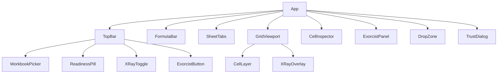
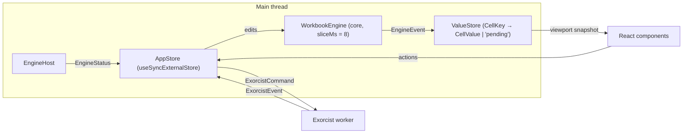
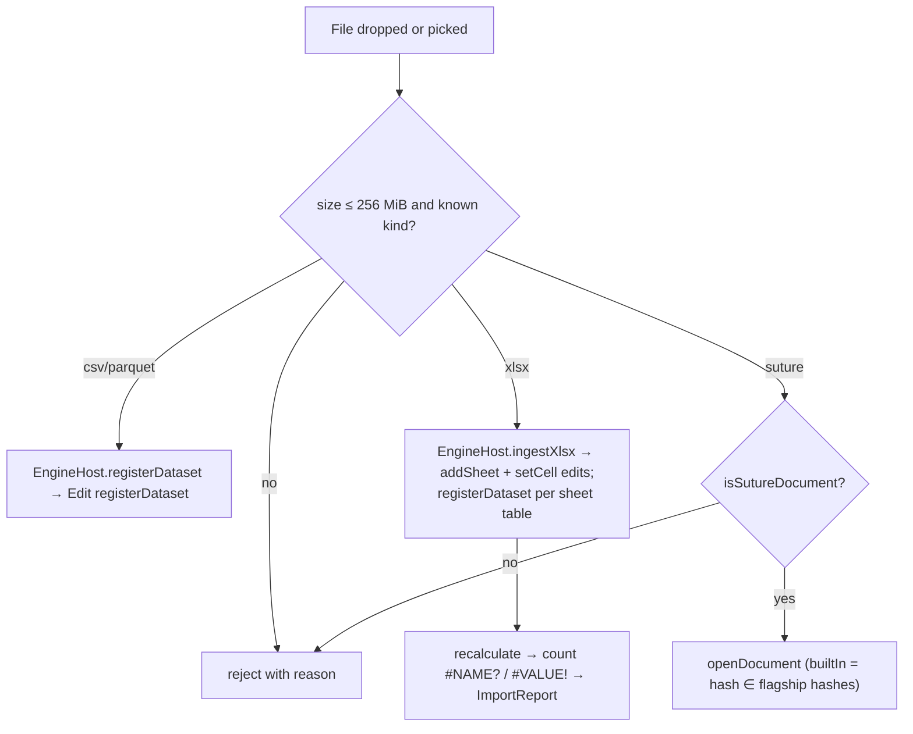

# Design: X-Ray UI & Flagship Workbooks

Implements `requirements.md` in this folder. All code is in `packages/web/src/` (Vite + React + Tailwind). Imported types are used unchanged:
- **Spec 01:** `CellKey`, `CellCoord`, `CellValue`, `CellError`, `EngineId`, `Edit`, `DatasetMeta`, `WorkbookDefinition`, `WorkbookEngine`, `EngineEvent`, `PyEngine`, `createWorkbookEngine`, `parseCellKey`, `toCellKey`.
- **Spec 02:** `EngineHost`, `EngineStatus`, `EngineState`, `EngineName`, `XlsxIngestResult`, `IsolationInfo`, `detectIsolation`, `SqlBridge`, `PyBridge`.
- **Spec 03:** `SutureDocument`, `ReplayArtifact`, `ReplayOutcome`, `LineagePath`, `LineageEdge`, `ExorcistVerdict`, `ExorcistProgress`, `ValueSummary`, `CellAssertion`, `FuzzInput`, `ExorcistConfig`, `Hasher`, `ExorcistCommand`, `ExorcistEvent`, `workbookHash`, `fromReplayFragment`, `isReplayArtifact`.

No new runtime dependencies. Virtualization, the overlay, and state management are implemented in-repo.

## 1. Component tree and data flow





- The main-thread `WorkbookEngine` runs with `sliceMs: 8` and a `yieldControl` that resolves on a fresh `MessageChannel` message (Spec 01 Req 10.7). Formula evaluation therefore never holds the main thread for longer than one slice plus one cell.
- `SqlBridge` and `PyBridge` from Spec 02 are wrapped by `GatedPyEngine` (§6.2).
- The `AppStore` creates the Exorcist worker as a top-level worker (`architecture-and-isolation.md` §2: zero nested workers). For `start` and `replay` it passes ports from `EngineHost.connectClient` and buffers from `EngineHost.controlBuffer` (`interruptBuffer` for Pyodide, `duckdbCancelBuffer` for DuckDB).

## 2. State (`state/appStore.ts`)

```ts
export interface Selection { readonly anchor: CellKey; readonly focus: CellKey }

export type ExorcistUiState =
  | { readonly kind: 'idle' }
  | { readonly kind: 'running'; readonly sessionId: number; readonly seed: number; readonly startedHash: string; readonly progress: ExorcistProgress | null }
  | { readonly kind: 'finished'; readonly sessionId: number; readonly seed: number; readonly verdict: ExorcistVerdict; readonly fragment: string | null; readonly stale: boolean }
  | { readonly kind: 'replaying'; readonly artifact: ReplayArtifact }
  | { readonly kind: 'replayed'; readonly artifact: ReplayArtifact; readonly outcome: ReplayOutcome };

export type ImportJob =
  | { readonly id: number; readonly file: string; readonly kind: 'csv' | 'parquet' | 'xlsx' | 'suture'; readonly state: 'running' }
  | { readonly id: number; readonly file: string; readonly kind: 'csv' | 'parquet' | 'xlsx' | 'suture'; readonly state: 'done'; readonly report: ImportReport }
  | { readonly id: number; readonly file: string; readonly kind: 'csv' | 'parquet' | 'xlsx' | 'suture'; readonly state: 'failed'; readonly reason: string };

export interface ImportReport {
  readonly sheetsAdded: ReadonlyArray<string>;
  readonly datasetsAdded: ReadonlyArray<DatasetMeta>;
  readonly nameErrors: number;   // cells evaluating to #NAME?
  readonly valueErrors: number;  // cells evaluating to #VALUE!
  readonly warnings: ReadonlyArray<string>;
}

export interface AppState {
  readonly document: SutureDocument;
  readonly documentHash: string;
  readonly builtIn: boolean;              // document hash matches a shipped flagship
  readonly trustedPython: boolean;        // true for built-ins; otherwise set by the user
  readonly activeSheet: string;
  readonly selection: Selection;
  readonly draft: { readonly key: CellKey; readonly text: string } | null;
  readonly engines: Readonly<Record<EngineName, EngineStatus>>;
  readonly gridReady: boolean;
  readonly xray: { readonly enabled: boolean; readonly lineage: LineagePath | null };
  readonly exorcist: ExorcistUiState;
  readonly imports: ReadonlyArray<ImportJob>;
}

export type Action =
  | { readonly kind: 'select'; readonly selection: Selection }
  | { readonly kind: 'editDraft'; readonly key: CellKey; readonly text: string }
  | { readonly kind: 'commitDraft' }
  | { readonly kind: 'cancelDraft' }
  | { readonly kind: 'applyEdits'; readonly edits: ReadonlyArray<Edit> }
  | { readonly kind: 'openDocument'; readonly document: SutureDocument; readonly builtIn: boolean }
  | { readonly kind: 'trustPython' }
  | { readonly kind: 'toggleXRay' }
  | { readonly kind: 'startExorcist' }
  | { readonly kind: 'stopExorcist' }
  | { readonly kind: 'replay'; readonly artifact: ReplayArtifact }
  | { readonly kind: 'importFile'; readonly file: File }
  | { readonly kind: 'applyCounterexample'; readonly artifact: ReplayArtifact }; // applies artifact.failingInputs as setLiteral edits, then recalculates
```

`documentHash` is recomputed with `workbookHash(document, webHasher)` (Spec 03 §5; `webHasher` implements `Hasher` with `crypto.subtle`) after every edit, debounced to 200 ms. Assertion status in the inspector (Req 3.5) is derived from the latest `finished` state: `violated` for the artifact's assertion; `held` for every assertion when the verdict is `passed`; otherwise `not reached`. While a session is `running`, a hash different from `startedHash` marks it stale (Req 7.5).

## 3. Grid virtualization (`grid/viewport.ts`)

```ts
export const ROW_HEIGHT = 24;
export const DEFAULT_COL_WIDTH = 96;
export const HEADER_HEIGHT = 24;
export const ROW_HEADER_WIDTH = 56;
export const MAX_SCROLL_PX = 8_000_000;
export const OVERSCAN_ROWS = 4;
export const OVERSCAN_COLS = 2;

export interface ColumnLayout {
  readonly widths: Float64Array;      // per column, px
  readonly prefix: Float64Array;      // prefix[i] = sum(widths[0..i-1]); length cols + 1
}

export interface VisibleWindow {
  readonly top: number; readonly bottom: number;   // inclusive row indices
  readonly left: number; readonly right: number;   // inclusive col indices
  readonly offsetY: number;                         // px offset of row `top` inside the scroll content
}

export function rowScale(rows: number): number;  // max(1, rows * ROW_HEIGHT / MAX_SCROLL_PX)
export function visibleWindow(scrollTop: number, scrollLeft: number, viewportW: number, viewportH: number,
  rows: number, layout: ColumnLayout): VisibleWindow;
export function colAt(x: number, layout: ColumnLayout): number; // binary search over prefix
export function cellRect(c: CellCoord, win: VisibleWindow, layout: ColumnLayout): { readonly x: number; readonly y: number; readonly w: number; readonly h: number };
```

- Rows have a fixed height of 24 px. The scroll content height is `min(rows × 24, 8,000,000)`. With `scale = rowScale(rows)`, `top = floor(scrollTop × scale / 24)`, and the cell layer is translated so that row `top` sits at the right pixel. A full 1,048,576-row sheet would be 25,165,824 px, which is above the height limits browsers accept, so the scale is needed.
- Columns use variable widths with a prefix sum. The maximum, 16,384 × 96 = 1,572,864 px, needs no scaling.
- The cell layer is a single absolutely positioned container. React renders one memoized `<Cell>` per visible coordinate, keyed by `CellKey`. Values come from one `ValueStore` snapshot for the visible window, taken per animation frame, not from a subscription per cell.
- Number display: up to 12 significant digits (`toPrecision(12)` with trailing zeros trimmed), and exponent notation outside `[1e-6, 1e15)`. Display formatting never changes stored values.

## 4. Engine Readiness Pill (`chrome/ReadinessPill.tsx`)

```ts
export function engineLabel(s: EngineStatus): string;
```

| `EngineState` | Label | Extra |
|---|---|---|
| `notLoaded` | `Lazy` | `ui-craft-and-branding.md` §4: shown only before loading begins; never shown again once the engine has started loading |
| `loading` | `Loading` or `Loading 42%` | percentage only when `progress !== null && progress.totalBytes !== null` |
| `ready` | `Ready` | — |
| `degraded` | `Degraded (restart on timeout)` for both engines (not cross-origin isolated) | `EngineStatus.reason` holds the unprefixed reason ("timeouts restart the engine (page is not cross-origin isolated)"). The popover and accessible name prepend the engine name, giving the steering wording "DuckDB: timeouts restart the engine (page is not cross-origin isolated)". |
| `failed` | `Failed` | popover: reason, crash count, Retry → `EngineHost.retry` |

The rendered text has the form `Grid Ready | DuckDB Lazy | Python/NumPy Lazy`. The segment colors are `ink` for Grid, `engine-sql` for DuckDB, and `engine-py` for Python/NumPy.

## 5. X-Ray overlay (`xray/`)

### 5.1 Geometry (`xray/geometry.ts`)

```ts
export interface Point { readonly x: number; readonly y: number }
export interface Rect { readonly x: number; readonly y: number; readonly w: number; readonly h: number }

export interface Bezier { readonly p0: Point; readonly p1: Point; readonly p2: Point; readonly p3: Point }

export function threadCurve(from: Rect, to: Rect): Bezier;
export function toPathD(b: Bezier): string;                    // "M x y C x y, x y, x y"
export function splitAt(b: Bezier, t: number): readonly [Bezier, Bezier]; // de Casteljau
export function brokenThread(b: Bezier, gapPx: number): readonly [string, string]; // halves with a gap at t = 0.5
```

- **Endpoints:** if `to` is right of `from`, the curve runs from `from`'s right-middle to `to`'s left-middle. If `to` is left of `from`, it runs from left-middle to right-middle. If they share a column, it runs right-middle to right-middle.
- **Control points:** offset horizontally by `o = clamp(|Δx| / 2, 40, 240)`, or `o = 60` when they share a column, so threads bow outward.
- **Range precedents** start at the range's bounding box.
- **Cross-sheet precedents** start at a 12 px stub on the top edge of the viewport, labeled with the sheet name.
- **Broken thread:** `splitAt(b, 0.5)`, then each half is trimmed by `gapPx / 2 = 3 px` of arc length around the split point (by binary search on `t`). Two 6 px perpendicular ticks mark the fracture.

### 5.2 Edge selection (`xray/edges.ts`)

```ts
export interface XRayThread {
  readonly edge: LineageEdge;          // Spec 03 type, used for every edge (not only lineage)
  readonly engine: EngineId;           // engine of edge.to
  readonly d: string | readonly [string, string]; // tuple when broken
  readonly fractured: boolean;
  readonly broken: boolean;
}

export interface XRayFrame {
  readonly threads: ReadonlyArray<XRayThread>;
  readonly hidden: number;             // threads beyond the 1,500 cap
}

export function computeXRayFrame(input: {
  readonly engine: WorkbookEngine;
  readonly window: VisibleWindow;
  readonly expanded: VisibleWindow;    // window grown by one viewport on each side
  readonly layout: ColumnLayout;
  readonly selection: CellKey;
  readonly lineage: LineagePath | null;
}): XRayFrame;
```

1. Candidate edges come from `dependents()` / `precedents()` of the cells in `expanded`. Lineage edges follow the same window rule (steering: threads only for cells in or near the viewport), and they are exempt from the cap.
2. If more than 1,500 qualify, keep only the edges touching `selection` plus the lineage edges, and set `hidden` to the number dropped.
3. An edge is `fractured` if it is in `lineage.edges`, and `broken` if it equals `lineage.failingEdge`.
4. `computeXRayFrame` is memoized on `(window, layout version, WorkbookEngine.graphVersion(), lineage identity)` (Req 5.8). The overlay lives inside the scroll content, so scrolling within the current window moves it natively, with no recomputation.

### 5.3 Rendering (`xray/XRayOverlay.tsx`)

- There is one `<svg>` with `pointer-events: none` and `aria-hidden="true"`.
- Per thread, the `<path>` has `stroke` set to the engine token, a `stroke-dasharray` of `6 4` (SQL), `2 4` (Python), or none (Formula), a width of 1.25, and an opacity of 0.55. Threads touching the selection are drawn at width 2 and opacity 1.
- Fractured paths use the `fracture` stroke at width 2 with the class `suture-pulse`, and set `pointer-events: stroke`, `role="button"`, `tabindex=0`, and an `aria-label` such as "Failing lineage from Params!B2 to Margins!B5, open counterexample". Clicking one, or pressing Enter, dispatches the open-counterexample action (Req 5.7).
- CSS:
  ```css
  @keyframes suture-pulse { from { opacity: 1 } to { opacity: .35 } }
  .suture-pulse { animation: suture-pulse 1.2s ease-in-out infinite alternate }
  @media (prefers-reduced-motion: reduce) { .suture-pulse { animation: none; opacity: 1 } }
  ```
  Only `opacity` is animated, as the steering requires.

## 6. Bring your own data (`import/`)

### 6.1 File routing (`import/routeFile.ts`)

```ts
export type ImportKind = 'csv' | 'parquet' | 'xlsx' | 'suture';
export const MAX_IMPORT_BYTES = 256 * 1024 * 1024;
export function importKind(fileName: string): ImportKind | null; // by lowercase extension; ".suture.json" → 'suture'
export function sanitizeDatasetName(fileName: string, existing: ReadonlyArray<string>): string; // Spec 02 Req 5.4
```



- `isSutureDocument(v: unknown): v is SutureDocument` validates every field, including `WorkbookDefinition` and `ExorcistConfig` (`import/validateDocument.ts`).
- XLSX sheets keep their names, with ` (2)`, ` (3)`, … appended on collision. Cells are added with `setCell` edits in one `applyEdits` call.
- Each sheet table is registered with `EngineHost.registerDataset({ name, bytes: table.ipc, sourceFormat: 'xlsx', encoding: 'arrow' })` (Spec 02 Req 5.3), and the returned `DatasetMeta` is applied as a `registerDataset` edit.

### 6.2 Python trust gate (`engines/gatedPy.ts`)

```ts
export function gatedPyEngine(inner: PyEngine, isTrusted: () => boolean): PyEngine;
```

- While `isTrusted()` is false, both methods resolve immediately with `#PY!` and the message "Python is blocked until you trust this workbook" (origin = the cell, engine `py`). No worker is started.
- `TrustDialog` explains that the workbook's Python runs locally in a worker that can make network requests from this page.
- `trustPython` sets the flag, and the store calls `recalculateAll`.

## 7. Flagship workbooks (`workbooks/`)

Both documents are TypeScript modules (`workbooks/saasRunway.ts`, `workbooks/ecommerceMargin.ts`) that build a `SutureDocument` with the helpers in `workbooks/build.ts`. Each module also exports `WorkbookNotes` (the flaw, the control edit, and the expected assertion id), which the estimation and control tests use. SQL and Python sources are exported constants, so tests and docs reference one copy. Built-in hashes are computed at runtime with `workbookHash` over the canonical definition. Replay links (Req 7.3) compare against those hashes, so no generated hash file can drift from the source.

Both flagships run in **batched** mode (Spec 03): each contains `=SQL()` and `=PY()` cells. Neither uses `monotonicWith`. The engine still implements and tests it (Spec 03).

### 7.1 SaaS Cash Runway & Unit Economics (batched)

The data flow is DuckDB cohort SQL → Pyodide NumPy OLS (`Model!B4`) → the unguarded formula `Model!B5 = cash / B4`.

Sheet `Inputs` (column A holds labels, which are literal strings):

| Cell | Label | Base value | Fuzz domain |
|---|---|---|---|
| B2 | Cash on hand | 6000000 | — |
| B3 | Starting MRR | 300000 | float [150000, 450000] |
| B4 | New customers / month | 30 | integer [5, 60] |
| B5 | ARPA (monthly) | 1500 | float [900, 2400] |
| B6 | Monthly logo churn | 0.025 | float [0.005, 0.08] |
| B7 | Blended CAC | 9000 | float [4000, 14000] |
| B8 | Gross margin | 0.78 | float [0.70, 0.85] |
| B9 | Opex excl. S&M (monthly) | 450000 | float [300000, 600000] |
| B10 | Churn shock × | 1 | float [0.25, 3] |

Sheet `Cohorts`:

| Cell | Engine | Content |
|---|---|---|
| A1 | DuckDB | `COHORT_BASE_SQL`: 12 monthly signup cohorts, `intake_factor = 0.85 + 0.30·suture_u01(m, 11)`. It has no inputs, so it is computed once and cached across every scenario. |
| A3 | DuckDB | `TRAJECTORY_SQL`: the 12-month operating trajectory. Legacy MRR decays with `churn = B6·B10`. Each cohort's survivors decay by the same churn. Opex grows 2% a month. Columns: `month, gross_profit, sm_spend, opex, net_burn`. Every `Inputs` value is a bound prepared-statement parameter (Spec 02 §5.2). |

Sheet `Model`:

| Cell | Label | Formula | Base value |
|---|---|---|---|
| B2 | Gross profit (month 0) | `=Inputs!B3*Inputs!B8` | 234000 |
| B3 | S&M spend (monthly) | `=Inputs!B4*Inputs!B7` | 270000 |
| B4 | Projected net burn (OLS, month 13) | `=PY(BURN_PY)`: `np.linalg.lstsq` of `net_burn` on `[1, month]`, evaluated at month 13 | 275710.02 (rounded) |
| B5 | Runway (months) | `=Inputs!B2/B4` | 21.76 (rounded) |
| B6 | Runway status | `=IF(B5<12,"RAISE NOW",IF(B5<18,"PLAN RAISE","OK"))` | OK |
| B7 | Net new MRR | `=Inputs!B4*Inputs!B5-Inputs!B3*Inputs!B6*Inputs!B10` | 37500 |
| B8 | LTV | `=Inputs!B5*Inputs!B8/(Inputs!B6*Inputs!B10)` | 46800 |
| B9 | LTV / CAC | `=B8/Inputs!B7` | 5.2 |
| B10 | CAC payback (months) | `=Inputs!B7/(Inputs!B5*Inputs!B8)` | 7.6923076923076925 |

Assertions, in document order:
1. `runway-non-negative`: `Model!B5` `gte` const 0.
2. `runway-defined`: `Model!B5` `notError`.
3. `runway-finite`: `Model!B5` `finite`.

The flaw: `Model!B5` divides cash by projected net burn without handling a company that turns profitable (projected net burn ≤ 0). With high MRR, margin, and ARPA, low churn, and low opex, the burn trend crosses zero. Runway then goes negative, or becomes `#DIV/0!` at exactly zero, and `B6` tells a profitable company to "RAISE NOW". At the base case, every assertion holds.

The expected violated assertion is `runway-non-negative`. It comes first in document order, and both a negative number and `#DIV/0!` fail `gte`.

- **Control (Req 10.4):** the corrected formula is the standard division guard `=IF(B4<=0,120,Inputs!B2/B4)`, which caps runway at 120 months ("10+ years") for companies that are not burning cash. `IF` short-circuits (Spec 01 Req 7.6), so the division never runs when `B4 ≤ 0`. The shipped `Model!B5` stays unguarded, so the Exorcist still has a real cliff to find.
- **Estimation:** the failing region is where the month-13 OLS projection of net burn is ≤ 0. Measured over 1,000 uniform samples: 10.4% fail with the flaw and 0% with the control.

### 7.2 100,000-Row E-Commerce Margin Audit (batched)

The sheets are `Params, Orders, Segments, Cohorts, Model, Margins`. The DAG has two layers:
- **Upstream of `Params` (computed once, cached across every scenario):** `Orders!A1` synthesizes the 100,000 orders, and `Segments!A1` collapses them into a 96-row tier table. Neither depends on any fuzzed input, so batched evaluation (Spec 01 §8) never re-runs them.
- **Downstream of `Params` (per scenario):** `Segments!A3` stress SQL over the 96 tiers, the NumPy pivot and model in `Model`, the `Cohorts` lookups, and the `Margins` KPIs.

No fuzz scenario re-scans the 100,000 rows.

Sheet `Params`:

| Cell | Label | Base value | Fuzz domain |
|---|---|---|---|
| B2 | Promo discount | 0.10 | float [0, 0.35] |
| B3 | Loyalty discount | 0.05 | float [0, 0.20] |
| B4 | Discount cap (policy) | 0.25 | float [0.15, 0.30] |
| B5 | Shipping cost per order | 3.5 | — |
| B6 | Unit cost shock × | 1 | float [0.95, 1.10] |

Sheet `Orders`, cell A1 (`ORDERS_SQL`, dataset synthesis; deterministic per Spec 02 §5.4):

```sql
=SQL("WITH base AS (
  SELECT i,
         1 + CAST(floor(suture_u01(i, 1) * 8) AS INTEGER) AS ci,
         round(exp(3.2 + 0.9 * suture_normal(i, 3)), 2) AS lp
  FROM range(100000) t(i)
)
SELECT i AS order_id,
       list_extract(['Electronics','Home','Apparel','Beauty','Sports','Toys','Grocery','Books'], ci) AS category,
       CASE WHEN suture_u01(i, 2) < 0.55 THEN 'NA' WHEN suture_u01(i, 2) < 0.85 THEN 'EU' ELSE 'APAC' END AS region,
       lp AS list_price,
       round(lp * least(0.70, greatest(0.20,
             list_extract([0.58, 0.48, 0.38, 0.42, 0.50, 0.45, 0.60, 0.55], ci) + 0.03 * suture_normal(i, 5))), 2) AS unit_cost,
       1 + CAST(floor(suture_u01(i, 6) * 4) AS INTEGER) AS quantity,
       list_extract([0.0, 0.05, 0.10], 1 + CAST(floor(suture_u01(i, 7) * 3) AS INTEGER)) AS base_discount,
       suture_u01(i, 8) < 0.30 AS has_promo,
       suture_u01(i, 9) < 0.25 AS is_loyal,
       DATE '2026-01-01' + CAST(floor(suture_u01(i, 10) * 365) AS INTEGER) AS order_date
FROM base
ORDER BY i")
```

Sheet `Segments`:

| Cell | Engine | Content |
|---|---|---|
| A1 | DuckDB | `TIERS_SQL`: `GROUP BY category, base_discount, has_promo, is_loyal` over `{{Orders!A1}}`, giving 8 × 3 × 2 × 2 = 96 rows with `orders, units, gross = Σ quantity·list_price, cost = Σ quantity·unit_cost`. It does not depend on `Params`, so it is computed once. |
| A3 | DuckDB | `STRESS_SQL` (the flaw, below): per tier, `d = least(base_discount, cap) + [promo] least(promo, cap) + [loyal] least(loyal, cap)`. Grouped by category and cohort (`stacked`, `promo`, `loyal`, `none`): `revenue = Σ gross·(1−d)`, `margin = Σ gross·(1−d) − cost·shock − orders·ship`, `stacked_discount = Σ gross·d / Σ gross`. |

The discount `d` is constant inside a tier. So `Σ q·p·(1−d) − Σ q·c·shock − n·ship` over a tier equals the per-order scan exactly, up to float summation order. Each scenario reads 96 rows, not 100,000.

Sheet `Model`:

| Cell | Content |
|---|---|
| B2 | `=PY(PIVOT_PY)`: an 8 × 2 `Matrix2D` of stacked-cohort margin and revenue per category, in the order Electronics, Home, Sports, Toys, Apparel, Beauty, Grocery, Books. |
| B3 | `=PY(MODEL_PY)`: revenue-weighted `np.linalg.lstsq` of margin % on stacked discount plus category effects over the `Segments!A3` rows. Returns a 1 × 2 `Matrix2D`: the projected Electronics margin % at the maximum stacked discount `0.10 + 2·cap`, and the number of cohort anomalies with \|z\| > 2. |

Sheet `Cohorts` (rows 2–9, one per category, in the `Model!B2` order):

| Column | Content |
|---|---|
| A | category literal |
| B | segment literal: `Hardlines` (Electronics, Home, Sports, Toys), `Softlines` (Apparel, Beauty), `Consumables` (Grocery, Books) |
| C | `=INDEX(Model!B2, r, 1)` stacked margin |
| D | `=INDEX(Model!B2, r, 2)` stacked revenue |
| E | `=C/D` stacked margin % |

Sheet `Margins`:

| Cell | Label | Formula |
|---|---|---|
| B2 | Total margin | `=SQL("SELECT sum(margin) FROM {{Segments!A3}}")` |
| B3 | Stacked-cohort margin | `=SUM(Cohorts!C2:C9)` |
| B4 | Hardlines stacked margin | `=SUMIFS(Cohorts!C2:C9,Cohorts!B2:B9,"Hardlines")` |
| B5 | Hardlines stacked net margin % | `=B4/SUMIFS(Cohorts!D2:D9,Cohorts!B2:B9,"Hardlines")` (base value 0.3235, rounded) |
| B6 | Average stacked margin % (Softlines) | `=AVERAGEIF(Cohorts!B2:B9,"Softlines",Cohorts!E2:E9)` |
| B7 | Hardlines margin floor (policy) | `=VLOOKUP("Hardlines",D11:E13,2,FALSE)` over the literal policy table in `D10:E13` (Hardlines 0.05, Softlines 0.12, Consumables 0.03) |
| B8 | Discount policy status | `=IF(B5<B7,"BREACH","OK")` |
| B9 | Model: projected Electronics margin % at max stack | `=INDEX(Model!B3,1,1)` |
| B10 | Model: cohort anomalies (\|z\| > 2) | `=INDEX(Model!B3,1,2)` |

Assertions, in document order:
1. `hardlines-stacked-net-margin`: `Margins!B5` `gte` const 0.
2. `total-margin-not-null`: `Margins!B2` `notNull`.
3. `model-projection-finite`: `Margins!B9` `finite`.

The flaw: the policy says the stacked discount per order must not exceed the cap. `STRESS_SQL` caps each discount separately, so a promo-plus-loyal order can receive up to `0.10 + least(promo, cap) + least(loyalty, cap)`, which is 0.10 + 0.30 + 0.20 = 0.60 at the domain maximum. At the base case, the stacked discount is at most 0.25 and the Hardlines stacked net margin is 0.3235. With high promo and loyalty, a cap near its maximum, and a cost shock above 1, the Hardlines stacked cohort goes negative.

The expected violated assertion is `hardlines-stacked-net-margin`.

- **Control (Req 10.4):** `Segments!A3` with `d` replaced by `least(base_discount + CASE WHEN has_promo THEN {{Params!B2}} ELSE 0 END + CASE WHEN is_loyal THEN {{Params!B3}} ELSE 0 END, {{Params!B4}})` (`STRESS_SQL_FIXED`).
- **Estimation:** measured over 1,000 uniform samples: 7.4% fail with the flaw and 0% with the control.

### 7.3 Performance

Both flagships use `batchSize: 100` and `maxBatches: 10`. Flagship 1 uses `maxShrinkRounds: 32` and flagship 2 uses `maxShrinkRounds: 12`. Decimal simplification (Spec 03) finishes the shrink. The longer double-shrink tail adds seconds without making the counterexample clearer.

Per scenario, flagship 1 runs one trajectory query over a 12-row cohort table and one 12-point least-squares fit. Flagship 2 runs one stress query over the 96 tiers, two small NumPy calls, and one total-margin query. The 100,000-row synthesis and the tier aggregation run once per workbook load.

Targets: flagship 1 discovers its flaw from a fresh seed in at most 3 s in the browser. Flagship 2 does so in 5–10 s.

Measured on the Phase 3 build with value-uniform float domains (Spec 03 §4.1, commit dc77fb6) and flagship 2 at `maxShrinkRounds: 12`. Times cover search, shrink, and decimal simplification from fresh random seeds. Browser times are the app's own Run → verdict measurement:

| Flagship | Node, real engines | Browser (Playwright, Chromium) | Index of the first failing run |
|---|---|---|---|
| 1 | 1.9–3.0 s (7 seeds) | 2.6–3.4 s (4 runs, 1 on GitHub Actions; 1 above the 3 s target) | 0–5 (Node) |
| 2 | 2.3–4.8 s (7 seeds) | 2.5–3.6 s (6 seeds) | 0–79 |

History for flagship 2:
- With `fc.double` domains, the first failing run came at index 17–737 over 8 seeds. That is about 0.36% of runs, so about 3% of seeds would have found nothing in 1,000 runs. Node discovery took 3.4–18.3 s.
- With value-uniform domains and 24 shrink rounds, search finished inside the first batch, but every run used all 24 rounds. Node discovery took 3.9–11.6 s over 7 seeds and the browser took 4.0–10.7 s over 6 seeds.
- At 12 rounds, the shrunk counterexamples are still simplified to short values (for example `Params!B2=0.2, B3=0.2, B4=0.2, B6=1.1`), and every replay is exact.

## 8. Tests for flagship discovery

The flagship tests run against **real engines**, never mocks:
- **Node:** `packages/web/test/flagships.test.ts` uses the host-agnostic handlers (Spec 02 §2) through `test/hosts/nodeEngines.ts`, with DuckDB's Node build and Pyodide with NumPy.
- **Browser:** `packages/web/e2e/flagships.spec.ts` runs both flagships in Chromium. For each one it checks that the base case holds, discovers the flaw from a fresh seed, uses Apply Counterexample to trip the assertion, and replays the artifact exactly.

```mermaid
sequenceDiagram
  participant T as Test (Node or Playwright)
  participant S as Exorcist session (Node) or page + Exorcist worker (browser)
  T->>T: seed = crypto.getRandomValues(Int32Array(1))[0]; log seed
  T->>S: open flagship (built-in), start Exorcist with seed
  S-->>T: verdict
  T->>T: expect verdict.kind === 'violated'
  T->>T: expect assertion id === WorkbookNotes.expectedAssertion
  T->>S: replay the artifact (Node: decoded fragment; browser: replay link)
  T->>T: expect outcome.kind === 'reproduced' && exact === true
```

Rules (Req 10.2):
- The test source contains no input values, no counterexamples, and no fixed discovery seeds.
- It asserts only verdict kinds, assertion ids, and replay outcomes. Seeds, shrunk inputs, and timings are logged for the audit trail.

The estimation and control tests are deterministic and run in Node against real engines. They use `fc.sample(arb, { seed: 1, numRuns: 1000 })` for both flagships. The arbitraries are uniform over values: `fc.noBias(fc.integer({ min: 0, max: 2^32 − 1 }))` mapped onto the float domain. `fc.double` is uniform over float bit patterns, which piles mass near 0 on small domains. Scenarios are evaluated with `evaluateScenarioBatch` in chunks of 100. Each test then:
- asserts that the failing fraction under the shipped formulas is at least 1%;
- applies the corrected formula (`WorkbookNotes.control`) as an `Edit` to a fresh engine, and asserts zero violations of the expected assertion over the same samples.

## 9. Trademark check (`packages/web/test/trademark.spec.ts`)

- The banned-term list is stored only as SHA-256 hex digests of lowercase terms (`test/fixtures/banned-term-digests.json`). The terms themselves never appear in the repository, as the steering requires.
- The test tokenizes every tracked text file under `packages/` and `.kiro/` into lowercase words and adjacent word pairs, hashes each one, and fails on any digest match. It reports the file and line, not the term.

## 10. Failure modes

| Failure | Behavior |
|---|---|
| Engine `failed` | pill shows `Failed` with Retry; dependent cells show `#SQL!` / `#PY!` from the port |
| Import too large or unsupported | rejected with reason; workbook unchanged |
| Malformed `.suture.json` | rejected with the first validation error path |
| Malformed or unknown replay link | Exorcist panel shows the decode error, or asks for the matching document |
| Untrusted Python | `#PY!` "blocked" until trusted; no Pyodide download |
| Over 1,500 threads | partial X-Ray with a hidden-count chip |
| Session stale | verdict labelled stale; replay still possible against the snapshot hash |

## 11. Telemetry

The telemetry strip never reports WASM cold boot as DAG latency. It shows these values separately:

| Field | Source | Meaning |
|---|---|---|
| cold boot DuckDB | `EngineHost.telemetry().duckdbInitMs` | worker start → engine ready (WASM download, compile, init) |
| cold boot Pyodide | `EngineHost.telemetry().pyodideInitMs` | worker start → Python + NumPy ready |
| first eval | `AppStore` | first recalculation of the open workbook, including any engine boot it triggered |
| warm DAG eval | `AppStore` | latest recalculation in which no engine booted or respawned |

`AppStore.recalc` records the engine boot count before and after each recalculation. A recalculation that booted or respawned an engine never updates `warm DAG eval`. Opening another workbook resets both eval fields. On the Phase 3 build, the slice workbook measured a 13 ms warm DAG eval, with cold boots of about 1.2 s for DuckDB and 2.7 s for Pyodide.

## 12. Temporary Phase 3 verification UI (`app/App.tsx`, `app/store.ts`)

Until the Phase 4 grid, inspector, and X-Ray overlay land, a minimal UI exposes the engine for E2E tests and demos. Phase 4 replaces it.

- **Workbook picker** (`data-testid="workbook-picker"`): Slice, Flagship 1, or Flagship 2, from `WORKBOOKS` in `store.ts`. Switching stops a running session and recalculates.
- **Cell list:** every non-empty cell with its raw source and current value, grouped by sheet, plus a "new cell" form (reference + source) for querying imported datasets.
- **Assertion chips:** one per assertion, showing whether it holds at the current values.
- **Import file** (`data-testid="import-file"`): accepts `.csv`, `.parquet`, `.xlsx`. CSV and Parquet register a dataset. XLSX adds its sheets and registers each sheet table. Each import produces an import report row (`data-testid="import-report"`).
- **Exorcist controls:** Run and Stop, the verdict with seed, path, and shrunk inputs, the lineage strip, Apply Counterexample, and the replay link.
- **Telemetry strip** (§11).

These elements use the steering design tokens and carry no third-party product names.
