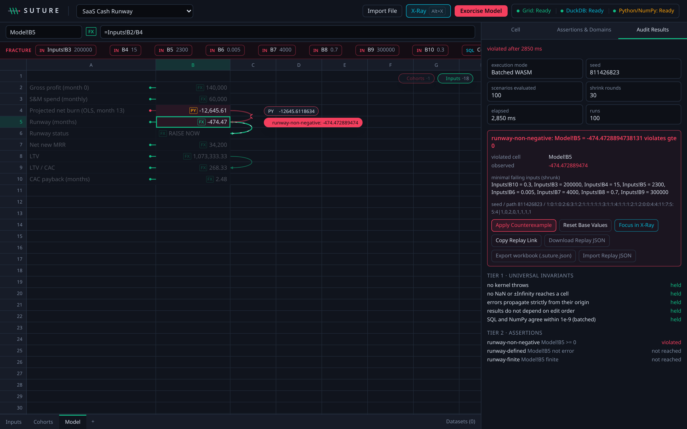

# Suture

[](https://github.com/g4stein/SUTURE/actions/workflows/ci.yml)

Suture is a zero-backend spreadsheet engine that runs entirely on your machine: in the browser, or headless as the `suture` CLI and a local MCP server for Kiro. One dependency graph connects three engines:

- `=SQL("…")` cells run in **DuckDB-WASM**;
- `=PY("…")` cells run in **Pyodide with NumPy**;
- ordinary formulas (`SUMIFS`, `VLOOKUP`, `IRR`, and 27 more) run in Suture's own evaluator.

The **Exorcist** is a property-based fuzzer built on [fast-check](https://fast-check.dev). It perturbs a workbook's declared inputs across all three engines, shrinks any failure to a minimal counterexample, and produces a replay link that reproduces it exactly.

**Live demo:** https://suture-nu.vercel.app · **Kiro write-up:** [KIRO.md](KIRO.md) · **Kiro Crew app:** [g4stein/suture-crew](https://github.com/g4stein/suture-crew) · **npm:** [`@g4stein/suture-mcp`](https://www.npmjs.com/package/@g4stein/suture-mcp)



## Judge in 60 seconds

1. Open **https://suture-nu.vercel.app**. Use a recent Chrome, Edge, or Firefox for the full engine; Safari works in an honest degraded mode, because it lacks COEP `credentialless`. You land on `Model!B5`, the runway KPI. The inspector shows its formula, precedents, and assertions. `Model!B4` above it is Python/NumPy (`PY`), fed by DuckDB SQL on the `Cohorts` sheet (`SQL`).
2. Press **Exorcise Model**. In about 3 seconds the fuzzer finds `runway-non-negative` violated and shrinks the failing inputs.
3. Press **Apply Counterexample**. Runway goes negative, the status says *RAISE NOW*, and X-Ray draws the crimson fracture from the shrunk inputs through SQL → PY → FX.
4. Press **Copy Replay Link** and open it in a new tab. It reproduces the same failure exactly.
5. Switch the picker to **100k-Row E-Commerce Margin Audit**. 100,000 orders run in DuckDB-WASM, then NumPy, then formulas, across five sheets. Exorcise it too.
6. In Kiro, add `{"mcpServers":{"suture":{"command":"npx","args":["-y","@g4stein/suture-mcp@0.1.0"]}}}` to `.kiro/settings/mcp.json`. Ask Kiro to audit `flagship:1` and then verify the fix `=IF(B4<=0,120,Inputs!B2/B4)` for `Model!B5`.
7. For always-on audits, install the Kiro Crew app (Kiro Crew 0.13.0 or later):
   ```bash
   kirocrew app install https://github.com/g4stein/suture-crew.git --ref main
   kirocrew app enable suture-crew
   ```
   Its **Open in Suture X-Ray** links open on the built-in *Wholesale Quote (Crew sample)* workbook and replay with no import.

No data leaves your machine. There is no application server, no remote execution, and no telemetry endpoint.

> **Status:** code freeze for Kiroween 2026. The web app, the `suture` CLI, the published `@g4stein/suture-mcp` server, and the [Suture Crew](https://github.com/g4stein/suture-crew) app all run the same real-engine code. CI runs the full Playwright suite on Chromium, the judge path on WebKit and Firefox, and a packed-tarball smoke test of the npm package. Open items are tracked in `.kiro/specs/*/tasks.md`.

## Using Suture

- **Pick a workbook** in the command bar: *SaaS Cash Runway*, *100k-Row E-Commerce Margin Audit*, *Wholesale Quote (Crew sample)*, or *Blank Workbook* (`?workbook=blank` opens it directly). The readiness pill shows each engine honestly: `Grid: Ready | DuckDB: Lazy | Python/NumPy: Lazy`, then `Loading` and `Ready`. Click it for telemetry: `crossOriginIsolated`, the SQL validator, cold boot per engine, first and warm evaluation, and dataset row counts.
- **Edit like a spreadsheet.** Type on a cell to edit it. Enter, Tab, the arrow keys, Page Up/Down, and Ctrl/Cmd+Home navigate, and Delete clears. The name box jumps to any `Sheet!A1`. `=SQL(…)` and `=PY(…)` drafts open a multi-line editor in the formula bar, where Shift+Enter inserts a newline. Cells carry `FX` / `SQL` / `PY` chips. A table result shows as a `100,000 × 10 — inspect` badge that opens the first 100 rows in the preview drawer.
- **X-Ray** (Alt+X, or the toolbar button) draws a thread from each precedent to its dependent. Threads are colored by the dependent's engine (SQL cyan dashed, Python amber dotted, formula emerald solid) and dim everything outside the focus. Links to other sheets appear as portal badges at the grid edge.
- **Exorcise Model** fuzzes the declared inputs through every engine. On a violation, X-Ray jumps to the failing cell and draws the lineage from the shrunk input through SQL, Python, and formulas in pulsing crimson. Callouts show each step's value, and a lineage strip lets you jump between sheets. The Audit Studio shows the Tier 1 invariants, the Tier 2 assertions, the minimal failing inputs, and the actions: **Apply Counterexample**, **Reset Base Values**, **Focus in X-Ray**, **Copy Replay Link**, **Download / Import Replay JSON**, and **Export workbook (.suture.json)**. Opening a replay link recomputes the counterexample and shows its values in the X-Ray callouts; the grid keeps base values until you press **Apply Counterexample**.
- **Add your own checks** in *Assertions & Domains*. You can use all 9 assertion kinds (`≥ ≤ > <`, `between`, `not error`, `finite`, `not null`, `monotonic with`), with constant or cell operands, and float or integer fuzz domains on input cells.
- **Bring your own data**: drop `.csv`, `.parquet`, `.xlsx`, `.suture.json`, or a replay `.json` anywhere on the page. Files are parsed locally and never uploaded. Python that arrives in an imported file stays blocked behind a trust banner until you trust it.
- Screens narrower than 768 px get a stacked layout with the studio as a bottom sheet.

## Headless: the `suture` CLI

The CLI evaluates and audits a workbook from a terminal or a CI job. It uses the real DuckDB-WASM and Pyodide engines in-process.

```bash
pnpm install && pnpm build
node packages/cli/dist/suture.mjs eval flagship:1                      # every cell's dialect and value
node packages/cli/dist/suture.mjs audit flagship:1 --out-replay r.json # Exorcist: verdict, shrunk inputs, failing lineage
node packages/cli/dist/suture.mjs replay r.json                         # exact reproduction check
node packages/cli/dist/suture.mjs inspect flagship:2 --cell Margins!B5  # dialect, AST, precedents, dependents, chain
```

- `<workbook>` is `flagship:1`, `flagship:2`, or a `.suture.json` file. Add `--json` for machine-readable output. It is identical for the same seed, except a `meta` block with timings and the replay artifact's `createdAt`.
- `--seed <n>` makes an audit reproducible; without it the seed is random and printed.
- Exit codes are CI-friendly. `audit` exits `0` when every invariant and assertion held, `1` on a violation, `2` on a configuration, input, or runtime error, and `130` when interrupted. `replay` exits `0` only for an exact reproduction, `1` when it reproduces only directly or not at all, and `2` for a wrong workbook (hash mismatch) or an error. `eval` and `inspect` exit `0`, or `2` on bad input.
- `replay` finds the built-in flagships by the artifact's workbook hash; for any other workbook, pass it with `--workbook <file.suture.json>`.
- **Python trust.** Under Node, Python can reach the file system and the network through Pyodide's JavaScript bridge. So a `.suture.json` file's `=PY()` cells run only with `--trust-python`; otherwise they evaluate to `#PY!` and Pyodide never starts. The built-in flagships always run.
- **No interrupts.** Engines run in-process, so a cell whose code never returns blocks the command.

## Suture in Kiro: the MCP server

`packages/mcp` is a local Model Context Protocol server over stdio. The workspace config [`.kiro/settings/mcp.json`](.kiro/settings/mcp.json) starts it with `node packages/mcp/dist/suture-mcp.mjs`. Run `pnpm install && pnpm build` once and open the repository in Kiro. If you use Kiro CLI, start it from the repository root. It serves both MCP protocol eras: the 2025-11-25 `initialize` handshake, and the stateless 2026-07-28 revision with `server/discover`.

| Tool | What it does |
|---|---|
| `suture_list_workbooks` | Lists `flagship:1`, `flagship:2`, and every `.suture.json` in the workspace, with sheets, inputs, assertions, and Python status. |
| `suture_inspect_lineage` | Returns a cell's dialect, formula, upstream precedents, downstream dependents, and full topological chain. No engine runs. |
| `suture_run_audit` | Runs the Exorcist and returns the Tier 1 / Tier 2 verdicts, the shrunk `failingInputs`, the `lineagePath`, and the replay artifact. |
| `suture_verify_patch` | Applies one or more cell patches in memory, replays the original counterexample, runs a fresh audit with the same seed, and compares base cases. Returns `{ ok, seed, counterexampleFixed, freshAuditPassed, regressions, baseValueDiffs }`. Never writes to disk. |

A typical loop on Flagship 1:
1. `suture_run_audit` finds `runway-non-negative` violated: runway goes negative when projected burn is negative.
2. `suture_verify_patch` with `{ "Model!B5": "=IF(B4<=0,120,Inputs!B2/B4)" }` and the returned artifact reports `ok: true`, with zero regressions and no base-case changes.
3. You edit the workbook.

Only the two static tools are auto-approved. The audit tools evaluate the workbook, and with `trustPython: true` its Python, so Kiro asks first. Workbook paths must stay inside the workspace.

### From npm: `@g4stein/suture-mcp`

The server is also packaged for npm, so any workspace can use it without cloning this repository. Use this `.kiro/settings/mcp.json`:

```json
{
  "mcpServers": {
    "suture": {
      "command": "npx",
      "args": ["-y", "@g4stein/suture-mcp@0.1.0"],
      "autoApprove": ["suture_list_workbooks", "suture_inspect_lineage"]
    }
  }
}
```

The package is MIT-licensed and needs Node.js 22. It bundles `@suture/core` and `@suture/runtime` into one executable file and depends only on `@duckdb/duckdb-wasm`, `pyodide`, `@modelcontextprotocol/server`, and `zod`. The license and notice texts of the code it bundles are in `dist/THIRD_PARTY_LICENSES.md`.

`pnpm --filter @g4stein/suture-mcp test:pack` packs the package, installs the tarball with npm in a temporary project outside the repository, checks its contents, its licenses, and that nothing links back into the monorepo, and runs `suture_run_audit` through the installed bin. CI runs it on every pull request.

Publishing (maintainers, with an npm login that owns the `@g4stein` scope):

```bash
pnpm install
pnpm --filter @g4stein/suture-mcp build
cd packages/mcp
pnpm pack                                              # writes g4stein-suture-mcp-0.1.0.tgz; rewrites workspace: specifiers
npm publish ./g4stein-suture-mcp-0.1.0.tgz --access public
```

The same steps run in the manual **Publish Suture MCP** workflow (`.github/workflows/publish-mcp.yml`, with an `NPM_TOKEN` secret). Publish the packed tarball, not the folder: a plain `npm publish` in `packages/mcp` would keep the `workspace:*` devDependency specifiers in the published manifest.

## Built-in workbooks

Each built-in workbook ships with a realistic modeling flaw that its base case hides. In the web app, **Exorcise Model** finds the flaw from a fresh random seed; nothing is scripted. The first two are the flagships, also available as `flagship:1` and `flagship:2` in the CLI and the MCP server; the end-to-end suite runs fresh-seed discovery on both. The Wholesale Quote is the web app's copy of the Suture Crew sample, so the CLI and MCP server take it as a file (`samples/wholesale-quote.suture.json` in suture-crew).

| Workbook | Pipeline | Flaw the Exorcist finds |
|---|---|---|
| **SaaS Cash Runway & Unit Economics** | DuckDB cohort SQL → NumPy least-squares burn projection (`Model!B4`) → `Model!B5 = cash / B4` | Runway divides by projected net burn with no guard. A company that turns profitable gets a negative runway and is told to "RAISE NOW". |
| **100,000-Row E-Commerce Margin Audit** | DuckDB synthesizes 100,000 orders and aggregates them once into 96 tiers. Per scenario, it runs stress SQL over the tiers, then a NumPy pivot and weighted OLS, then `SUMIFS` / `AVERAGEIF` / `VLOOKUP` KPIs. | The discount cap is applied to each discount separately instead of to the stacked total, so the Hardlines stacked cohort goes below zero net margin. |
| **Wholesale Quote (Crew sample)** | DuckDB prices the quote from three discount inputs → formula margin and status | The SQL adds the discounts instead of compounding them, so a stacked quote prices at 0 and the margin divides by it. This is the [Suture Crew](https://github.com/g4stein/suture-crew) app's bundled sample, built in so its X-Ray links open directly. |

Fresh-seed discovery times in Chromium on the Phase 3 build were 2.5–3.6 s for flagship 1 (8 runs, local and GitHub Actions) and 2.5–3.6 s for flagship 2 (10 runs). That time covers search, shrink, and decimal simplification.

## Architecture

```
packages/
  core/     ECMAScript only (no DOM, no Node built-ins)
            parser + printer, 30-function registry, incremental dependency graph, time-sliced scheduler,
            CellValue contract, engine ports, Exorcist (search → shrink → simplify → confirm → lineage)
  runtime/  the one copy of the engine code every host runs (subpath entries, no root entry)
            engines: DuckDB-WASM · Pyodide + NumPy · ingest handlers   bridge: protocol, clients, trust gate
            workbooks: flagships, validation   headless: eval · audit · replay · inspect · verify-patch
            node: in-process engine host
  web/      Vite + React + Tailwind
            AppStore (external store) · virtualized grid · formula bar · X-Ray overlay
            Exorcist Audit Studio · readiness pill · drop overlay
            EngineHost + PortClient (main thread)
            workers: DuckDB-WASM · Pyodide + NumPy · ingest (exceljs) · Exorcist
  cli/      suture (one Node ESM bundle)
  mcp/      suture-mcp (stdio MCP server)
```

- **One DAG, three dialects.** `packages/core` parses each cell, builds one dependency graph, and schedules evaluation. SQL and Python cells go through engine ports (`SqlEngine`, `PyEngine`), and their results are normalized at the boundary into one `CellValue` contract: numbers, strings, booleans, errors, `TableRef` (Arrow IPC), and `Matrix2D`.
- **Top-level workers only.** The main thread creates every worker. DuckDB uses its synchronous bindings inside its own worker, so no worker spawns another. Table bytes for Python inputs move DuckDB → Pyodide over a peer `MessagePort` and are copied once into NumPy memory.
- **One engine code path.** The same DuckDB, Pyodide, and ingest handler code (`packages/runtime`) runs in the browser workers, the Node tests, the CLI, and the MCP server. Tests therefore exercise real engines, never mocks. Every host hashes the same canonical workbook form and records the same version in replay artifacts.
- **Hardened workers.** Deadlines escalate from cooperative cancellation (a `SharedArrayBuffer` signal when the page is cross-origin isolated) to a worker respawn. A crash respawns the worker, restores registered datasets, and then re-sends held requests in their original order. Three crashes within 60 s mark the engine `failed`, with a manual retry.
- **Safe SQL.** User SQL is one `SELECT` over registered tables, checked by DuckDB's own AST serializer, with a stricter lexical guard as fallback. File and URL reads, DDL, and external readers are rejected.
- **Bring your own data.** `.csv`, `.parquet`, and `.xlsx` files are parsed locally. The XLSX reader (exceljs) lives only in the lazily loaded ingest worker chunk.
- **Honest telemetry.** Cold boot per engine, first evaluation (which may include boot), and warm DAG evaluation are reported separately.
- **No main-thread jank.** The grid renders only the visible cells plus 4 rows and 2 columns of overscan, across 1,048,576 × 16,384 cells. An edit re-links only the edited cells, and the scheduler checks its 8 ms slice in every phase of a recalculation, so editing the input of 20,000 formulas never holds the main thread for 50 ms. X-Ray geometry is recomputed only when the window, layout, graph, selection, or lineage changes. The end-to-end tests fail on any main-thread task over 50 ms while scrolling, typing, recalculating, or rendering X-Ray.
- **Small main bundle.** The main JavaScript is about 195 kB gzip, against a 350 kB budget that CI enforces after every build (`scripts/bundle-budget.mjs`). exceljs, DuckDB-WASM, and Pyodide load only in their worker chunks. Hashed assets are cached as immutable for a year; there is no service worker, so COOP/COEP and deploys are never affected by a cached app shell.

The design is specified in `.kiro/specs/` (requirements, design, and tasks for each of the five specs), and the binding rules are in `.kiro/steering/`.

## Local setup

Requirements: Node.js 22 or later, and pnpm (`corepack enable` picks up the pinned version from `package.json`).

```bash
pnpm install          # install the workspace
pnpm dev              # start the Vite dev server for packages/web
pnpm test             # unit, integration, and property tests: core, runtime (real engines in Node), web,
                      # and the compiled CLI and MCP server end to end
pnpm build            # production builds: packages/web/dist, packages/cli/dist, packages/mcp/dist
pnpm typecheck        # strict TypeScript across the workspace
pnpm --filter @g4stein/suture-mcp test:pack   # npm-install the packed MCP tarball outside the repo and run it
pnpm run licenses     # dependency license audit
pnpm run budget       # main-thread JavaScript ≤ 350 kB gzip (after pnpm build)
```

Playwright end-to-end tests (17 on Chromium, plus the judge path on WebKit and Firefox; none skipped): five UI journeys (flagship discovery and replay, the 100k-row audit across sheets, CSV drag-and-drop with live SQL and Python, XLSX with a custom assertion and the Python trust gate, a 390×844 viewport with a DOM trademark scan and the loading shell), the 20,000-formula recalculation under the 50 ms task limit, the unisolated readiness pill, a real Suture Crew replay link, and the flagship, ingest, and worker-hardening specs. The browser projects need `playwright install --with-deps chromium webkit firefox`:

```bash
pnpm --filter @suture/web exec playwright install --with-deps chromium webkit firefox
pnpm test:e2e         # builds the app and the fault-injection harness, then runs Playwright (all three browsers)
```

The fault-injection harness is built by `packages/web/vite.e2e.config.ts` into `dist-e2e/`. It is never part of the production `dist`.

Deployment (`vercel.json`) serves the page with `Cross-Origin-Opener-Policy: same-origin` and `Cross-Origin-Embedder-Policy: credentialless`. Those headers enable `SharedArrayBuffer`, which cooperative cancellation needs. Without isolation, the engines run in a degraded mode in which a timeout restarts the worker.

## License policy

Suture is released under the [MIT License](LICENSE). Dependencies must be permissively licensed:

- GPL, LGPL, and AGPL are not allowed. A dual license such as `MIT OR GPL-3.0` is accepted through its permissive alternative.
- MPL-2.0 is allowed only for the unmodified Pyodide runtime.
- A package that declares no license fails the audit.
- The MCP server's SDK (`@modelcontextprotocol/server` and `core`, Apache-2.0) and `zod` (MIT) add 3 packages and pass the audit.

`pnpm run licenses` (`scripts/license-check.mjs`) parses every package in `pnpm-lock.yaml` as an SPDX expression and enforces these rules. Two workspace pins in `pnpm-workspace.yaml` exist only to satisfy the policy:
- Vite is pinned to 7.x, because Vite 8 depends on `lightningcss` (MPL-2.0).
- `unzipper` is removed, because its `buffers` dependency declares no license. Suture uses exceljs's browser build, which does not need it.

## How it was built: Kiro specs and property-based testing

The full Kiro write-up, with evidence for every claim, is in **[KIRO.md](KIRO.md)**. In short, Suture was built with [Kiro](https://kiro.dev) in a spec-driven workflow:

1. **Steering** (`.kiro/steering/`) fixes the non-negotiables: the `CellValue` contract, error propagation, worker isolation, the license policy, and design tokens.
2. **Specs** (`.kiro/specs/01…05`) turn each subsystem into numbered requirements, a design, and a task list. Each finished task is checked off with the commit and test file that prove it.
3. **Hooks** (`.kiro/hooks/`) run after the agent writes a source file. `pbt-on-core-save` re-runs the core test and property suites and logs new counterexamples. `spec-drift-guard` compares the file against its governing design spec and reports any drift.
4. **Agents** (`.kiro/agents/`) take adversarial roles: the `pbt-adversary` writes properties meant to break the engine.

Every real bug caught by a property is logged with its seed and shrink path in [`.kiro/audit/pbt-discoveries.md`](.kiro/audit/pbt-discoveries.md). The first one is a good example. The round-trip property `parse(print(ast)) ≡ ast` generated a call whose argument divides the error literal `#N/A` by `FALSE`, and fast-check shrank it to:

```
AA(#N/A/FALSE)        seed 20261120, path "50:1:0:4:3:3"
```

The lexer matched error literals with a greedy pattern, so `#N/A/FALSE` became one unknown token and the printed formula no longer parsed. The fix matches only the 12 known error literals, longest first. Later entries in the log:
- A conformance table, then a differential property against an independent formula engine, caught `MOD` taking the wrong sign: `MOD(1, -3)` must be `-2`. Suture's `MOD` is now a native kernel.
- A real-engine ingest test caught exceljs rewriting quoted sheet names in shared formulas (`'Q3 Plan'!B2` became `'Q4 Plan'!B3`).
- Measuring the Exorcist itself showed that `fc.double` starved the upper part of float domains, hitting Flagship 2's flaw about 20× less often than its share of the domain. Float domains now sample uniformly over values.
- A CI-only hardening failure turned out to be a race: Pyodide's interrupt check erased a SIGINT written between its read and its reset. The client now re-asserts the signal until the worker settles.

The flagship tests follow the same rule. They contain no input values, counterexamples, or discovery seeds. Each test starts the Exorcist from `crypto.getRandomValues`, and passes only when it finds the expected assertion violation and the replay reproduces it exactly.
